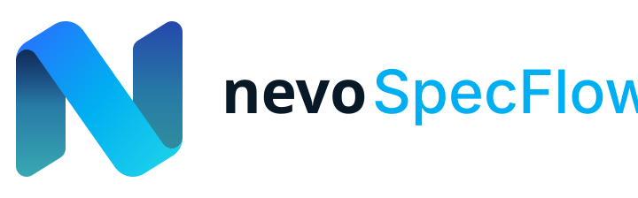
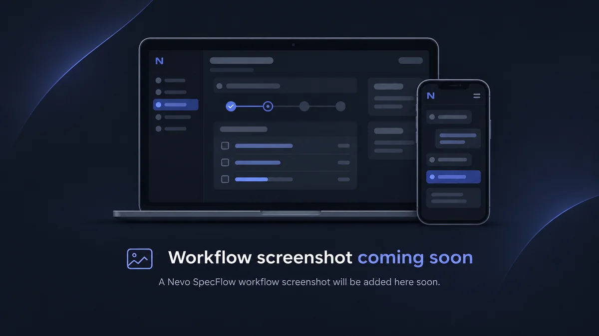
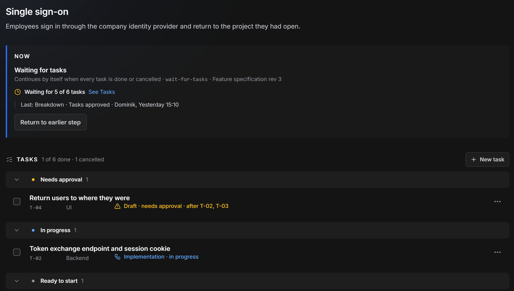
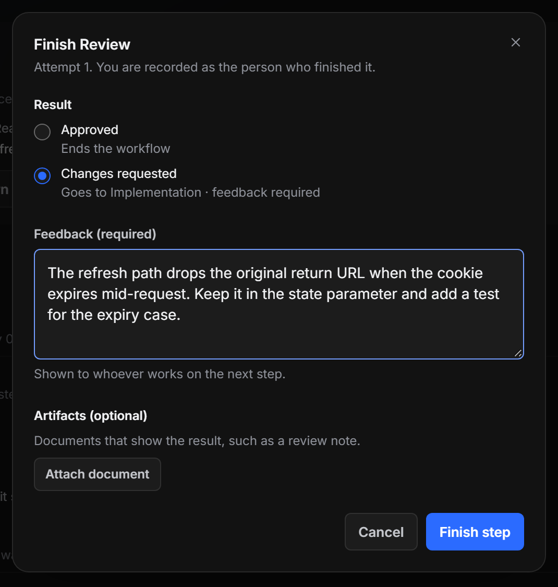
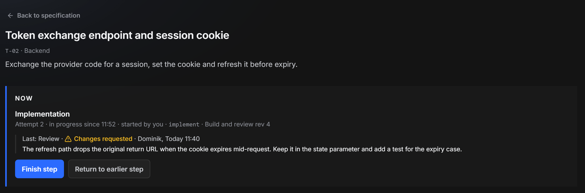
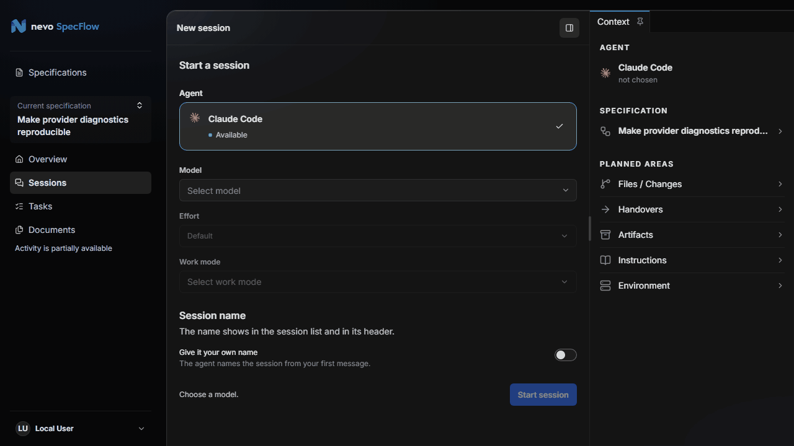
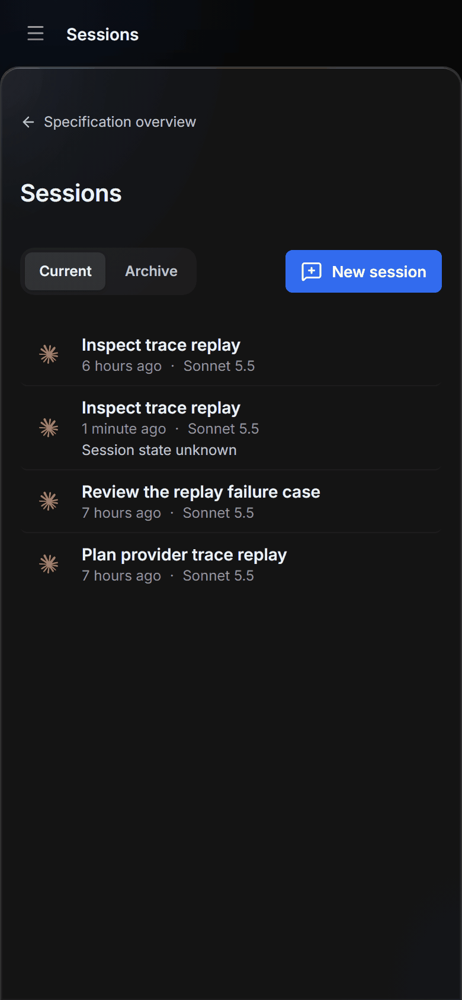

<p align="center">
  <picture>
    <source media="(prefers-color-scheme: dark)" srcset="./assets/brand/nevo-specflow-repository-dark.svg">
    <source media="(prefers-color-scheme: light)" srcset="./assets/brand/nevo-specflow-repository-light.svg">
    
  </picture>
</p>

<p align="center"><strong>Spec-driven development with workflows you define.</strong></p>

**Nevo SpecFlow** runs development workflows defined in your Git repository. Its engine records where each Specification and Task stands, applies the repository's rules, and coordinates work across people and coding agents. That execution state persists across agent sessions. You host Nevo SpecFlow yourself and interact with the project through a browser workbench and CLI.

<p align="center">
  
</p>

## Orchestrating development work

A single sign-on Specification includes a Task to exchange an authorization code for a session. During independent review, the reviewer finds that the original return URL is lost when the session cookie expires and requests a fix and a test. The engine records the result, sends the Task back to implementation, and makes the feedback available to the next executor. If the workflow calls for automatic continuation and an executor is available, corrections can begin in a fresh agent session.

Once review passes, the Task can complete. When all linked Tasks are done, the Specification can move to owner acceptance. Developers can also complete workflow steps manually. Your team defines how much review and verification each kind of work needs. A discovery Task might end with a research note and a decision, while a small change might need only implementation and automated verification.

### Workflow UI concept

These Storybook mockups show the proposed workflow screens for the single sign-on example. The Specification is waiting for its linked Tasks, including the session cookie Task. Select any image to open the full mockup.

<p align="center">
  <a href="./assets/readme/workflow-concept-specification-full.png"></a>
</p>

<details>
  <summary>See how review feedback follows the Task back to implementation</summary>

  <p><strong>Review.</strong> The reviewer requests changes and records what needs to be fixed.</p>
  <p align="center">
    <a href="./assets/readme/workflow-concept-review-full.png"></a>
  </p>

  <p><strong>Implementation.</strong> The Task shows its second attempt alongside the previous review result and feedback.</p>
  <p align="center">
    <a href="./assets/readme/workflow-concept-rework-full.png"></a>
  </p>
</details>

## Workflows defined in your repository

Workflow definitions live in your Git repository, alongside the code. SpecFlow installs starting points under `.nevo/definitions/`, including the [standard Specification workflow](packages/specflow-engine/definitions/workflow/specification-standard.yaml) and the [standard Task workflow](packages/specflow-engine/definitions/workflow/task-standard.yaml).

A **workflow** defines the steps, who executes them, which results allow a transition, and when work can continue automatically or needs a human decision. A **Task type** selects the workflow for a kind of work. For example, [UI implementation](packages/specflow-engine/definitions/task-type/ui-implementation.yaml) selects the [UI Task workflow](packages/specflow-engine/definitions/workflow/task-ui.yaml). An **agent archetype**, such as [Reviewer](packages/specflow-engine/definitions/agent-archetype/reviewer.yaml), points to the executor's instructions and sets provider and model preferences.

This [review step from the Nevo workflow prototype](assets/readme/workflow-prototype-review.yaml) illustrates the intended model for workflow gates and finalization actions. The current SpecFlow Engine uses a different schema.

```yaml
steps:
  review:
    exitGates:
      - type: command
        action: test
    finalize:
      - id: commit-and-push
    transitions:
      - value: pass
        to: human-verification
        continuation: auto
      - value: fail
        to: implementation
        continuation: auto
        execution:
          session: fresh
          role: refiner
```

In the prototype, the engine runs the configured test gate before it finalizes the review with a commit and push. A pass moves the work to human verification. A failed review sends it back to implementation in a fresh session.

Planned extensions build on the same model, with client approval steps and actions backed by Git hosting, issue trackers, CI/CD, release tooling, scripts, or plugins.

## The workbench

The workbench shows which Specifications and Tasks are active, what's finished, and what needs your attention. While the workflow execution UI is in development, the CLI supports project setup, inspection, and definition validation.

Run the workbench in an environment you control. Git branches and isolated worktrees keep changes tied to their Specification. Scoped permissions let a reviewer inspect work and participate in decisions while agent and workspace management can stay with the people responsible for it.

### Agent sessions in Specification context

A managed session can be linked to a Specification. On desktop, start from the Specification and ask Claude Code to inspect the repository.

<p align="center">
  
  <br><em>Claude Code reads <code>src/replay.mjs</code> and identifies missing input validation.</em>
</p>

With remote access configured, open the same session from the Specification's session list on mobile. Its Context panel links back to the Specification and opens the history of the agent's file read.

<p align="center">
  
</p>

## Getting started

Standalone downloads and npm distribution aren't public yet. For the first release, the plan is to download Nevo SpecFlow for Windows, macOS, or Linux from [GitHub Releases](https://github.com/dczerwinskipl/nevo-specflow/releases), then run these commands in your Git repository:

```bash
nevo-specflow init
nevo-specflow start
```

Follow the setup prompts, then open the address printed in your terminal.

### Install from source (development)

Until public builds are available, you can install from source. You'll need Node.js 24.20 or later in the 24.x line, Git, and Corepack:

```bash
git clone https://github.com/dczerwinskipl/nevo-specflow.git
cd nevo-specflow
corepack enable
pnpm install --frozen-lockfile
pnpm dogfood:install
```

Then run `nevo-specflow init` and `nevo-specflow start` in the Git project you want to use, not in this repository.

For sample data, run `nevo-specflow start --demo` from a configured Git project.

## Documentation

- [Product overview](docs/product/specflow/overview.md)
- [Architecture](docs/architecture/overview.md)
- [CLI reference](docs/reference/cli/nevo-specflow-contract.md)
- [Full documentation](docs/README.md)

## Contributing

Contributions, issues, and feedback are welcome. See [CONTRIBUTING.md](CONTRIBUTING.md).

## License

[MIT](LICENSE).
