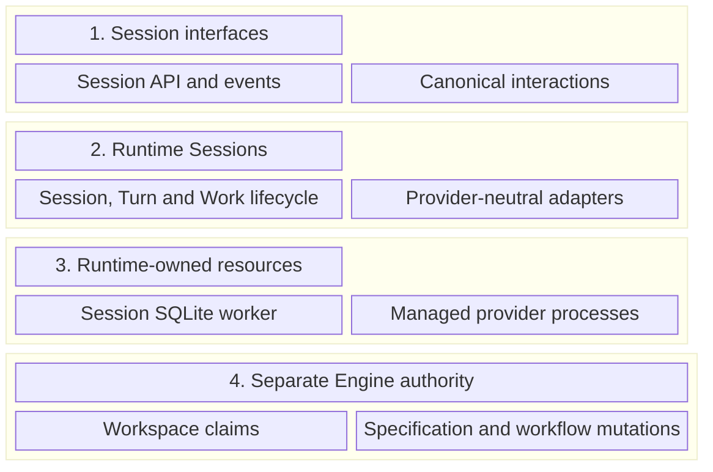

# AI architecture

- [Canonical Session / Turn / Work model](canonical-session-turn-work.md)
- [Provider boundary](provider-boundary.md)
- [Managed Session persistence and lifecycle](session-storage-and-lifecycle.md)
- [Provider process ownership and limits](provider-process-ownership.md)

Product presentation belongs under
[AI session UX](../../product/specflow/ui/ai-session-ux.md).

## Session and provider component boundaries

Managed Sessions are a Runtime capability, not part of the Engine workflow model.
The Engine admits write claims and owns Specification state; the Runtime owns
Session/Turn lifecycles, provider processes and their SQLite persistence.

This is a responsibility map, not a sequence or a promise that every Session writes a
Specification. A read-only Turn needs no workspace write claim. For the actual admission
and settle order see the [Session Turn sequence](session-storage-and-lifecycle.md#turn-flow),
the [provider boundary](provider-boundary.md) and
[Engine execution claims](../runtime/workspace-execution-claims.md).
