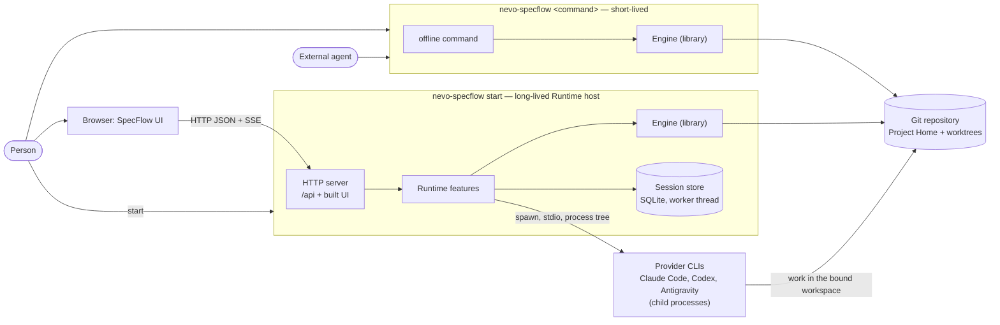
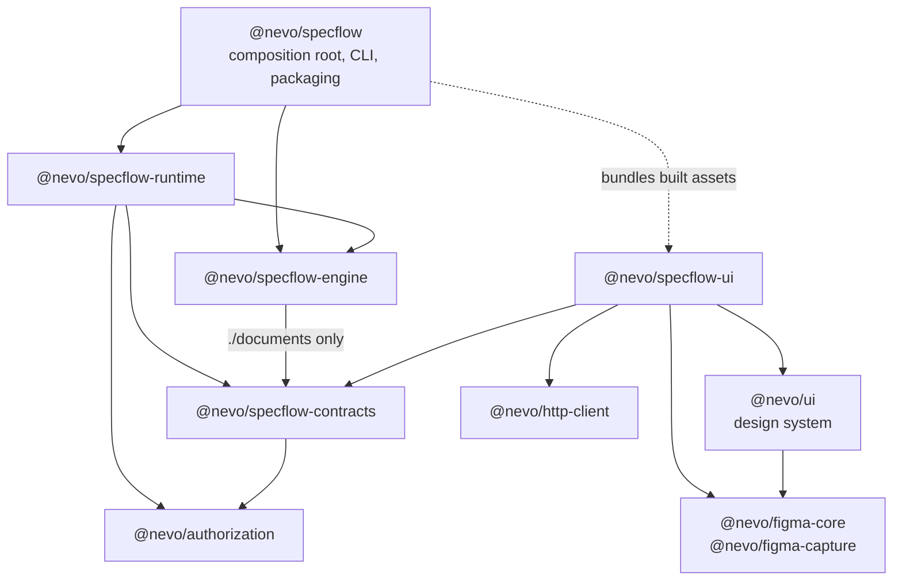
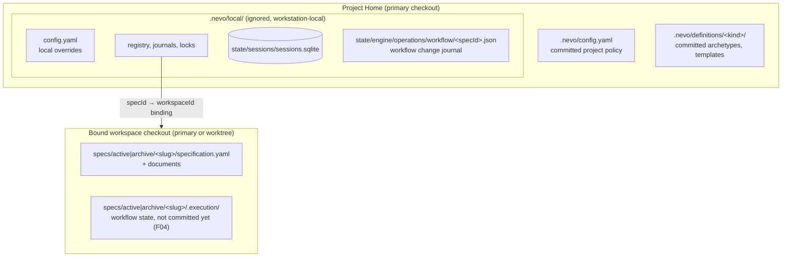

# Architecture overview

A **derived** map for orientation. It adds no rules: each section names the documents that own
its facts, and when this page and an owner disagree, the owner wins and this page is fixed.

## System and process boundaries

Nevo SpecFlow is one local product, `nevo-specflow`, installed into a Git repository.

- A **person** works mainly in the browser UI, and uses the CLI to initialise a project, start
  SpecFlow and recover interrupted operations.
- An **external agent** that the person runs in a terminal (for example Claude Code) reads and
  changes Specifications only through offline CLI commands; it never talks to the Runtime.
- **Managed agents** are provider CLIs that the Runtime starts for a Session. They work in the
  bound workspace and reach the person only through the Runtime, which shows their questions and
  permission requests in the UI.

There are two kinds of process. An offline command opens the Engine in its own short-lived
process. `nevo-specflow start` keeps its process running as the Runtime host: the same process
serves the built UI and `/api`, opens the Engine in-process and owns the provider child processes.

Owners: [CLI contract](../reference/cli/nevo-specflow-contract.md),
[Runtime ownership and lifecycle](runtime/ownership-and-lifecycle.md),
[Engine boundaries](runtime/specflow-engine.md),
[Provider boundary](ai/provider-boundary.md),
[Provider process ownership](ai/provider-process-ownership.md).

## Responsibility boundaries

- **Engine** is the only place that changes Specification and workspace state: Project Home and
  workspace bindings, Specification Create and Close, documents and Engine-owned commits,
  definitions, workspace execution claims and the workflow kernel. It is a library without a
  server; mutations are serialized by the project control lock and shared resources.
- **Runtime** is the lifecycle owner of long-lived resources: the HTTP server, Sessions and their
  store, provider processes, operation progress and authentication. HTTP and SSE are adapters over
  its feature modules. Specifications, documents, commits and workspace bindings change only
  through the Engine; Runtime itself writes only its own local state, such as the Session store.
- **UI** talks to the Runtime only through the `/api` contracts in `@nevo/specflow-contracts`; it
  never imports Runtime internals. Reusable components come from the `@nevo/ui` design system.
- **CLI** (`@nevo/specflow`) is the composition root: it composes the commands and packages the
  single product artifact. Its `init` writes the project configuration.
- The **workflow kernel** exists in the Engine but is not yet wired to the Runtime, CLI or UI.

Owners: [Engine boundaries](runtime/specflow-engine.md),
[Runtime ownership and lifecycle](runtime/ownership-and-lifecycle.md),
[UI application architecture](../product/specflow/ui/application-architecture.md),
[Workflow kernel](workflow/workflow-kernel.md).

## Package dependency direction

Arrows point from a consumer to its dependency, as declared in each `package.json`. The UI is not a
runtime dependency of `@nevo/specflow`: its built assets are bundled into the artifact and served by
the Runtime.

Owners: [ADR 0012](decisions/0012-product-package-topology-and-dependency-direction.md),
[Repository structure](repository-structure.md). Repository tooling under `tools/*` is private and
never a dependency of product packages ([ADR 0005](decisions/0005-repository-tooling-is-separate-from-the-product-api.md)).

## Where state lives

Owners: [Configuration](runtime/configuration.md),
[Project Home and workspaces](runtime/project-home-and-workspaces.md),
[Specification documents](runtime/specification-documents.md),
[ADR 0017](decisions/0017-definitions-as-project-data.md),
[Workflow kernel](workflow/workflow-kernel.md),
[Session storage and lifecycle](ai/session-storage-and-lifecycle.md).

## Where to start

| Topic                         | Owner                        | Authoritative document                                                                                                              | Code entry point                                                           |
| ----------------------------- | ---------------------------- | ----------------------------------------------------------------------------------------------------------------------------------- | -------------------------------------------------------------------------- |
| CLI commands                  | `@nevo/specflow`             | [CLI contract](../reference/cli/nevo-specflow-contract.md), [CLI architecture](../engineering/cli/architecture.md)                  | `packages/specflow/src/program.ts`                                         |
| Runtime composition           | `@nevo/specflow-runtime`     | [Ownership and lifecycle](runtime/ownership-and-lifecycle.md)                                                                       | `packages/specflow-runtime/src/runtime.ts`, `src/server/app.ts`            |
| Authentication, authorization | Runtime `auth`               | [Runtime auth](runtime/auth/README.md)                                                                                              | `packages/specflow-runtime/src/features/auth/`, `packages/authorization/`  |
| Project Home, workspaces      | Engine                       | [Project Home and workspaces](runtime/project-home-and-workspaces.md)                                                               | `packages/specflow-engine/src/project/`                                    |
| Specification Create, Close   | Engine                       | [Specification lifecycle](runtime/specification-lifecycle.md)                                                                       | `packages/specflow-engine/src/specs/create/`, `specs/lifecycle/`           |
| Documents and commits         | Engine                       | [Specification documents](runtime/specification-documents.md), [ADR 0018](decisions/0018-engine-commit-policy-and-manual-commit.md) | `packages/specflow-engine/src/specs/documents/`, `specs/manual-commit/`    |
| Definitions                   | Engine                       | [ADR 0017](decisions/0017-definitions-as-project-data.md)                                                                           | `packages/specflow-engine/src/specs/definitions/`                          |
| Workflow kernel               | Engine                       | [Workflow kernel](workflow/workflow-kernel.md)                                                                                      | `packages/specflow-engine/src/workflow/`                                   |
| Workspace execution claims    | Engine                       | [Workspace execution claims](runtime/workspace-execution-claims.md)                                                                 | `packages/specflow-engine/src/execution/`                                  |
| Sessions, Turns, Work         | Runtime `sessions`           | [Session storage and lifecycle](ai/session-storage-and-lifecycle.md), [Sessions API](../reference/api/sessions.md)                  | `packages/specflow-runtime/src/features/sessions/lifecycle/coordinator.ts` |
| Providers                     | Runtime `sessions/providers` | [Driver protocol](../reference/protocols/session-provider-driver.md), [Provider references](../reference/providers/README.md)       | `packages/specflow-runtime/src/features/sessions/providers/`               |
| UI application                | `@nevo/specflow-ui`          | [UI application architecture](../product/specflow/ui/application-architecture.md)                                                   | `packages/specflow-ui/src/app/router.tsx`, `src/services/index.tsx`        |
| Design system                 | `@nevo/ui`                   | [Design system](../design-system/README.md)                                                                                         | `packages/nevo-ui/src/`                                                    |
