# Architecture overview

This page is a **derived overview** for orientation. It restates facts owned by other documents in
diagram form and adds no rules. Each section names its owning documents; when a diagram and its
owner disagree, the owner wins and the diagram is fixed.

It reads from the outside in: who uses SpecFlow and for what, which parts run, what each part is
made of, and finally the technical views.

## 1. Context: who uses SpecFlow

SpecFlow is a local product, `nevo-specflow`, installed into a Git repository. A **person** works
mainly in the browser UI; an **agent the person runs themselves** (for example Claude Code or Codex
in a terminal) works through the CLI. SpecFlow can also run **managed agents** itself: Runtime
starts the provider CLI as a child process and relays the conversation to the UI.

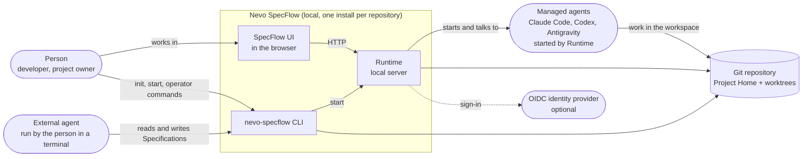

Owners: [Product overview](../product/specflow/overview.md),
[CLI contract](../reference/cli/nevo-specflow-contract.md),
[Runtime authentication](runtime/auth/README.md),
[Provider boundary](ai/provider-boundary.md).

## 2. Use cases by actor

What each actor does today, and through which surface. The workflow kernel (steps, Tasks,
automatic continuation) exists in the Engine but is not yet exposed through the CLI, Runtime or UI,
so it has no use case here yet.

**Person.** Works mainly in the UI; uses the CLI to set up a project, start SpecFlow and recover
interrupted operations.

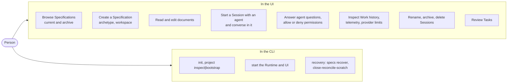

**External agent.** An agent the person runs in a terminal reads and changes Specifications only
through the offline CLI. It never talks to the Runtime.

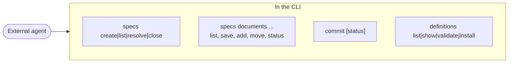

**Managed agent.** A provider CLI started by Runtime for a Session. It works in the bound workspace
and reaches the person only through Runtime, which shows its questions and permission requests in
the Session screen.

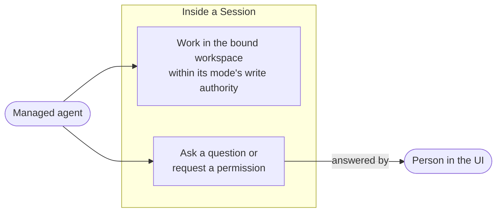

Owners: [UI interaction model](../product/specflow/ui/interaction-model.md),
[Full Session](../product/specflow/ui/full-session.md),
[Specification creation](../product/specflow/specification-creation.md),
[Specification CLI commands](../reference/cli/specflow-specification-commands.md),
[Provider references](../reference/providers/README.md).

## 3. Containers: what runs

Two ways in share one Engine. Offline CLI commands open the Engine in their own process and exit.
`nevo-specflow start` runs the long-lived Runtime, which serves the built UI and the `/api` HTTP
surface from one origin, opens the same Engine in-process, and owns the managed provider processes.

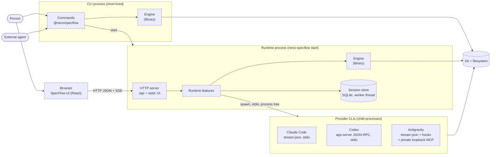

Owners: [Runtime ownership and lifecycle](runtime/ownership-and-lifecycle.md),
[Engine boundaries](runtime/specflow-engine.md),
[Provider process ownership](ai/provider-process-ownership.md),
[Session provider driver protocol](../reference/protocols/session-provider-driver.md).

## 4. Components

### 4.1 CLI (`@nevo/specflow`)

The product composition root. Command groups open the Engine for the current checkout, except
`start`, which hands over to the Runtime, and `auth`, which belongs to the Runtime auth feature.

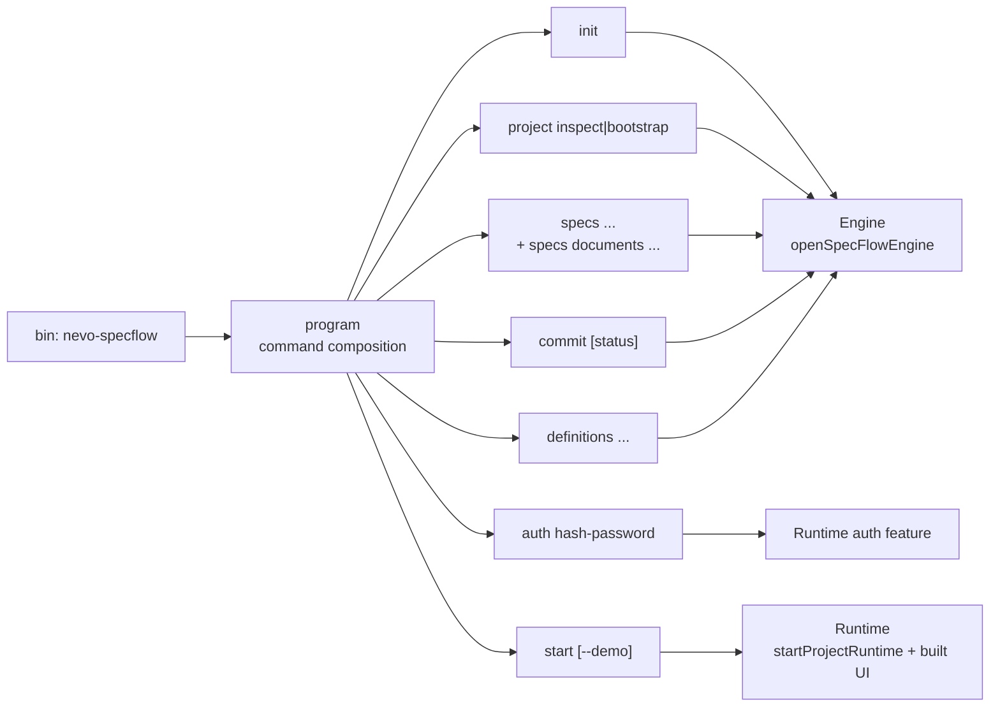

Owners: [CLI contract](../reference/cli/nevo-specflow-contract.md),
[CLI architecture](../engineering/cli/architecture.md),
[Product packaging](../engineering/repository/product-packaging.md).

### 4.2 Runtime (`@nevo/specflow-runtime`)

One composition root builds infrastructure, then the feature modules under `src/features/<feature>/`,
then starts the HTTP adapter. HTTP and SSE are adapters over the features, not owners of state.

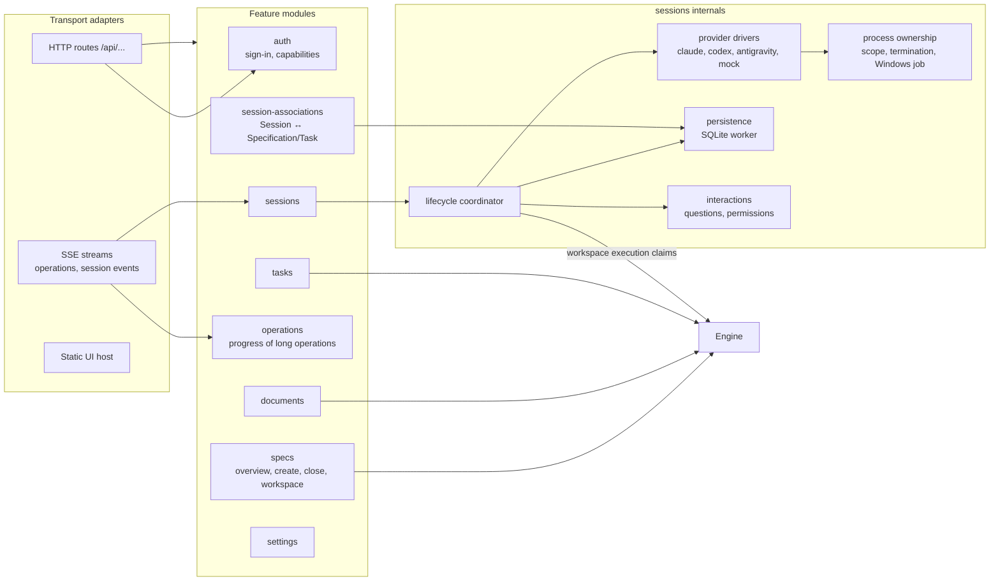

Owners: [Runtime ownership and lifecycle](runtime/ownership-and-lifecycle.md),
[Authorization](runtime/auth/authorization.md),
[Session storage and lifecycle](ai/session-storage-and-lifecycle.md),
[Task read composition](runtime/task-read-composition.md),
[Operation progress](../engineering/shared/operation-progress.md).

### 4.3 Engine (`@nevo/specflow-engine`)

A library with no server of its own. `openSpecFlowEngine` resolves the Project Home once per
process; every use case then runs against that verified project.

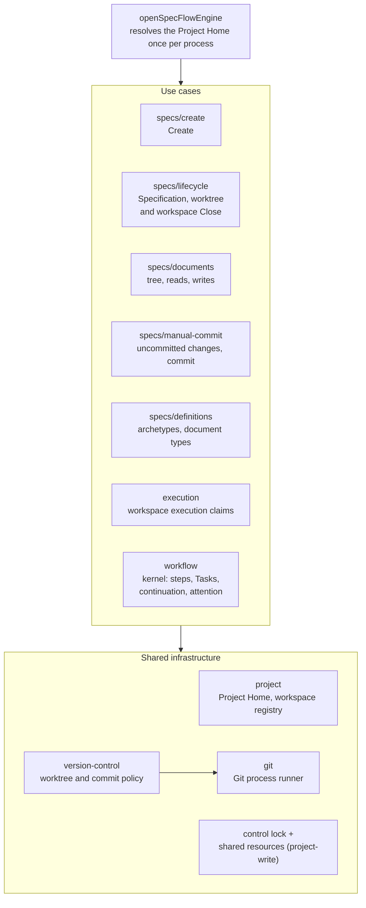

Owners: [Engine boundaries](runtime/specflow-engine.md),
[Project Home and workspaces](runtime/project-home-and-workspaces.md),
[Specification lifecycle](runtime/specification-lifecycle.md),
[Specification documents](runtime/specification-documents.md),
[Workspace execution claims](runtime/workspace-execution-claims.md),
[Workflow kernel](workflow/workflow-kernel.md),
[Git/worktree configuration](../reference/configuration/specflow-git-worktrees.md).

### 4.4 UI (`@nevo/specflow-ui`)

A React single-page app on the Nevo UI design system. Feature UI modules contribute routes and
navigation to the shell; screens read through TanStack Query from services that talk to the
Runtime, with separate project and demo adapters.

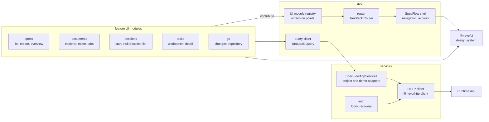

Owners: [UI application architecture](../product/specflow/ui/application-architecture.md),
[Data loading and integration](../product/specflow/ui/data-loading-and-integration.md),
[Design system boundary](../design-system/principles/system-boundary.md).

## 5. Technical views

### 5.1 Package dependency direction

Arrows point from a consumer to its dependency, as declared in each `package.json`. The UI is not a
runtime dependency of `@nevo/specflow`: its built assets are bundled into the artifact and served by
Runtime.

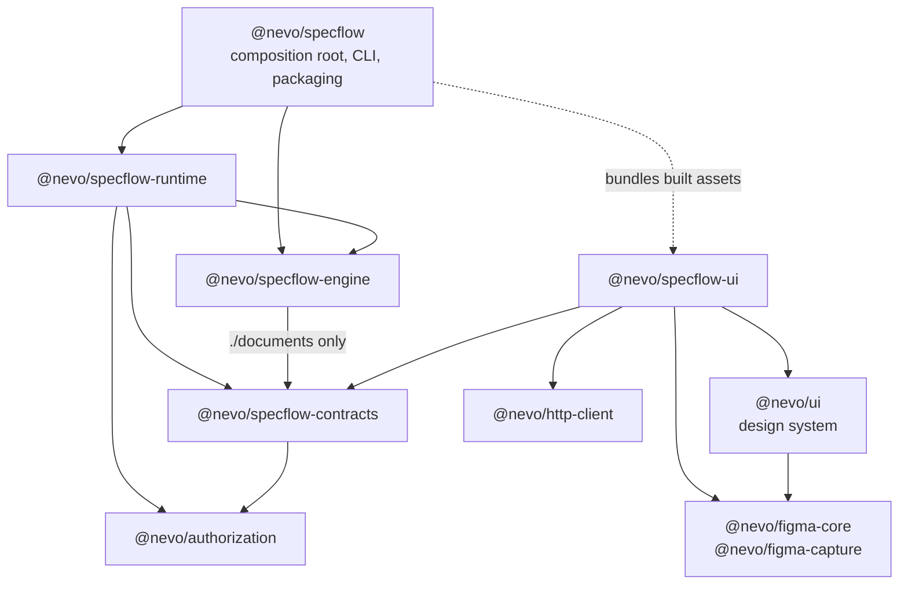

Owners: [ADR 0012](decisions/0012-product-package-topology-and-dependency-direction.md),
[Repository structure](repository-structure.md). Repository tooling under `tools/*` is private and
never a dependency of product packages ([ADR 0005](decisions/0005-repository-tooling-is-separate-from-the-product-api.md)).

### 5.2 Where state lives

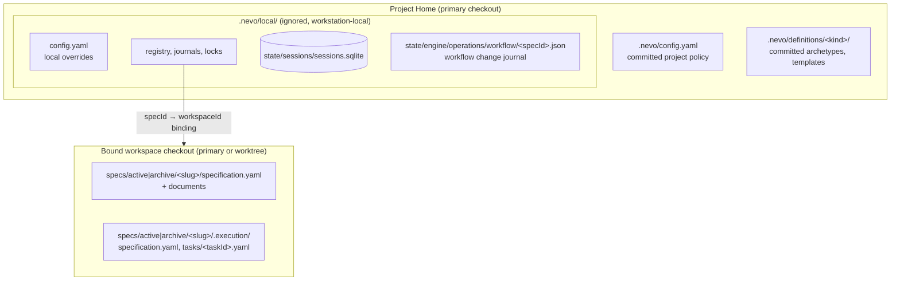

Owners: [Configuration](runtime/configuration.md),
[Project Home and workspaces](runtime/project-home-and-workspaces.md),
[Specification documents](runtime/specification-documents.md),
[ADR 0017](decisions/0017-definitions-as-project-data.md),
[Workflow kernel](workflow/workflow-kernel.md),
[Session storage and lifecycle](ai/session-storage-and-lifecycle.md).

### 5.3 Managed Session Turn

The happy path of one workspace-writing Turn. Read-only invocations take no Engine claim. Failure,
`unknown` dispatch outcomes and restart recovery are owned by the session storage document and the
driver protocol.

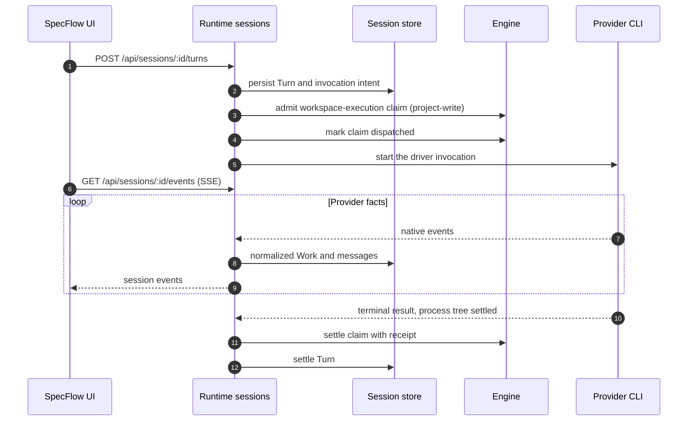

Owners: [Canonical Session, Turn and Work](ai/canonical-session-turn-work.md),
[Session storage and lifecycle](ai/session-storage-and-lifecycle.md),
[Sessions API](../reference/api/sessions.md),
[Workspace execution claims](runtime/workspace-execution-claims.md).
