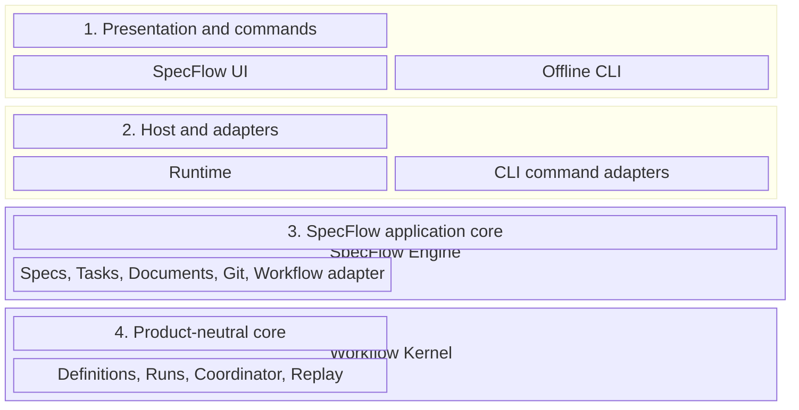
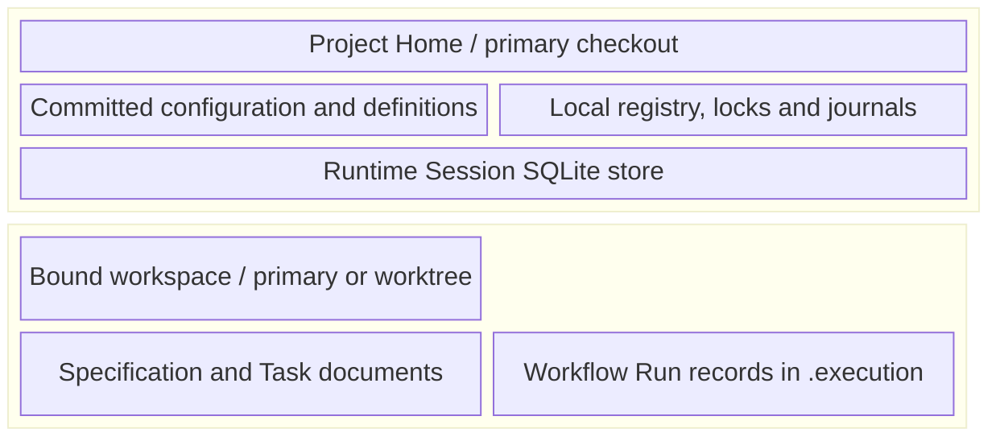

# Architecture overview

A **derived** map for orientation. It adds no rules: each section names the documents that own
its facts, and when this page and an owner disagree, the owner wins and this page is fixed.

## Logical layers

This is a **logical responsibility map**, not a call graph or an ordered pipeline. The layer
titles group capabilities; they do not prescribe source folders, separate deployment units or a
mandatory call chain. The offline CLI and Runtime are alternative entry paths to the same
SpecFlow Engine. The Workflow Kernel is its pure library dependency, not another process.

**Names in diagrams are component names.** Their source packages are
`@nevo/specflow-runtime`, `@nevo/specflow-engine` and `@nevo/workflow`. See
[package dependencies](#package-dependency-direction) for exact identifiers.

External effects such as Git, filesystem operations, provider processes and SQLite are
**owned by different capabilities**, not by one universal bottom layer. See
[Runtime ownership](runtime/ownership-and-lifecycle.md),
[Engine boundaries](runtime/specflow-engine.md),
[Workflow architecture](workflow/) and
[UI application architecture](../product/specflow/ui/application-architecture.md) for their
respective internal views. The [process boundary](#system-and-process-boundaries) and
[dependency table](#package-dependency-direction) answer different questions.

## System and process boundaries

Nevo SpecFlow is one local product, `nevo-specflow`, installed into a Git repository.
Its process topology must not be mistaken for the logical bands above.

- **Browser:** runs the built SpecFlow UI and communicates with Runtime over HTTP JSON and SSE.
- **`nevo-specflow start`:** is the long-lived Runtime host with an HTTP server,
  feature modules, an in-process Engine, a dedicated Session SQLite worker and managed
  provider child processes.
- **`nevo-specflow <command>`:** runs the offline CLI and its own short-lived in-process
  Engine. It operates on verified Project Home and workspaces without starting Runtime.
- **Managed provider CLI:** is started by Runtime and uses native tools in a bound workspace
  according to its admitted execution mode.
- **External agent launched by a person:** works in its own process, uses the product's
  offline CLI and edits files with native tools. It does not need Runtime.

The person generally uses the UI and uses the CLI for init, start and recovery. CLI and
Runtime do not maintain separate Specification mutation state machines.
`start --demo` uses the same Engine operations over an in-memory store seeded with
demonstration data, not a second UI workflow implementation
([ADR 0025](decisions/0025-demo-runs-the-engine-in-memory.md)).

Owners: [CLI contract](../reference/cli/nevo-specflow-contract.md),
[Runtime ownership and lifecycle](runtime/ownership-and-lifecycle.md),
[Engine boundaries](runtime/specflow-engine.md),
[Provider boundary](ai/provider-boundary.md),
[Provider process ownership](ai/provider-process-ownership.md).

## Responsibility boundaries

- **SpecFlow Engine** owns every SpecFlow product operation on project state: Project Home and workspace
  bindings, Specification Create and Close, document operations and Engine-owned commits,
  definitions, workspace execution claims and the workflow kernel. It is a library without a
  server; these operations are serialized by the project control lock and shared resources. The
  Engine does not own every physical write: agents edit workspace files with their own tools, and a
  writing managed Turn first takes a workspace execution claim so that it excludes the Engine's own
  writers for its duration.
- **Runtime** is the lifecycle owner of long-lived resources: the HTTP server, Sessions and their
  store, provider processes, operation progress and authentication. HTTP and SSE are adapters over
  its feature modules. Runtime performs Specification, document, commit and binding operations only
  through the Engine, and itself writes only its own local state, such as the Session store.
- **UI** talks to the Runtime only through the `/api` contracts in `@nevo/specflow-contracts`; it
  never imports Runtime internals. Reusable components come from the `@nevo/ui` design system.
- **CLI** (`@nevo/specflow`) is the composition root: it composes the commands and packages the
  single product artifact. Its `init` writes the project configuration.
- **Workflow execution** uses the product-neutral `@nevo/workflow` coordinator through the Engine's
  SpecFlow adapter. The offline CLI calls the Engine directly. The Runtime exposes Engine workflow
  operations and read projections over HTTP, and the UI presents those projections and sends
  actions through the Runtime.

Owners: [Engine boundaries](runtime/specflow-engine.md),
[Runtime ownership and lifecycle](runtime/ownership-and-lifecycle.md),
[UI application architecture](../product/specflow/ui/application-architecture.md),
[Workflow kernel](workflow/workflow-kernel.md),
[Specification CLI commands](../reference/cli/specflow-specification-commands.md),
[Workflow HTTP API](../reference/api/specification-workflow.md).

## Package dependency direction

This is a **source/package dependency reference**, not a runtime communication diagram.
The following are direct production workspace dependencies declared under `dependencies` in the corresponding `package.json` files. Entries under `devDependencies` are excluded:

- **`@nevo/specflow` (composition root):** `specflow-runtime`, `specflow-engine`,
  `specflow-docs`.
- **`@nevo/specflow-runtime`:** `specflow-engine`, `specflow-docs`,
  `specflow-contracts`, `authorization`.
- **`@nevo/specflow-engine`:** `workflow` and the `./documents` entry point of
  `specflow-contracts` only.
- **`@nevo/specflow-docs`:** `ai-semantic-search`, `specflow-contracts`.
- **`@nevo/specflow-ui`:** `specflow-contracts`, `http-client`, `ui`,
  `figma-core`, `figma-capture`.
- **`@nevo/specflow-contracts`:** `authorization`.

The UI is a **build-time** dependency of the product composition root: compiled assets are
bundled into one artifact and served by Runtime. It is not a Runtime import or separately
deployed server. The neutral foundations and other UI design-system dependencies are in
[Repository structure](repository-structure.md). Repository-only `tools/*` are not product
dependencies ([ADR 0005](decisions/0005-repository-tooling-is-separate-from-the-product-api.md)).
Dependency-direction rules belong to
[ADR 0012](decisions/0012-product-package-topology-and-dependency-direction.md).

## Where state lives

Storage is split by authority and lifetime. This grouping deliberately shows no fictitious
single database or generic repository layer.

The Engine's ignored registry binds `specId` to the authoritative `workspaceId`.
The Runtime owns the Session store; the Engine owns workflow/run file publication and its local
recovery journal. These are distinct authorities, not interchangeable copies.

Owners: [Configuration](runtime/configuration.md),
[Project Home and workspaces](runtime/project-home-and-workspaces.md),
[Specification documents](runtime/specification-documents.md),
[ADR 0017](decisions/0017-definitions-as-project-data.md),
[Workflow kernel](workflow/workflow-kernel.md),
[Session storage and lifecycle](ai/session-storage-and-lifecycle.md).

## Where to start

| Topic                         | Owner                                   | Authoritative document                                                                                                              | Code entry point                                                                |
| ----------------------------- | --------------------------------------- | ----------------------------------------------------------------------------------------------------------------------------------- | ------------------------------------------------------------------------------- |
| CLI commands                  | `@nevo/specflow`                        | [CLI contract](../reference/cli/nevo-specflow-contract.md), [CLI architecture](../engineering/cli/architecture.md)                  | `packages/specflow/src/program.ts`                                              |
| Runtime composition           | `@nevo/specflow-runtime`                | [Ownership and lifecycle](runtime/ownership-and-lifecycle.md)                                                                       | `packages/specflow-runtime/src/runtime.ts`, `src/server/app.ts`                 |
| Authentication, authorization | Runtime `auth`                          | [Runtime auth](runtime/auth/README.md)                                                                                              | `packages/specflow-runtime/src/features/auth/`, `packages/authorization/`       |
| Project Home, workspaces      | Engine                                  | [Project Home and workspaces](runtime/project-home-and-workspaces.md)                                                               | `packages/specflow-engine/src/project/`                                         |
| Specification Create, Close   | Engine                                  | [Specification lifecycle](runtime/specification-lifecycle.md)                                                                       | `packages/specflow-engine/src/specs/create/`, `specs/lifecycle/`                |
| Documents and commits         | Engine                                  | [Specification documents](runtime/specification-documents.md), [ADR 0018](decisions/0018-engine-commit-policy-and-manual-commit.md) | `packages/specflow-engine/src/specs/documents/`, `specs/manual-commit/`         |
| Definitions                   | Engine                                  | [ADR 0017](decisions/0017-definitions-as-project-data.md)                                                                           | `packages/specflow-engine/src/definitions/` (composition), `specs/definitions/` |
| Workflow kernel               | `@nevo/workflow` and the Engine adapter | [Workflow kernel](workflow/workflow-kernel.md)                                                                                      | `packages/workflow/src/`, `packages/specflow-engine/src/workflow/`              |
| Workspace execution claims    | Engine                                  | [Workspace execution claims](runtime/workspace-execution-claims.md)                                                                 | `packages/specflow-engine/src/execution/`                                       |
| Sessions, Turns, Work         | Runtime `sessions`                      | [Session storage and lifecycle](ai/session-storage-and-lifecycle.md), [Sessions API](../reference/api/sessions.md)                  | `packages/specflow-runtime/src/features/sessions/lifecycle/coordinator.ts`      |
| Providers                     | Runtime `sessions/providers`            | [Driver protocol](../reference/protocols/session-provider-driver.md), [Provider references](../reference/providers/README.md)       | `packages/specflow-runtime/src/features/sessions/providers/`                    |
| UI application                | `@nevo/specflow-ui`                     | [UI application architecture](../product/specflow/ui/application-architecture.md)                                                   | `packages/specflow-ui/src/app/router.tsx`, `src/services/index.tsx`             |
| Design system                 | `@nevo/ui`                              | [Design system](../design-system/README.md)                                                                                         | `packages/nevo-ui/src/`                                                         |
