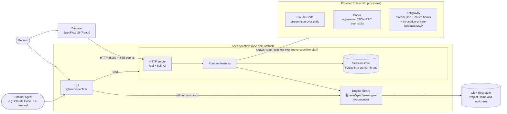
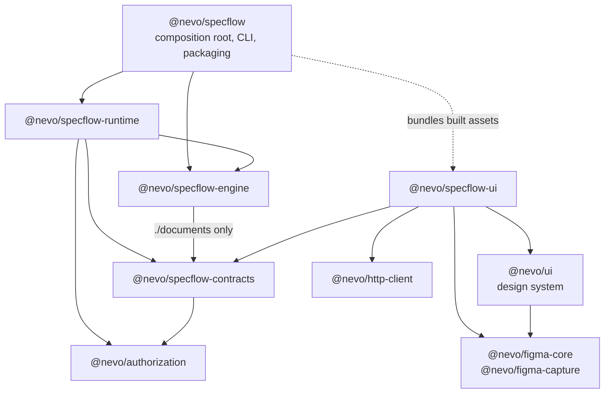
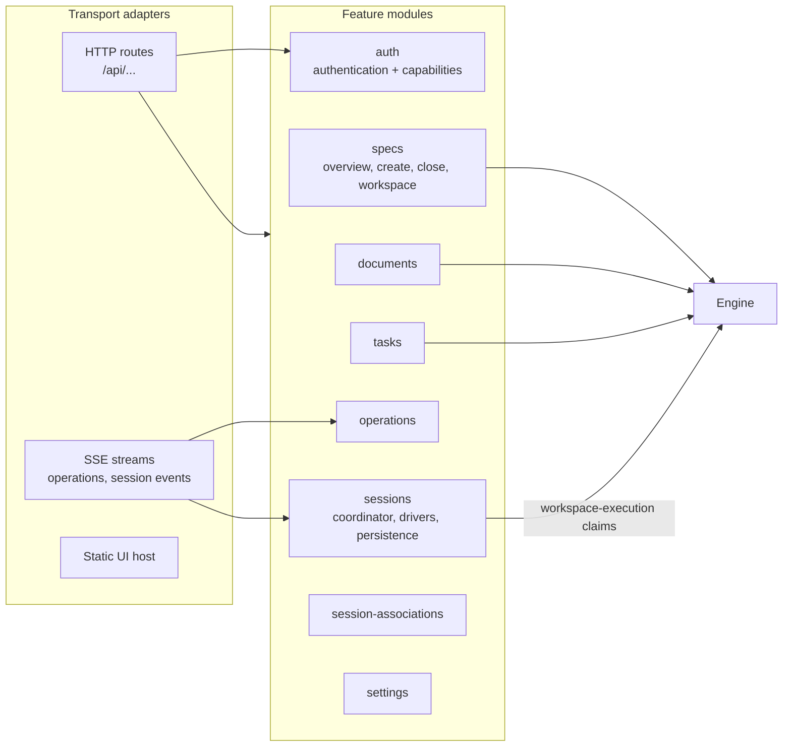
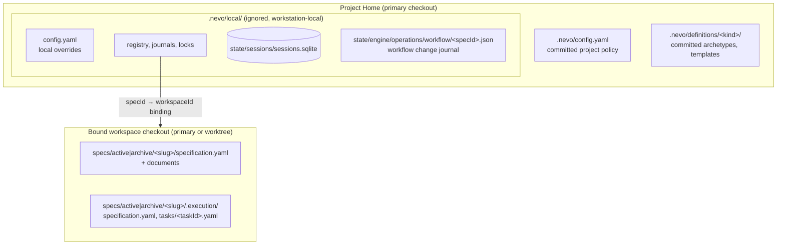
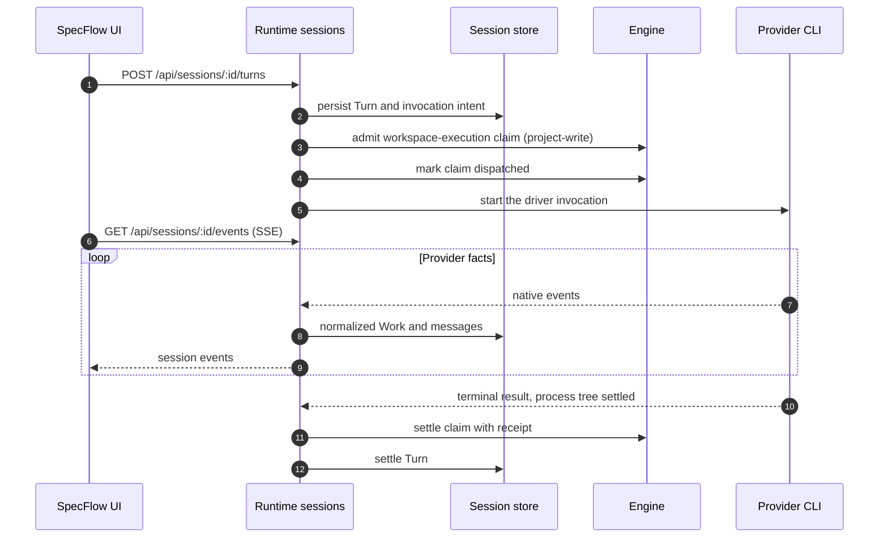

# Architecture overview

This page is a **derived overview** for orientation. It restates facts owned by other documents in
diagram form and adds no rules. Each section names its owning document; when a diagram and its
owner disagree, the owner wins and the diagram is fixed.

## Processes and transports

One local product, `nevo-specflow`, has two ways in: offline CLI commands that open the Engine
in-process, and `nevo-specflow start`, which runs the long-lived Runtime. Runtime serves the built
UI and the `/api` HTTP surface from one origin and owns provider processes for managed Sessions.

Owners: [Runtime ownership and lifecycle](runtime/ownership-and-lifecycle.md),
[Engine boundaries](runtime/specflow-engine.md),
[CLI contract](../reference/cli/nevo-specflow-contract.md),
[Provider boundary](ai/provider-boundary.md),
[Session provider driver protocol](../reference/protocols/session-provider-driver.md).

## Package dependency direction

Arrows point from a consumer to its dependency, as declared in each `package.json`. The UI is not a
package dependency of `@nevo/specflow`: its built assets are bundled into the artifact and served by
Runtime.

Owners: [ADR 0012](decisions/0012-product-package-topology-and-dependency-direction.md),
[Repository structure](repository-structure.md). Repository tooling under `tools/*` is private and
never a dependency of product packages ([ADR 0005](decisions/0005-repository-tooling-is-separate-from-the-product-api.md)).

## Runtime composition

Runtime has one composition root. Feature modules under
`packages/specflow-runtime/src/features/<feature>/` contribute routes and services; HTTP is an
adapter over them, not the owner of state.

Owners: [Runtime ownership and lifecycle](runtime/ownership-and-lifecycle.md),
[Authorization](runtime/auth/authorization.md),
[Task read composition](runtime/task-read-composition.md),
[Operation progress](../engineering/shared/operation-progress.md).

## Where state lives

Owners: [Configuration](runtime/configuration.md),
[Project Home and workspaces](runtime/project-home-and-workspaces.md),
[Specification documents](runtime/specification-documents.md),
[ADR 0017](decisions/0017-definitions-as-project-data.md),
[Workflow kernel](workflow/workflow-kernel.md),
[Session storage and lifecycle](ai/session-storage-and-lifecycle.md).

## Managed Session Turn

The happy path of one workspace-writing Turn. Read-only invocations take no Engine claim. Failure,
`unknown` dispatch outcomes and restart recovery are owned by the session storage document and the
driver protocol.

Owners: [Canonical Session, Turn and Work](ai/canonical-session-turn-work.md),
[Session storage and lifecycle](ai/session-storage-and-lifecycle.md),
[Sessions API](../reference/api/sessions.md),
[Workspace execution claims](runtime/workspace-execution-claims.md).
