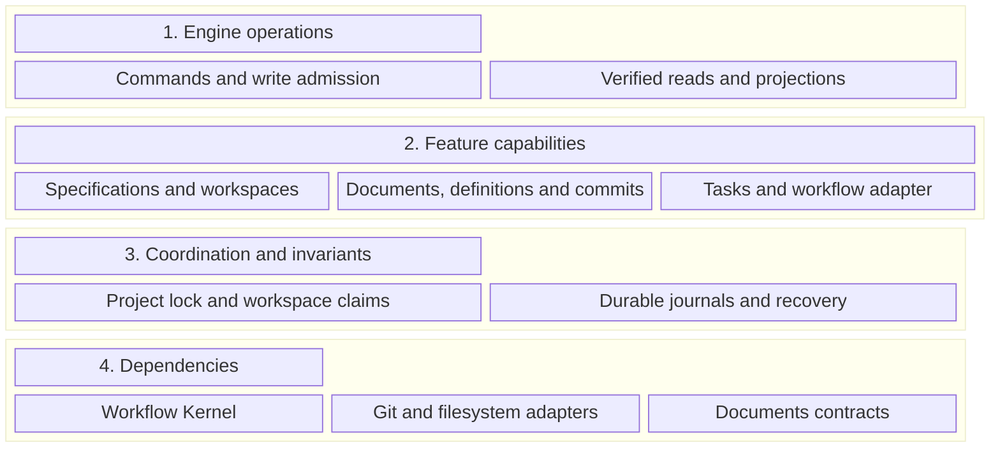

# SpecFlow Engine ownership and transport boundaries

## Engine component layers

The Engine is the **offline-capable application boundary** shared by Runtime and short-lived
CLI commands. These bands group owned capabilities; they are not mandatory directories or a
strict import chain.



Runtime is **not** contained in this diagram: it is a separate caller and lifetime owner.
The neutral workflow coordinator does not perform Git, filesystem or network I/O; the Engine's
adapter interprets host annotations and applies effects. Engine's contracts import is restricted to
`@nevo/specflow-contracts/documents`. Detailed rules belong to
[Workflow kernel](../workflow/workflow-kernel.md),
[Project Home](project-home-and-workspaces.md),
[Workspace execution claims](workspace-execution-claims.md) and
[ADR 0012](../decisions/0012-product-package-topology-and-dependency-direction.md).

## Engine boundary

`@nevo/specflow-engine` owns verified Project Home discovery, physical workspace identity,
local registry and binding authority, canonical Specification reads, Specification documents and
definitions, durable Create/Close/document/commit journals, Git operations and recovery,
[workspace execution claims](workspace-execution-claims.md) for native agent processes, and the
[workflow kernel](../workflow/workflow-kernel.md) for Specification and Task execution. It runs in a CLI process without starting Runtime, HTTP or an AI
provider. There is one Engine-owned state machine for mutations, not parallel HTTP/CLI copies.

`@nevo/specflow` supplies the installed Commander CLI and calls Engine operations.
`@nevo/specflow-runtime` composes authenticated HTTP endpoints and translates Engine results
into `@nevo/specflow-contracts` DTOs. HTTP performs authorization before protected reads or
mutations. Neither adapter may own independent Git/journal/registry mutation logic.

The Engine depends on `@nevo/specflow-contracts` for exactly one neutral entry point,
`@nevo/specflow-contracts/documents`: the archetype and template definition schemas, document
vocabulary, ids, error codes and limits that both the Engine and its transports must agree on. The
Engine MUST NOT import Runtime, UI or the authorization policy, nor any other contracts entry point;
ESLint enforces the restriction (`tools/eslint/boundaries.mjs`).

```text
@nevo/specflow-engine --> @nevo/specflow-contracts/documents   (neutral vocabulary and schemas only)
```

Inside the Engine, the Specification slices keep their imports acyclic: `specs/documents` exposes its pure
primitives through `index.ts` (the filesystem readers through `reading.ts`). The Engine's `lint`
script runs `tools/eslint/check-import-cycles.mjs`. It fails on any cycle through a gated path,
including `specs/create/` and `specs/lifecycle/`, and includes type imports in the graph.
Resource coordination reads Close claims through `specs/lifecycle/claim-source.ts`.

Runtime remains responsible for long-lived provider processes, streams and managed Sessions.
Engine-local operation records are **not** provider Session/Turn execution records. Runtime admits
every native agent execution through an Engine workspace execution claim before it starts the
process, and settles it only with proof that the process stopped.

The Runtime and offline CLI already expose Engine workflow operations, and the UI consumes Runtime
workflow and Task projections. The neutral coordinator remains independent of transport and provider
processes. Managed **agent step execution** is a separate integration with its own
Runtime/Engine admission and finalize contract; the presence of manual workflow commands alone
does not imply that a managed agent can execute a step.
See [Workflow kernel](../workflow/workflow-kernel.md), [Specification workflow HTTP API](../../reference/api/specification-workflow.md),
[CLI contract](../../reference/cli/nevo-specflow-contract.md) and
[Runtime ownership](ownership-and-lifecycle.md).

## Sources of authority

- Verified Project Home supplies local state and committed Git policy, never arbitrary caller cwd.
- Registered `specId -> workspaceId` binding selects the canonical Specification source.
- Verified checkout `specification.yaml` holds canonical metadata/status; generated indexes,
  branch naming and unregistered duplicate files are not alternative binding authority.
- Unavailable or physically mismatched bound sources fail closed, without primary/fixture fallback.
- Snapshot read projections are not reservations: write admission independently revalidates them.
- Engine coordination fences cooperating local processes; it does not assert arbitrary editors or
  Git processes are quiescent.

Implementation: `packages/specflow-engine/src/` (`project/`, `specs/`, `git/`, `version-control/`,
`execution/`, `workflow/`, composed in `application.ts`), the Runtime features under
`packages/specflow-runtime/src/features/` (`specs/`, `documents/`, `operations/`, `tasks/`,
`sessions/effects/`), and the CLI command modules under `packages/specflow/src/` (`specs/`,
`documents/`, `commit/`, `definitions/`, `project/`, `init/`).

See [Project Home](project-home-and-workspaces.md), [Specification lifecycle](specification-lifecycle.md),
and the [implemented HTTP contracts](../../reference/api/specflow-specification-operations.md).
