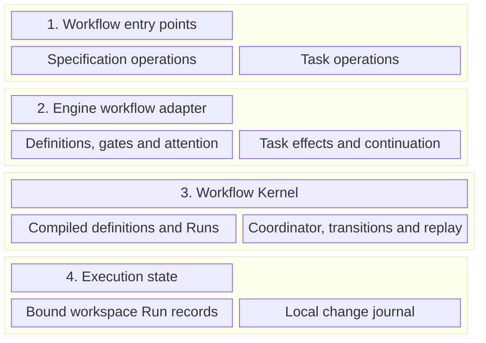

# Workflow architecture

- [Deterministic workflow](deterministic-workflow.md)
- [Workflow kernel](workflow-kernel.md)
  - [Definitions, executors and gates](workflow-definitions-and-gates.md)
  - [Runs, handoffs, returns and wait](workflow-runs-and-handoffs.md)
  - [Task resources and preparation](workflow-tasks.md)
  - [Continuation and attention](workflow-continuation-and-attention.md)
  - [Storage and recovery](workflow-storage-and-recovery.md)

## Responsibility map

The pure `@nevo/workflow` kernel is **not** the layer that reads YAML files, evaluates
SpecFlow gates or writes Git. The Engine's adapter interprets the host-specific annotations
and owns changes to Specification and Task resources.

The bands explain **ownership**, not an execution order: the adapter invokes
`decide(definition, run, command)` and applies its result. Neither Runtime nor the
UI owns an alternative workflow state machine. A Specification and each Task use the same neutral
core with different subject identities. The kernel owns only pure decisions; Engine owns recovery
and persistence. See [Workflow kernel](workflow-kernel.md),
[Deterministic workflow](deterministic-workflow.md) and
[ADR 0023](../decisions/0023-neutral-workflow-coordinator-and-manual-execution.md).
