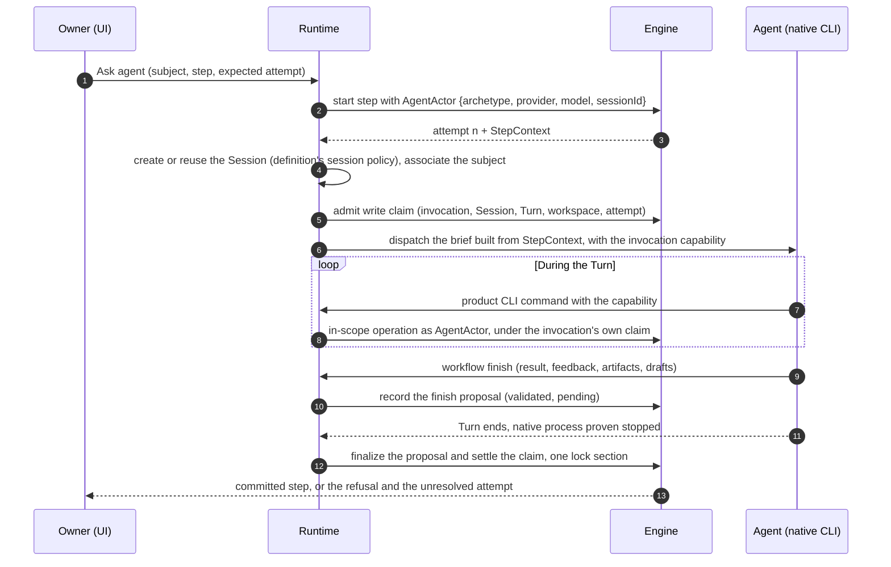

# Ask agent — agent execution of workflow steps and Tasks (contract)

**Draft proposal, not implemented.** This document restructures the earlier E6 proposal in place
(same stable id): its candidate invocation protocol, durable partial work and context sections are
now the contract below, and its open decisions D11 to D13 carry options and a recommendation. The
delivery order, one PR per slice with its tests, is the sibling
[Ask agent delivery plan](ask-agent-delivery-plan.md). Nothing here overrides a current document;
where it proposes a change to one, it says which.

Already decided and implemented: manual execution, the neutral coordinator, executors and actors,
Tasks as resources and the Ask agent attachment point
([ADR 0023](../../../architecture/decisions/0023-neutral-workflow-coordinator-and-manual-execution.md),
[ADR 0024](../../../architecture/decisions/0024-tasks-are-resources.md),
[Manual workflow execution](../../../product/specflow/ui/workflow-execution.md#ask-agent)).
`session: reuse` after a manual step is `session-unavailable`, with no fresh-Session fallback (D10).
The finish post action that commits the execution state is the seam for an agent step's commit
(ADR 0024, decision 11).

## Goal and non-goals

**Goal.** The owner chooses **Ask agent** on a step an agent may do, and the agent does that one
step end to end without the owner relaying anything: it receives the step's context, writes the
Specification documents, Task drafts or code the step needs through supported operations, and
submits the step's result, feedback and artifacts. The owner then sees one committed step, or an
unresolved attempt with everything the agent already produced, and makes every decision that needs
a person. It works for any workflow definition: nothing in the mechanism names a step, archetype or
document type.

**Non-goals** (deferred, unchanged from E6): unattended continuation into the next step (plan 06
F01), Task batching (F12), parallel Task worktrees and per-worktree claims (F08), `command` and
`human` gate types (F03), typed transition inputs (E5), filesystem containment of the agent, and
bootstrapping dependencies in a fresh worktree.

## Evidence: the dogfood run of 2026-11-16

One managed Session wrote a whole Specification (overview, behaviour, UX, backend, decisions), six
Tasks with bodies and one tested code change on this repository, on the PR #163 build. A person had
to do every Start, Finish, approval and Task creation. The findings this contract answers:

| Finding                                                                                                                         | Answered by                                                                                                          |
| ------------------------------------------------------------------------------------------------------------------------------- | -------------------------------------------------------------------------------------------------------------------- |
| **B1 / D11.** `tasks create` and `tasks edit` fail with `SPEC_BUSY` inside the agent's own Turn; the message names Create/Close | [Engine writes during a Turn](#engine-writes-during-a-turn-d11)                                                      |
| **B6.** A new `decisions.md` is not registered: missing from Documents, the attach picker and `spec-doc:` context               | [Document registration](#document-registration-b6)                                                                   |
| **B3.** Documents, Tasks and code the agent wrote are never committed; a finish commits only `.execution/`                      | [Commit ownership](#commit-ownership-and-close-b3)                                                                   |
| **B4.** Every finish from the breakdown onward reports `MANUAL_COMMIT_CONFLICT`; the banner says Close includes the changes     | Fixed on the manual path in PR #163; the agent path is covered by [Commit ownership](#commit-ownership-and-close-b3) |
| Gap: every Start and Finish by hand; the finish input could be the agent's                                                      | [Lifecycle](#one-agent-attempt), [Completion](#step-completion-d12)                                                  |
| Gap: the owner approved the breakdown and the Task review                                                                       | [Agent and human authority](#agent-and-human-authority)                                                              |
| Gap: every brief written by hand (step text, documents, rules)                                                                  | [Context](#context-building-d13)                                                                                     |
| Gap: about 30 permission prompts for read-only tools and the product CLI                                                        | D20                                                                                                                  |
| Review of this plan: with authentication `none`, an agent can call the owner routes itself                                      | [Owner routes](#engine-writes-during-a-turn-d11), D21 (superseded: the host's choice)                                |
| B2: a Turn is lost when a tool runs long or writes outside the workspace                                                        | Not here: a Session driver defect, see the [delivery plan](ask-agent-delivery-plan.md#findings-outside-the-slices)   |

## Current state

PR #163 (merged) added facts this contract relies on: a Specification's Sessions run in its worktree (the claim names that workspace; the
resource stays project-wide); Close asks a checkout quiescence port, so it never removes a checkout
a Turn works in, read-only Turns included; and native-stop evidence lets startup recovery or
reconcile settle a claim and its Turn as `interrupted` without a click. It also fixed three dogfood
findings: claim refusals name their holder, the Session (B1's message); workflow-state commits hold
only the Engine's own Task changes (B4); and commit subjects are whole (B5).

| Capability                                       | Owner            | Evidence                                                                                                                                                     | Readiness                                                                                                                             |
| ------------------------------------------------ | ---------------- | ------------------------------------------------------------------------------------------------------------------------------------------------------------ | ------------------------------------------------------------------------------------------------------------------------------------- |
| One writer claim per native agent execution      | Engine           | [Workspace execution claims](../../../architecture/runtime/workspace-execution-claims.md)                                                                    | Established; excludes every other Engine writer, including the agent's own CLI calls (B1)                                             |
| Kernel start/finish/return consult claims        | Engine           | Same document, "The project-wide resource"                                                                                                                   | Established for agent claims (F05): every workflow write is admitted against them, Git on or off; owned-claim admission in the Engine |
| Agent actor `{class: agent, details}`            | Engine (kernel)  | [Workflow kernel, Executors and actors](../../../architecture/workflow/workflow-kernel.md#executors-and-actors)                                              | Established in the kernel; no trusted producer: the Runtime never builds one (F02 open)                                               |
| Attempt bound to a Session                       | Engine + Runtime | Kernel: an agent attempt with `sessionId` is resumed and finished only by that Session                                                                       | Established rule, never exercised: nothing starts an agent attempt                                                                    |
| Session association with Specification and Tasks | Runtime Sessions | [Session storage, associations](../../../architecture/ai/session-storage-and-lifecycle.md#authorization-and-associations)                                    | Established; `associate-tasks` is reserved for the workflow orchestrator and has no caller                                            |
| Step context at start                            | Engine           | `compileStepContext` (`workflow/operations/step-context.ts`): step, purpose, instructions, transitions, handoff, archetype, Task, Task types, existing Tasks | Established but insufficient: no Specification documents, document types, resolved Task context or Session policy                     |
| Document create with type, classify              | Engine documents | [Specification documents](../../../architecture/runtime/specification-documents.md#identity-paths-and-the-registry)                                          | Established; refused during the claim                                                                                                 |
| Commit policy, ledger, manual commit             | Engine documents | [ADR 0018](../../../architecture/decisions/0018-engine-commit-policy-and-manual-commit.md)                                                                   | Established for Engine writes only; a direct file write is not in the ledger and a changed post-image refuses the whole manual commit |
| Close refuses foreign dirty paths                | Engine lifecycle | [Specification lifecycle](../../../architecture/runtime/specification-lifecycle.md): `CLOSE_PREFLIGHT` names the paths                                       | Established (no silent loss today); the Close preview groups workflow blockers but does not list the dirty paths with them            |
| Owner-only operations                            | Engine           | Kernel: `returnToStep`, `setTaskStatus`, Task resource commands, `abandonSpecification` take `OwnerActor`                                                    | Established; Task create/edit would have to admit an agent actor in scope (D11)                                                       |

## Agent and human authority

The workflow definition decides **who may execute** a step (`executors`); the Engine decides **who
may decide**. The split is generic: it follows the step's declared facets and the effect or
operation class, never a step id.

| An agent actor MAY                                                                                   | Only an owner (`OwnerActor`) MAY                                                                                         |
| ---------------------------------------------------------------------------------------------------- | ------------------------------------------------------------------------------------------------------------------------ |
| Execute an attempt of a work step whose `executors` include `agent`, once the owner asked for it     | Ask an agent to execute a step (each attempt is expressly authorized; no automatic next attempt)                         |
| Read its step context and the documents it references                                                | Execute a step whose `executors` are `[human]`                                                                           |
| Create, save and classify documents of its subject Specification; save documents of its subject Task | Approve, cancel, remove, hold or resume a Task (`setTaskStatus`, Task lifecycle)                                         |
| Create and edit Task drafts, only in an attempt of a `produces: tasks` step                          | Confirm a transition whose effects are owner-authority (`approve-draft-tasks`) or that declares owner confirmation (D17) |
| Submit one finish proposal for its own attempt: result, feedback, artifacts, kept drafts             | Return, take over (F17), Abandon, Close, manual commit, discard or revert any work                                       |
| Ask the owner a question inside its Turn (an interactive step)                                       | Answer it; change definitions, configuration, authorization                                                              |

An agent never starts another subject's step, never finishes another attempt and never acts as an
owner, whatever its tool arguments say: the actor comes only from the trusted Runtime binding.

## One agent attempt

- The start runs before any provider process: a subject that is not ready, a stale expected attempt
  or a step without `agent` in its executors refuses before a Session or claim exists.
- The **attempt binding** `(subject, step, attempt, sessionId, turnId, invocationId, workspace)` is
  durable in the claim intent and on the attempt before dispatch; a crash between start and claim
  leaves an active attempt with no process, which the same Session resumes.
- A Turn ending finishes nothing. Only a finalized proposal advances the Run.
- One attempt may take several Turns of the same Session (the owner answers questions, the agent
  continues); each Turn has its own invocation and claim.

## Context building (D13)

The brief is generated, never typed by the owner. The Engine extends the step context it already
compiles at start (the step, its purpose and instructions, the finish transitions, the handoff with
the last feedback, the archetype profile and instructions, the Task and its type instructions, the
allowed Task types, the existing Tasks) with:

- **the subject's documents**: every registered document of the Specification (and, for a Task, of
  the Task) as `{id, type, title, path, revision, templateOnly}`, with the registered paths relative
  to the workspace root the Turn runs in;
- **the document types** the agent may register, from the catalogue: `{id, title, useWhen,
instructions, defaultFilename}`, plus the archetype's templates and requirements, so the agent
  creates `decisions` rather than a bare `decisions.md`;
- **the resolved Task context** (E6, ADR 0024 decision 9): each entry as a reference `{kind, ref,
path?, sha256, bytes, required}`, in deterministic order, with only `instructions` inline, bounded by
  the budgets in `workflow/limits.ts`; a digest of the resolved list on the attempt, the full list as
  local evidence (owner decision Q12);
- **the operations the agent may call** in this attempt (the broker scope below) and the exact CLI
  forms, generated from the same scope, so the brief never lists a command the broker refuses.

The Runtime renders the brief from that data with the archetype's profile; the Engine owns the data,
the Runtime only its presentation. Retrieval stays bound to the verified workspace: Specification and
Task documents come from their registry, never from project docs search; repository docs search
covers the configured `docs.root` of the Turn's workspace and says which mode it ran in. A rebind or
branch switch invalidates the context (the claim already refuses a registry change while held).

## Engine writes during a Turn (D11)

**Constraint (owner decision).** Task create and edit, and any other Engine write during an active
agent Turn, go through trusted Runtime-mediated operations bound to the invocation's Session and Turn
identity and its scope. The project-wide execution claim is not weakened, and no CLI process may
bypass or re-enter it without proven identity and permission scope.

**Proposal.**

1. At dispatch the Runtime creates an **invocation capability**: an unguessable secret (at least 256
   random bits) bound to `(invocationId, sessionId, turnId, specId[, taskId], workspace, scope)`,
   stored only in the Runtime process and handed to the provider process in its environment, together
   with the broker's endpoint. It is valid only while the invocation's claim is `dispatched` and the
   Turn is nonterminal; it dies with the Turn.
2. The product CLI, when it finds the capability in its environment, does **not** open the Engine for
   writing. It sends the command to the owning Runtime's broker. Without a capability the CLI behaves
   as today, so an unrelated process is still refused by the claim.
3. The broker verifies the capability, that the claim of that invocation is the one held, that the
   workspace and Specification binding are unchanged, and that the operation is in scope. It then calls
   the same Engine use case the UI calls, with the `AgentActor` from the binding and an **owned-claim
   admission**: the shared resource check treats the claim whose `operationId` the trusted Runtime
   names in-process as the caller's own, and every other unsettled writer still conflicts. Nothing is
   taken from the request: no claim id, actor, owner flag or `ignoreClaims`; a body that carries one
   is refused, not ignored.
4. **Broker surface.** The broker is not a TCP port: it listens on a per-user local endpoint (a
   Windows named pipe whose ACL grants only the Runtime's user SID, or a Unix domain socket in a
   directory of mode `0700` owned by that user), separate from the HTTP listener. The capability is
   compared in constant time. The Runtime redacts the capability's value from the Session transcript,
   tool output it stores, logs and diagnostics. The broker derives each Engine operation id from the
   invocation id and the client's id, so an id cannot be replayed under another invocation.
5. **Child processes.** The capability is in the environment of every process the agent starts
   (install scripts, test runners): the scope is the Turn's, not a tool's, and a descendant acts with
   the agent's scope. It cannot outlive the Turn: the capability is refused once the Turn ends, and the
   provider tree is stopped (process group, Job Object) before the claim settles. This is stated as a
   limit, not hidden.
6. **Scope is derived, not configured.** From the bound attempt: document create, save and classify of
   the subject Specification (Task documents for a Task subject); Task create and edit only when the
   step declares `produces: tasks`; the finish proposal of the bound attempt; every read. Never
   `setTaskStatus`, return, Abandon, Close, manual commit, or a write to another subject. A Turn of a
   Specification-associated Session without an attempt (an ad-hoc conversation) MAY get a narrower
   document-and-draft scope (D11b).
7. A Task created in an attempt of a producing step is recorded with origin `produced` by that step
   and attempt, so the finish and D06 treat it as that step's draft; a manual draft is never touched.
   Task create and edit accept an `AgentActor` only through this path; every Task decision still takes
   an `OwnerActor`.
8. Every accepted write is its own durable Engine mutation with its own operation id and revision,
   published at once and committed by the policy below; it is not held until the finish and does not
   disappear when a finish is refused.
9. Refusals name the real holder, as PR #163 made them do (`SPEC_BUSY` with `details.cause:
agent-turn`, naming the Session; B1's message). The broker answers out-of-scope requests with a reason the agent can
   act on, and an invalid context reference with the field and the accepted form (B7).

**Owner routes.** The broker gives the agent its own scope; the agent's own writes never carry the
owner's. Owner HTTP routes (Finish, Approve, Return) are protected by the configured authentication
mode only (IdP, password or `none`); the Runtime adds no owner credential, device pairing or owner
header on top (owner decision 2026-11-21, superseding D21). With `runtime.authentication.mode: none`
(the dogfood setup of this repository) the host has knowingly chosen no authentication: any local
process, the agent and its subprocesses included, can call the owner routes and the Runtime builds
an `OwnerActor` for it. That is the host's accepted risk, documented here, not a defect. The
provider environment never receives the user's login session or any credential the Runtime issues,
so with IdP or password authentication the agent cannot act as the owner through the HTTP routes.
The offline CLI builds `local:<os-user>`; kernel operations consult the claim (F05), which refuses
the offline owner CLI while an agent Turn runs.

**Trust model.** This is a cooperative protocol, not containment. The native agent still has the OS
user's write access; a process of the same user can read the capability from the agent's
environment, and, with enough effort, any credential that user can read. What the contract enforces:
the claim keeps every other Engine writer out; owner routes refuse a caller the configured
authentication mode does not admit (in mode `none`, none is refused, by the host's choice); the
finish validates the real workspace state
([Commit ownership](#commit-ownership-and-close-b3)), so a write that bypassed the Engine is detected
rather than trusted. What it does not: keeping the login session and Runtime-issued credentials out
of the provider's environment does not isolate against a deliberately malicious process of the same OS user, and the
contract does not promise it. Stronger separation needs OS user separation or a sandbox, outside
this scope.

On Windows the broker's named pipe uses Node's default pipe security (orchestrator decision, no
native ACL code), not an ACL that grants only the Runtime's user SID: the creator, SYSTEM and
Administrators get full control and everyone else read access, which cannot send a request; pipe
names can be listed by any local user, so the random name hides nothing and every request still
needs the 256-bit capability. On Unix the socket is in a `0700` directory owned by the user.

## Document registration (B6)

A document of a Specification is a registry entry with a type, never a file that happens to end in
`.md` (owner decision). The agent registers a new document through the Engine's document create with
a `type` (or a `templateId` of the archetype), or classifies a file it wrote with an explicit type.
There is no automatic registration by extension, folder or name.

Prevention at the boundary: an agent finish is refused while the Specification directory holds an
**uncommitted unclassified file** (`WORKFLOW_UNREGISTERED_DOCUMENTS`, naming the paths and the two
remedies: classify with a type, or delete). Committed unclassified files that existed before are not
the agent's concern. Because an agent attempt starts from a clean baseline (below), an uncommitted
unclassified file at finish was written in that attempt.

## Step completion (D12)

The agent submits the same finish input a person does: the transition (`result`), feedback, artifacts
(registered document ids, Task ids) and, for a producing step, the kept drafts. The Engine validates
it completely at submission, with the same rules as an owner's finish (legal transition, feedback
required, exit gates, open Tasks, D06 draft conflicts, unregistered documents), and records a
deduplicated **finish proposal** on the attempt. A refused submission returns the reasons to the agent
in the same Turn, so it can fix them.

The proposal is not a transition. Three things happen after the Turn ends and the native process is
proven stopped. They are kept apart:

1. **Publishing the step state.** The validated proposal is re-validated and published in the
   execution store: the finished attempt, its transition and its effects (or, for an owner-authority
   transition, the pending owner confirmation). This includes the store's own commit admission and
   its ledger record, as today.
2. **Settling the claim** with the native-result receipt.
3. **Running the post actions**: flushing the document queue when auto-commit is on, then the
   attempt commit (D15).

**1 and 2 run in one critical section; 3 runs after it.** One Engine operation (`finalizeAgentAttempt`) takes
the project control lock **once** and calls the lock-held forms of the store change and of the claim
settlement. Neither takes the lock again; there is no re-entrant or nested control-lock section. The
journals are published in a fixed order, the store change first and the claim settlement second.
**They are two durable publications, not one physical transaction**: a crash can fall between them.
While the claim is unsettled every other writer is refused, so no other writer can observe or enter
that window. A crash there leaves the step published and the claim held. Recovery (startup or
reconcile, on the same native-stop evidence) runs the same operation again: the store change
replays idempotently (F16, same request digest, nothing applied twice), then the claim settles. The
claim is never settled before the step state is published. When re-validation refuses (a gate
changed, a Task changed), the claim still settles in that section, the attempt stays active and
unresolved, and the owner sees the proposal with the refusal.

**Post actions run after the control lock is released**, each as an ordinary journaled Engine
operation with an id derived from `(attempt, kind)`, so a retry or a restart resumes it rather than
duplicating it. They take their own locks in the existing order of the manual commit: a short
control-lock section for the reservation, released; then the checkout lease; then short control-lock
sections for verification and prune. No operation waits for the lease while it holds the control
lock, and no post action is ever called from inside a lock section, so the order cannot deadlock. The
execution-state commit (`commit-execution-state`) is folded into the attempt commit, which already
holds those ledger entries, so two commit operations never compete for one path.

**A post action that fails after the step is published** fails nothing that is already published.
The finish result reports the step and each post action separately, as PR #163 reports a step and its
commit: `step: finished`, and `postActions: [{kind: attempt-commit, status: failed, code}]`. The
attempt keeps its attributed paths with their recorded hashes. The Now block says "Finished. The
commit failed (`<code>`)" with **Retry commit** (a repeated finish replays and runs the post actions
again, F16), and Close lists the paths until they are committed.

Replays are idempotent (F16): the proposal has a request digest; the same proposal again returns the
recorded one; a different one replaces it only while not finalized. A late callback of a stopped or
replaced invocation is refused.

## Approvals and owner confirmation (D17)

An agent may execute a review step: it reviews and submits a result with feedback. What it may not do
is grant an approval. The Engine classifies each effect by authority; `approve-draft-tasks` is
**owner authority**. A workflow author MAY also mark a transition `confirmation: owner` (for example a
"Requirements agreed" result of an interactive step). An agent proposal whose transition carries an
owner-authority effect or that marker is finalized into a **pending owner confirmation**: the attempt
ends, the Run waits at that transition, and the Now block shows **Confirm** and **Reject** with the
agent's feedback. Confirm applies the transition and its effects with the owner as actor; Reject
returns to the step with the owner's feedback. A person's own finish needs no confirmation. Effect
authority ships with the first agent finish: until pending owner confirmation exists, the Engine
refuses such an agent proposal outright (`WORKFLOW_OWNER_DECISION_REQUIRED`), so no slice lets an
agent approve. Task
approval itself (`setTaskStatus approve`) stays an owner operation, as today.

## Commit ownership and Close (B3)

**Rule.** The Engine commits only paths it can attribute; it never runs `git add -A`, `git commit -a`
or a commit of the whole tree, and the agent is not expected to commit by itself.

1. **Clean baseline at start.** Ask agent is refused while the workspace has changes the Engine cannot
   attribute (dirty or untracked paths outside the ledger), naming them, so whatever is dirty at the
   end of the attempt came from that attempt, the Engine's own ledger aside. This is the
   "dirty-baseline admission" of [execution scopes](../execution-scopes-and-recovery.md). Ledger
   entries of other authors may remain, but the broker refuses an agent write to a path whose ledger
   entry carries another author's operation ("commit it first"), so no path ever mixes two authors'
   uncommitted changes.
2. **Baseline at every Turn.** The claim is released between the Turns of one attempt, so the owner or
   an IDE may edit files meanwhile. When a Turn's claim settles, the Engine records the attempt's
   dirty set (path and content hash). The dispatch of the next Turn of that attempt (**Continue**)
   is refused while the dirty set differs from that record outside the ledger, naming the paths
   changed since, so an edit made between Turns is never attributed to the agent. The owner commits,
   reverts or keeps them by hand and continues.
3. **Documents and Tasks** written through the broker are ordinary Engine writes: queued or in the
   ledger by the commit policy, with their post-images. A registered document or Task file whose bytes
   differ from its ledger post-image at finish was written past the Engine; the finish is refused,
   naming it, and the agent saves it through the Engine. (B4 on the manual path was fixed in PR #163;
   this check does not depend on that fix.)
4. **Code and other files** the agent changed are declared in the finish proposal (`changes.paths`).
   The Engine checks that the declared set equals the dirty set outside the Specification directories
   and the Engine's own namespace, both derived from the configured Specification root and Project
   Home (never hardcoded paths): an undeclared or a declared-but-clean path refuses the finish, naming
   it. Ignored files are never committed.
5. **One attempt commit.** One attributable, Engine-owned commit per agent attempt, whatever
   `git.commits.auto.documents` says. It is a deliberate Ask agent operation, not the periodic
   auto-commit. It holds exactly:
   - the ledger entries whose every operation belongs to this attempt's invocations (documents,
     Tasks, execution state);
   - the declared paths, each with the content hash recorded when the step state was published.

   A path whose content differs from its recorded hash or post-image (someone edited it after the
   publish) refuses the commit, naming it, and nothing of it is committed: the commit never takes in
   another author's change, and an unattributed change is never committed.

   _Implemented (T13):_ "belongs to the attempt" is judged by each ledger entry's durable author set
   (the agent Turns that made its operations, and whether any operation was made without one),
   merged on every record and never truncated like the kept operation ids, so a file the agent saved
   more than 50 times still commits. The attempt's start and finalize attribute their execution
   state to its Turns. An entry the attempt never touched stays out; an entry the attempt changed
   together with someone else refuses the commit (`ATTEMPT_COMMIT_MIXED_AUTHORS`, naming it). The
   Task index (`tasks/index.yaml`) is one such shared entry: when the owner created, edited or
   removed Tasks and left that uncommitted before the agent changed Tasks, the index mixes both
   authors and the attempt commit is refused until the owner commits their Task changes and retries;
   after a committed checkout (the normal start of an attempt) the index is the attempt's alone. The commit is made on the
   working branch of the Specification's workspace; it is not a merge and moves no other branch.
   The subject is `spec(<subject>): <step title> (attempt n) by agent in <slug>` (whole, as PR #163
   made subjects), with the `Nevo-Operation` and attempt trailers. When auto-commit is on, the queued
   document commits drain first. A failed commit fails nothing already published (see
   [Step completion](#step-completion-d12)). **Authorization and disclosure:** starting Ask agent is
   the owner's deliberate authorization both to execute that step and to create that one commit. The
   Ask agent dialog says so before the owner starts it ("When the agent finishes, SpecFlow commits its
   work on `<branch>` as one commit; changes of others are never included"). There is no separate
   Accept step for every agent step: decisions that need a person use the workflow's
   `confirmation: owner` and owner-authority effects (D17).

6. **Close never silently loses work.** Close keeps refusing any dirty path other than the
   Specification's execution state (`CLOSE_PREFLIGHT`, `DOCUMENT_COMMITS_PENDING`). The Close preview
   lists these paths as an **Uncommitted changes** blocker group with the remedy for each kind (commit
   the Engine's changes, retry the attempt commit, or commit or discard foreign changes in Git), so the
   owner learns it before acting, not from a refusal. A finish banner never says "Close includes them"
   for paths Close will refuse. There is no product operation that discards work.

## Error recovery

| Situation                                                   | State                                                    | What the owner can do                                                                               |
| ----------------------------------------------------------- | -------------------------------------------------------- | --------------------------------------------------------------------------------------------------- |
| Start refused (not ready, dirty baseline, provider missing) | Nothing written                                          | Fix the named precondition; the Ask agent form explains it before submit                            |
| Turn ends without a finish proposal                         | Attempt active, accepted writes published, claim settled | **Continue** in the same Session (a new Turn of the same attempt), take over (F17) or return        |
| Proposal refused at finalize                                | Attempt active with the proposal and its refusal         | Fix it (or let the agent fix it in a new Turn), take over or return                                 |
| Turn `unknown`, process may still run                       | Claim held, project writers blocked                      | Check outcome; native-stop evidence settles it; else the administrative recovery of Session storage |
| Owner stops the agent                                       | Cancel requested; claim held until proof                 | Wait for proof; then as "Turn ends without a finish"                                                |
| Owner returns during an agent attempt                       | Attempt `returned`; Runtime cancels the Turn (F13)       | A late proposal of that attempt is refused (`WORKFLOW_ATTEMPT_MISMATCH`)                            |
| Pending owner confirmation                                  | Run waits at the transition                              | Confirm or Reject                                                                                   |
| Attempt commit failed                                       | Finish published, paths attributed and uncommitted       | Retry the post action; Close lists them until committed                                             |

Partial work is never rolled back by the product: each accepted write stays, and the attempt's
history lists its operations (documents, Tasks, declared paths) so the owner can inspect, keep or
revert them through ordinary versioned operations or Git.

## Invariants

These are the machine-checked rules the slices MUST enforce; each has one owner.

1. An attempt advances only through a finalized finish; a Turn's end, a submission or a reply never
   advances a Run (Engine, kernel).
2. Every Engine write during an agent Turn carries an `AgentActor` built by the Runtime from the
   binding and an owned-claim admission named in-process; a request body never supplies an actor,
   claim or scope (Engine admission, Runtime broker).
3. While an agent claim is unsettled, every writer except that invocation's broker calls is refused,
   kernel operations included (Engine, closes F05 for agent claims).
4. The step state and the claim settlement are published in one control-lock section, step state
   first; post actions run only after that section, never nested in a lock section (Engine).
5. An agent actor never applies an owner-authority effect or a `confirmation: owner` transition, and
   never calls an owner operation (Engine). Before owner confirmation exists, such an agent proposal
   is refused outright.
6. **The provider environment never receives the user's login session or any credential the
   Runtime issues; agent writes go only through the broker with agent scope** (Runtime). Owner
   routes are protected by the configured authentication mode; in mode `none` that protection is
   absent by the host's choice (documented, not a defect; owner decision 2026-11-21).
7. An agent finish is refused while unregistered uncommitted files, Engine files edited past their
   post-image, or undeclared changes exist; a Turn of an attempt is not dispatched while the dirty
   set changed since the previous Turn (Engine).
8. The Engine commits only the attempt's own ledger entries and its declared paths whose content
   still matches the recorded hash; it never commits another author's change (Engine commit port).
9. Close refuses unattributed dirty paths and lists them in its preview (Engine lifecycle).

## Decisions

Owner decisions on PR #169 (2026-11-16). All decisions are taken; they are the contract.

**D11 — How an agent's CLI proves its invocation. Decided: (a).** A per-invocation capability in the
provider environment; the CLI forwards to the Runtime's local broker, which calls the Engine with an
owned-claim admission ([Engine writes during a Turn](#engine-writes-during-a-turn-d11)). A product MCP
tool may later become a second transport over the same broker. Rejected: a delegated claim file (any
reader holds the claim) and releasing the claim per call (breaks exclusion).

**D11b — Scope of a Turn without an attempt. Decided: (b), documents only.** An ad-hoc Turn of a
Specification-associated Session may create, save and classify documents of its home Specification.
Task drafts need an attempt of a producing step.

**D12 — Finalizing an agent attempt. Decided: (a).** The validated proposal is finalized after
positive native-stop evidence. The step state is published and the claim settled in one non-nested
control-lock section; Git post actions run after it, in the manual commit's lock order, and their
failure is reported apart from the step ([Step completion](#step-completion-d12)). The two durable
publications are not one physical transaction. A crash between them is recovered by an idempotent
replay of the same operation, which the delivery slice tests. Rejected: applying the finish during
the Turn, and deriving the result from the last message.

**D13 — Context form. Decided: (a).** References with digests, read by the agent; only
`instructions` inline; budgets bound the list.

**D14 — Unregistered documents at finish. Decided: (a).** An agent finish is refused while
uncommitted unclassified files exist in the Specification directory.

**D15 — Commit of an agent attempt. Decided: (a1).** One attributable, Engine-owned attempt commit
on the working branch (not a merge), whatever the document auto-commit setting says, made when the
attempt is finalized. Starting Ask agent is the owner's deliberate authorization to execute that
step and to create that commit, and the Ask agent dialog discloses it. There is no mandatory Accept
step per agent step: decisions that need a person use `confirmation: owner` and owner-authority
effects (D17). An unattributed change is never committed
([Commit ownership](#commit-ownership-and-close-b3)). Rejected: a commit only with auto-commit on,
the agent committing with Git itself, and a mandatory Accept result step.

**D16 — Uncommitted work at Close. Decided: (a).** Close keeps refusing and lists the paths in its
preview with remedies; there is no discard action in the product.

**D17 — Human-only decisions. Decided: (a).** Engine-owned effect authority (approval effects are
owner authority) plus an optional `confirmation: owner` marker on transitions, finalized into a
pending owner confirmation; refused outright until that exists.

**D18 — Which Session runs the step. Decided: (c).** The kernel's continuation resolution decides,
and a step whose archetype is declared independent (a review facet) always gets a fresh Session,
never `reuse`. Definition validation refuses `session: reuse` into such a step. The owner may change
provider and model only for a fresh Session; the choice is recorded on the attempt.

**D19 — Stop and takeover. Decided: (a).** Stop cancels the Turn and keeps the claim until proof.
Take over (F17) is an explicit owner operation, allowed once the claim is settled: it ends the agent
attempt as `taken-over` and starts an owner attempt.

**D20 — Permission prompts. Decided: (a).** The Runtime starts an Ask agent Turn with the provider's
allowlist for read-only tools and the product CLI, configured per archetype; it is provider
configuration, not an Engine rule.

**D21 — superseded by owner decision 2026-11-21:** owner routes are protected by the configured
authentication mode only (IdP, password, none); in `none` the host knowingly accepts that any local
process, the agent included, can call owner routes; no pairing or extra credential.

## Readiness

**Ready for decomposition.** Every material decision is taken. The delivery plan orders the work
into separate vertical slices, each one PR with its tests; none expands the scope above.
