# SpecFlow UI UX audit, November 2026

This audit reviews the **finished** SpecFlow UI screens. Known placeholders such as the
_Planned areas_ list in Session Context are out of scope.

Sections 1 to 4 record **observations** and the auditor's first **proposals**. Proposals are not
decisions. The [Proposed decisions after review](#proposed-decisions-after-review) section records
what the review proposes to accept, change or drop. Those are still proposals until the owner
approves them. Where a proposal conflicts with an accepted contract, the contract wins.

This document is an audit and a planning input. It is not a source of authoritative contracts:
anything it plans that needs a contract, such as Session ownership, gets its own design document.

## Method and evidence

- Code: `main` at `87792596`, after the Full Session redesign (#112). The Storybook rework from
  #113 is still a proposal and was not applied.
- Real application: `nevo-specflow start --demo` with authentication mode `none`, viewed at
  1600×950 (wide desktop), 1280×800 (laptop) and 390×844 (mobile).
- Storybook: the Full Session screen, because demo mode cannot show it (see
  [Demo leads to a dead end](#demo-leads-to-a-dead-end)).
- Screenshots are 1× captures stored next to this document under [`images/`](images/).

The two most important problems are structural:

1. On a wide desktop the whole shell, including the navigation, moves between screens.
2. Entering a Session drops the Specification context from the navigator.

## 1. Desktop: space and layout jumps

### 1.1 The shell changes geometry between screens

`AppShell` centers the navigation together with the workspace. Each screen sets its own maximum
content width, so on a wide monitor the left navigation moves on every transition. This is the
size change visible between creating or choosing a Specification and opening its Documents.

| Screen                             | Content width | Navigation left edge at 1600 px |
| ---------------------------------- | ------------- | ------------------------------- |
| Specs list                         | 1100 px       | about 130 px                    |
| New Specification                  | 880 px        | about 230 px                    |
| Specification, Documents, Sessions | full          | about 15 px                     |

At 1280 px the Specs list is already full width, so the jump only shows on large monitors.

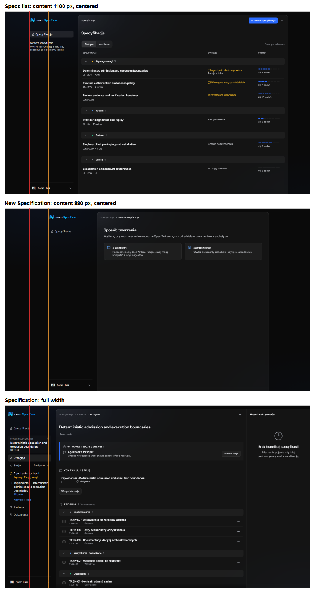

Full-size captures: [Specs list](images/desktop-specs-overview-1600.png),
[New Specification](images/desktop-create-choice-1600.png) and
[Specification Overview](images/desktop-specification-overview-1600.png).

**Suggestion.** Pin the navigation and the workspace panel to fixed positions on every screen.
Narrow only the column _inside_ the panel, for forms and the Specs list. The panel then never
moves; only its content column changes.

> **Superseded by rendered proposals.** Prototypes showed that a fully pinned, full-width shell
> moves the problem into the content. See
> [App Shell geometry and space use](shell-geometry.md) for five rendered variants, an independent
> visual review and the recommended proposal.

### 1.2 Empty Activity history occupies a fixed side band

The Specification Overview keeps a Secondary _Activity history_ column even when it only shows
the empty state. At 1280 px it takes about a third of the screen.

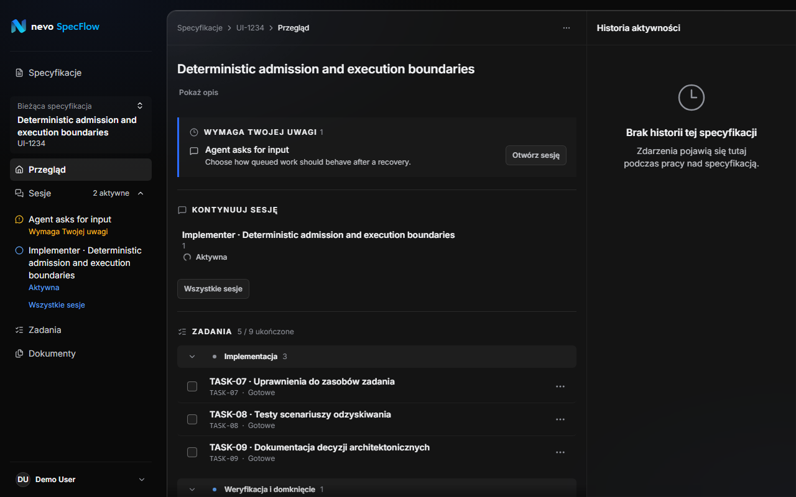

**Suggestion.** Collapse Secondary while it is empty, or render the history as a section of the
Overview.

### 1.3 Conversation is wider than the Composer

Assistant messages run across the whole Conversation panel, while the Composer is narrower and
centered. Long lines are hard to read and the two columns do not align. The accepted Session
Chat V10 direction asks for centered, width-limited assistant Markdown.

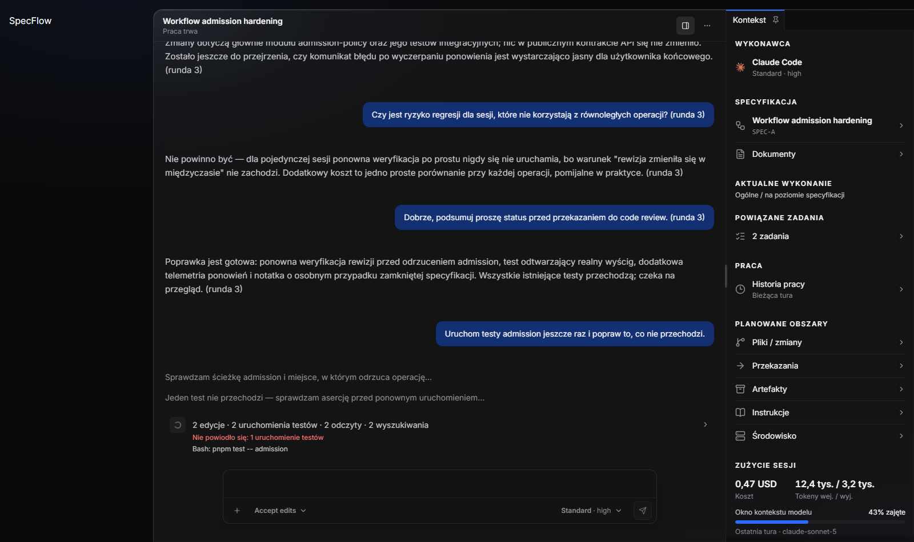

**Suggestion.** Use one shared reading width for messages, Work summaries and the Composer.

### 1.4 Sparse Secondary at a 50/50 split

When a second root tab opens, the split defaults to 50/50. _Work history_ then shows one row on
half of the screen.

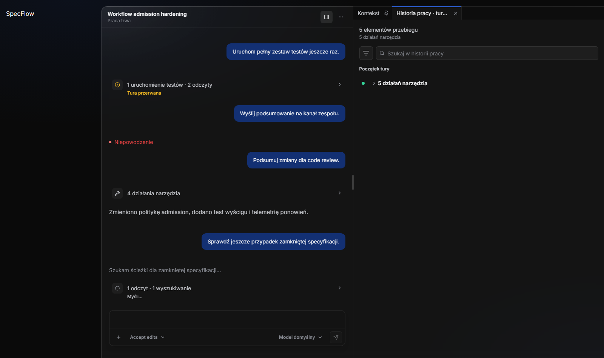

**Suggestion.** Let the default ratio depend on the opened content, or keep Secondary narrow
until the content needs more space.

> **Conflicts with an accepted contract.** The 50/50 default for a second independent root tab is
> part of the accepted Session Chat V10 split. The observation stands; the review proposes to
> drop this proposal.

### 1.5 Documents use four columns

Navigation, document tree, document and table of contents sit side by side. At 1280 px the table
of contents correctly disappears, but navigation and tree together still take a large share.

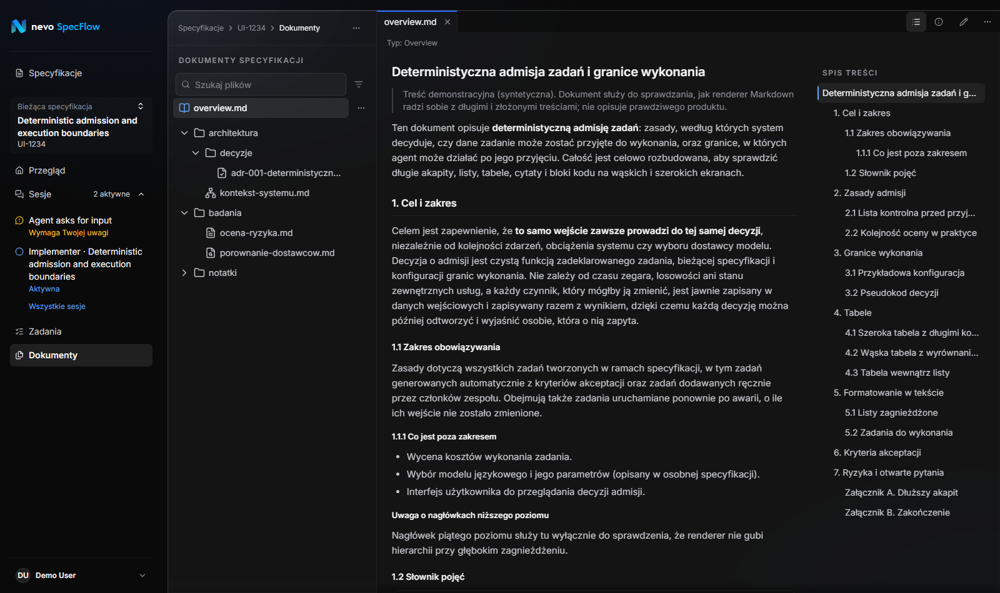

**Suggestion.** Make the tree collapsible, or collapse the navigation to icons in Documents.

## 2. Navigator and flow

### 2.1 A Session loses the Specification context

Sessions have a global route (`/sessions/:sessionId`). The navigator only recognises a
Specification from the Specification route. After opening a Session, even one started inside a
Specification, the navigator falls back to _Select a specification_. Overview, Sessions, Tasks and
Documents disappear, while Session Context in the same screen still knows the owning
Specification.

The New Session start card lives under the Specification route, so the context disappears in the
middle of the flow: right after **Start session**.

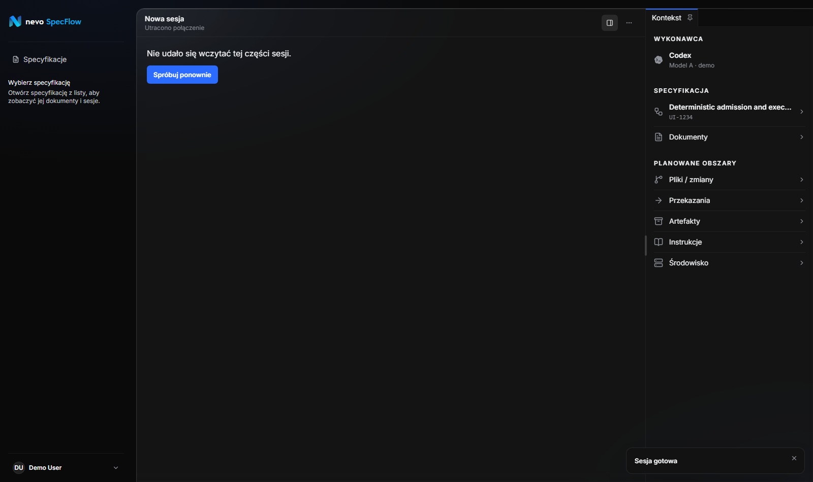

**Suggestion.** This is the main topic for the navigator redesign. The navigator should derive the
current Specification from the Session's owner as well, so the Specification section stays visible
in a Session.

**Root cause found in review.** The managed Sessions contract has no Session-to-Specification
association. Create Session rejects association fields, and the real Session route falls back to
an unknown scope. A Session started in this page keeps its Specification only through an
in-memory record of the started Session. After a reload, a direct URL or a move to an older
Session, the context is gone. Passing a `specId` to the navigator is therefore not enough. The
fix needs a durable, authoritative association first.

### 2.2 The same information appears three times

_Agent asks for input_ appears in the navigator, in _Requires your attention_ and in the Sessions
list. The Implementer Session appears in the navigator and in _Continue session_.

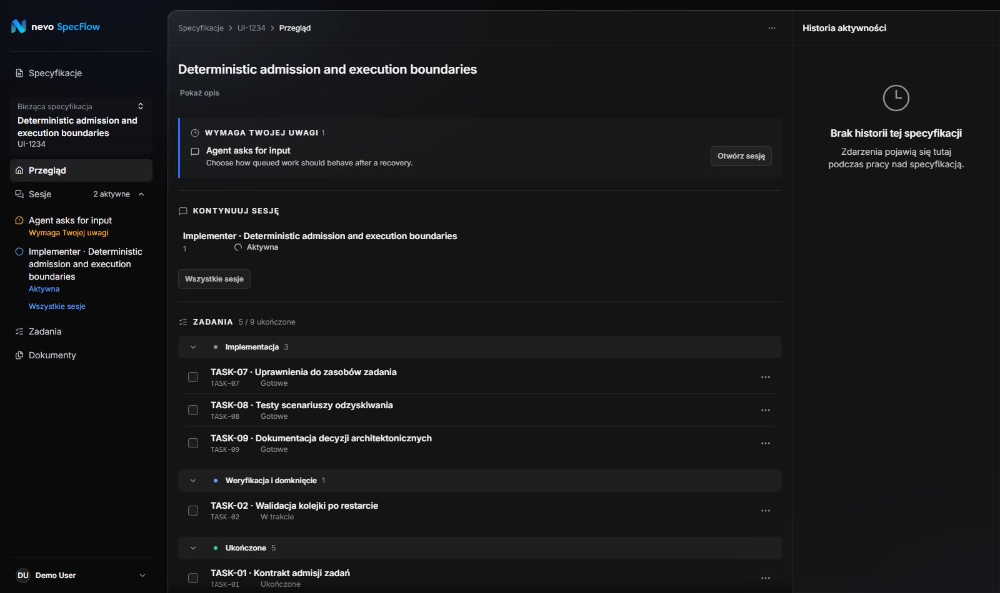

**Suggestions.**

- Let the navigator show places with counts and state, not a full list of objects.
- Inside a Specification, show a Session by role and state only. The Session name currently
  repeats the Specification title shown right above it, so each row wraps to three lines.
- Split _2 active_ into _waiting for you_ and _working_. The current count includes a Session that
  waits for the user.

### 2.3 Tasks is an anchor, not a view

The **Tasks** item scrolls the Overview to its Tasks section and moves the active highlight away
from **Overview**, although the page does not change. Either give Tasks its own view or drop the
item.

### 2.4 Attention does not roll up

In the demo data the Specification shows one attention item. The TASK-02 row says _In progress_,
while its preview says _Waiting for a human_ and lists five items that require attention.
This may be fixture data, but the model does not lift Task attention to the Task row or to the
Specification.

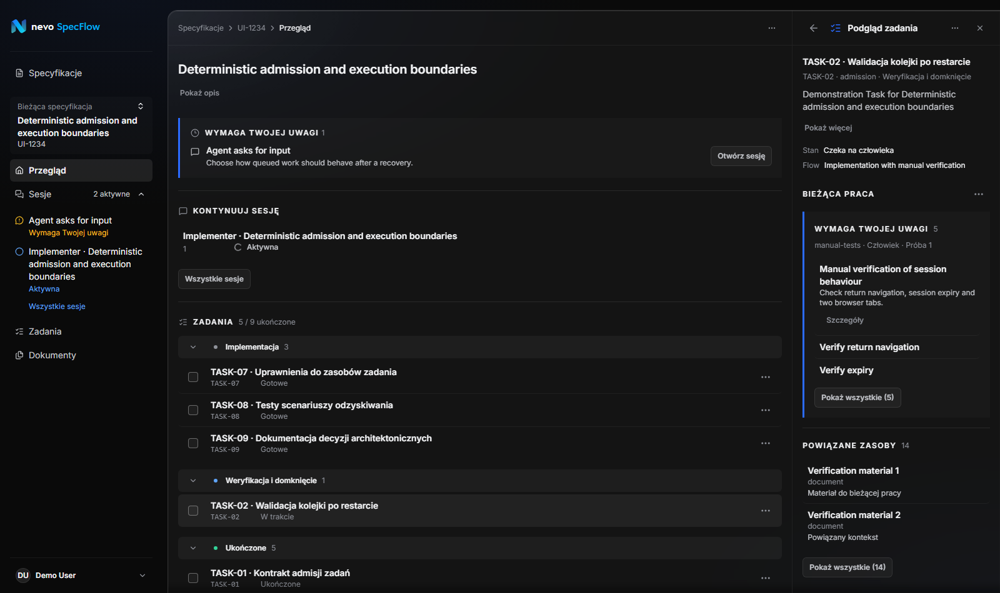

### 2.5 The Specification switcher shows no state

The switcher lists titles and keys only. It shows no attention or progress per item, the
_Selected_ label repeats the check mark, and there is no **New specification** action.

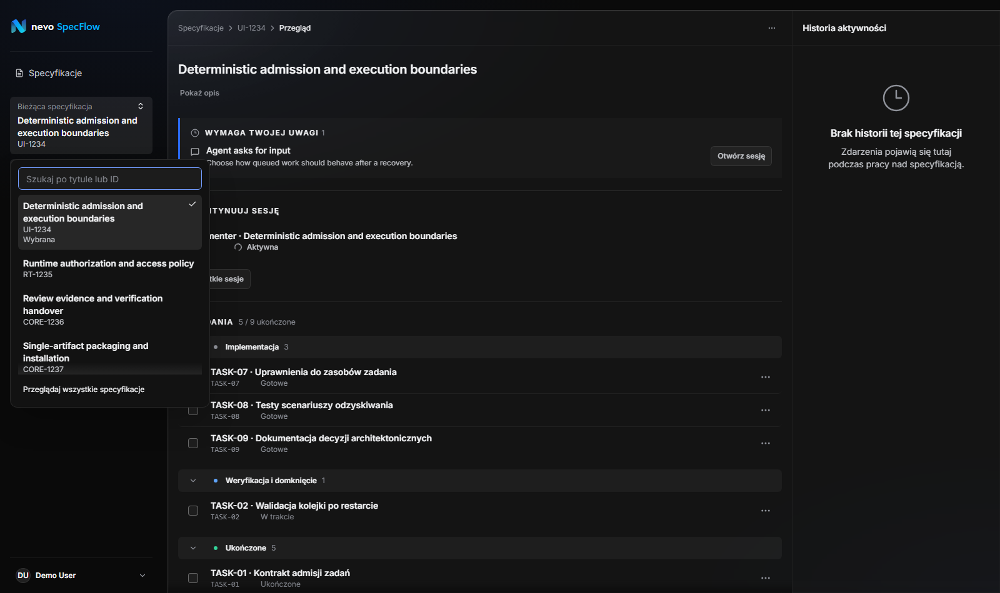

### 2.6 Two different shapes for creation

**New session** opens in the Session shell with a start card. **New specification with an agent**
is a long single-column form in a narrow centered column, although it also ends in a Spec Writer
Session.

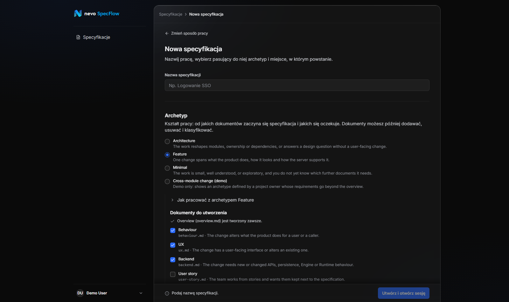

**Suggestion.** Since Session creation now lives in the Session shell, creating a Specification
with an agent fits the same shell: name and archetype in the start card, Context on the right.
This would also remove one of the width changes from section 1.1.

> **Review proposes to reject.** The creation process stays as it is. The width change is solved by the
> fixed shell geometry instead; the form itself may be improved without changing the process.

### 2.7 The Session start card has two calls to action

- A **Start session** button and, below it, a disabled Composer saying _Choose an agent and start
  the session_, although an agent is already selected.
- Model is required but has no default, and Context shows _not selected_ until one is chosen.
- Work mode shows no selection before a model is chosen.

> **Mostly specified behaviour.** The New Session spec makes the model a deliberate choice with
> nothing preselected, and keeps the Composer inactive until Start. Only the misleading Composer
> placeholder, which asks to choose an agent that is already chosen, remains a finding.

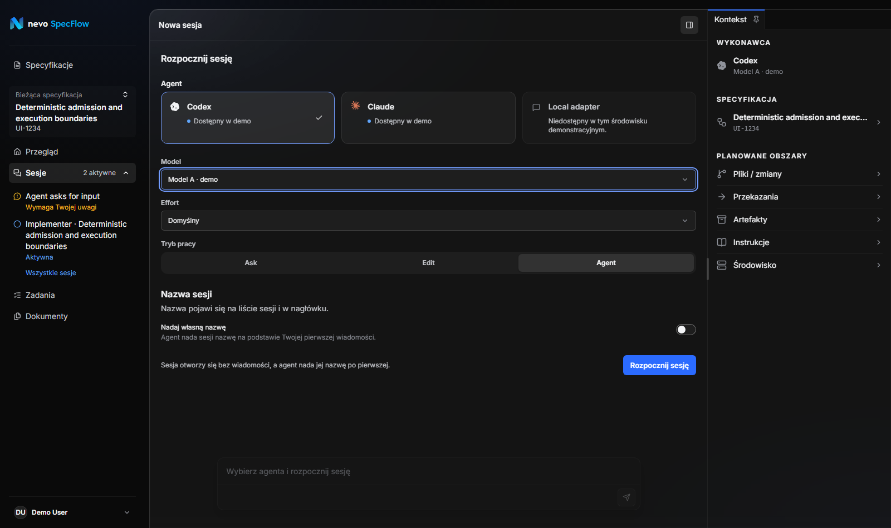

### 2.8 A pending question has its own answer field

A pending agent question renders its own _Your answer_ text area next to the main Composer, so
the screen has two text inputs. The Composer meanwhile shows the stop control.

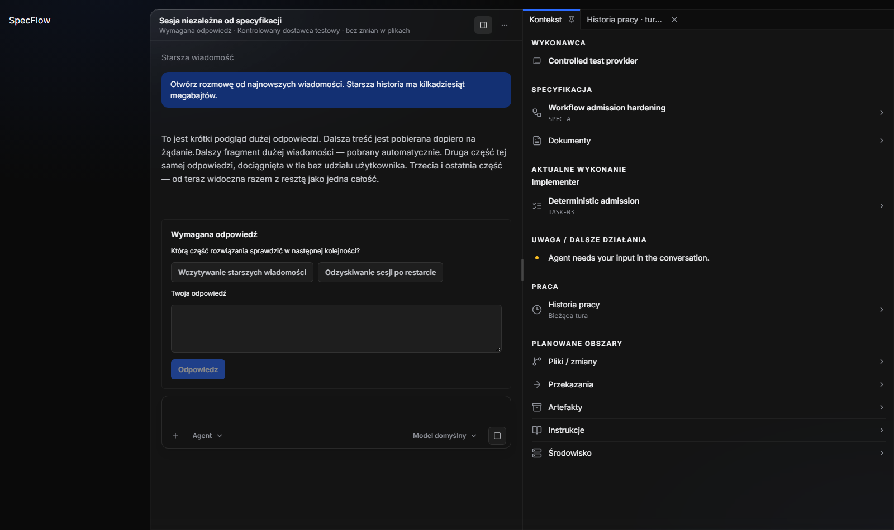

**Suggestion.** Answer through the main Composer with the question attached as context.

> **Review proposes a change.** Session Chat V10 requires a structured interaction to appear as an
> actual user decision, not handled by the general Composer. The structured answer stays. The
> problem to solve is two competing active inputs, for example by replacing the normal Composer
> with the answer field while the question is pending.

### Demo leads to a dead end

In `--demo` mode Managed Sessions receive no configuration, so `/api/session-providers` answers
503 and every Session read fails. **Open session** from _Requires your attention_ and a freshly
started Session both end in _Could not load this part of the session_. A _Session ready_ toast is
shown at the same time. If the demo is used to present the product, its main calls to action
should not lead there.

### 2.9 Smaller visual issues

- A Task row shows its key twice: in the title and in the line below.
- A bare number _1_ without a label sits under the Session name in _Continue session_ and in the
  Sessions list.
- Task rows have checkboxes but no bulk actions, so their purpose is unclear.
- The Sessions list shows developer text: _In the future the same collection may contain…_
- The list button says _New conversation_, the header says _New session_.
- The Composer shows the provider-native mode title _Accept edits_ untranslated in the Polish UI.
  It comes from the Runtime provider catalogue, so translating it is a product decision.

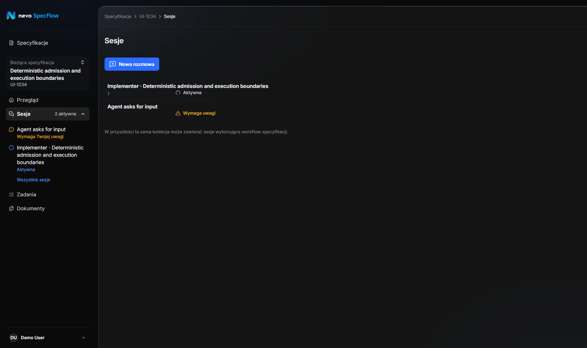

## 3. Mobile

| Session                                           | Specification                                                              | Session start card                                                 |
| ------------------------------------------------- | -------------------------------------------------------------------------- | ------------------------------------------------------------------ |
| 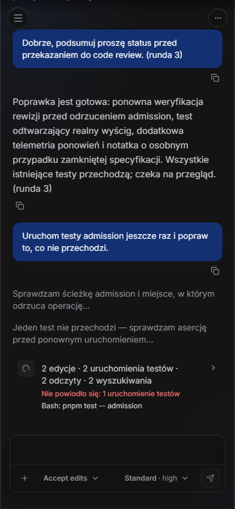 | 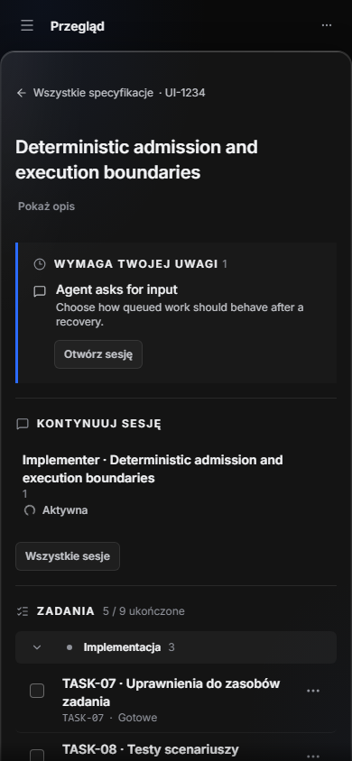 | 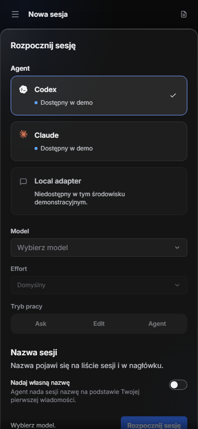 |

- **The Session has no header with its name and state.** The menu and overflow buttons float over
  the content and text scrolls underneath them. The user cannot see which Session and
  Specification is open, nor how to reach Context.
- **The Specification header only says _Overview_.** The title and the back link live in the
  content, and the Sessions list shows only the Specification key.
- **The Session start card cuts off Start session at the bottom.** The button is not sticky and the
  Composer is off screen.
- **A copy icon under every message costs vertical space.** A long-press or message menu would
  free it.
- **Back from a Task preview leaves the Specification.** On a phone, a Task opened from the
  Specification Overview is shown as pushed detail, but browser Back returns to the Specs list
  instead of closing the detail first. The route model expects the local stack to pop first.
- **The navigation drawer repeats the desktop problems.** Long Session names wrap and attention is
  listed again.

| Navigation drawer                                                                | Sessions list                                                                            |
| -------------------------------------------------------------------------------- | ---------------------------------------------------------------------------------------- |
| 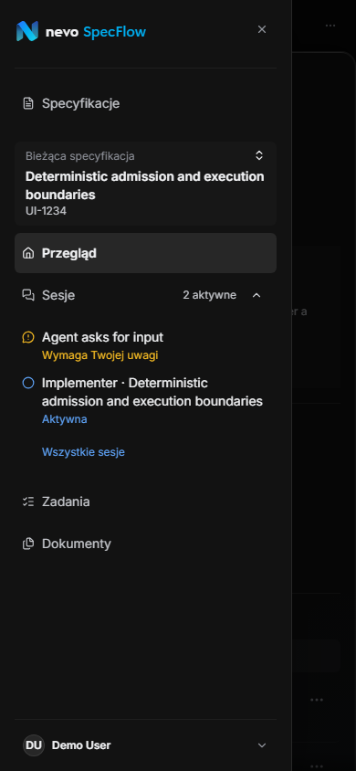 | 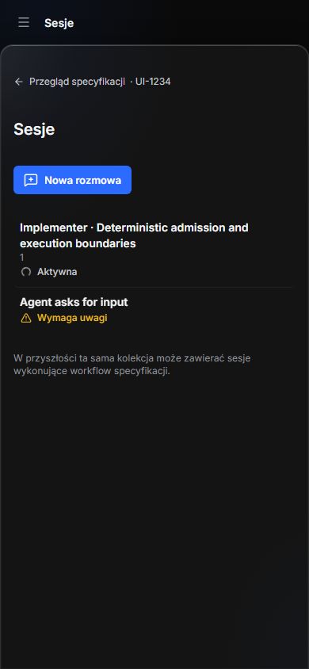 |

**Works well on mobile:** the Specs list, the Task preview as a pushed detail and a Document
opened directly.

| Specs list                                             | Task preview                                           |
| ------------------------------------------------------ | ------------------------------------------------------ |
| 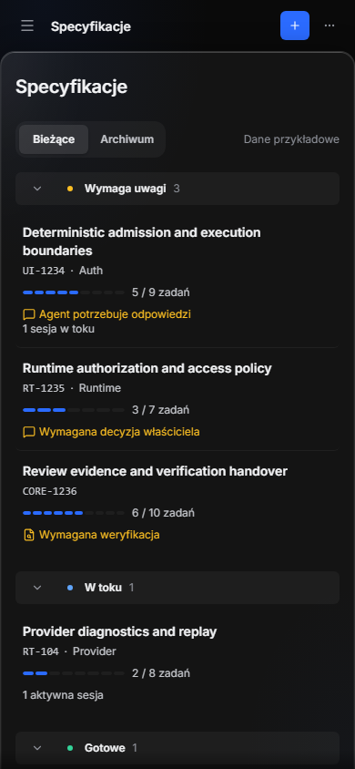 | 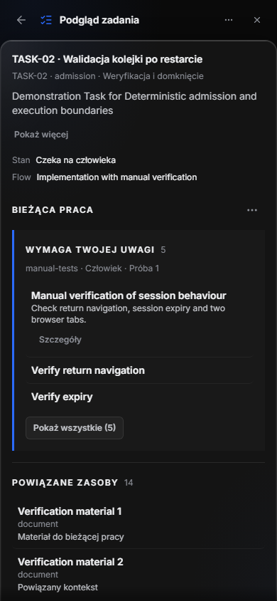 |

## 4. Storybook

Default stories show edge cases instead of the normal view of a screen, so the catalog looks
chaotic and every screen seems to carry a warning.

| Group              | Stories  |
| ------------------ | -------- |
| Whole Storybook    | 1409     |
| `SpecFlow/Screens` | 557      |
| Managed Session    | about 75 |

- **Warnings in default stories.** The active-Specification navigation story shows
  _Activity is partially available_.
- **Mixed languages.** The interface renders in English while fixture data is Polish, so each
  screen looks unfinished. Some fixtures are English inside Polish stories, for example
  _Agent needs your input in the conversation._ in the Session Context fixtures.
- **Overloaded data.** Session messages carry _(round 3)_ suffixes, and one Context shows usage,
  associations and warnings at once.

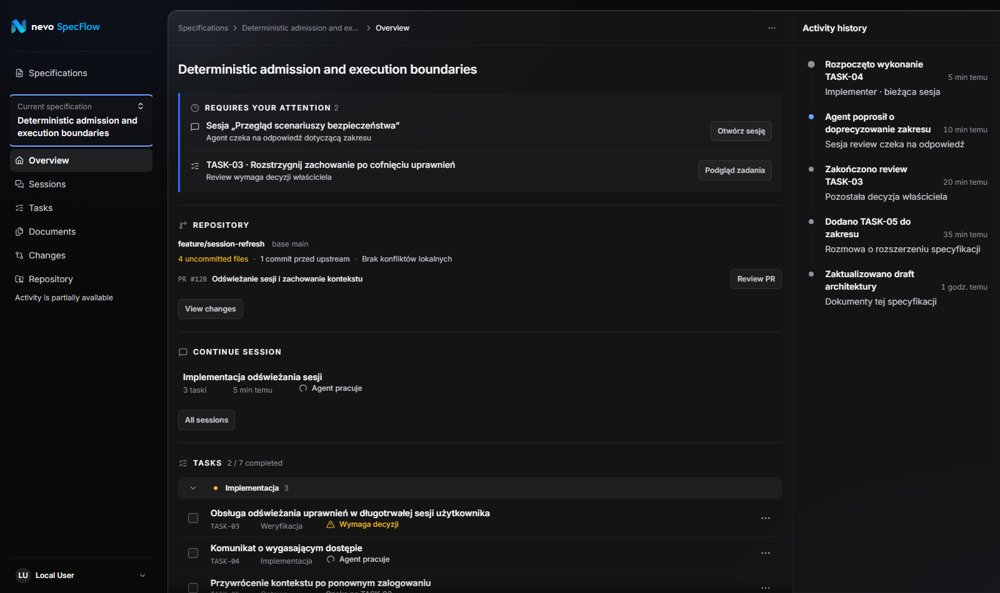

**Suggestion.** Give each screen one **Default** story with an ordinary, single-language state.
Move edge cases and scroll regression stories to a separate group. This matches the direction of
the Storybook rework proposal in #113.

## Proposed decisions after review

The first proposals were reviewed on 2026-11-05 and 2026-11-06. The review keeps the product
structure and the accepted Workspace V2 and Session Chat V10 behaviour, and splits the work into
small, independent pull requests instead of one redesign.

**None of these decisions is owner-approved yet.** The owner approves each row explicitly before
it becomes implementation scope. The navigator direction and the handling of agent questions need
that approval most.

### Proposed decision per audit proposal

| Proposal              | Proposed decision             | What to do                                                                                                                                                              |
| --------------------- | ----------------------------- | ----------------------------------------------------------------------------------------------------------------------------------------------------------------------- |
| Shell geometry        | Decide from rendered evidence | See [App Shell geometry and space use](shell-geometry.md). The rendered review proposes variant A2: explicit Focused and Workspace modes with one shared Focused width. |
| Navigator             | Implement partly              | Keep quick access to Sessions and the current hierarchy. Add a durable Specification context, shorter names and better counts.                                          |
| Creation shape        | Reject                        | Do not move Create Specification into the Session shell. Improve the form without changing the process. Do not preselect a model.                                       |
| Secondary space       | Split                         | Solve the empty Activity history separately. Keep the accepted dynamic V10 split in Full Session.                                                                       |
| Conversation width    | Implement                     | One reading width for answers, comments and Work summaries, consistent with the Composer.                                                                               |
| Mobile header         | Implement                     | A consistent header with name, state and access to Context, built from existing Design System primitives.                                                               |
| Question and Composer | Redesign the UX               | Keep the structured interaction but avoid two competing active inputs. Consider replacing the normal Composer with the answer field while the question is pending.      |
| Demo                  | Implement                     | Remove the false success message and the broken calls to action. Decide separately whether demo simulates Sessions.                                                     |
| Storybook             | Implement                     | Within the #113 rework: Default stories, fixture language and tree organisation.                                                                                        |
| Small issues          | Implement partly              | Remove developer copy, duplicated identifiers and unlabelled values. Check attention roll-up against the real Runtime first.                                            |

### Navigator direction

Keep the short Session list in the navigator. With few active Sessions it is useful. Change its
names, counts and state presentation instead. Repetition between the navigator and the Overview is
acceptable as long as the navigator stays the lighter of the two.

```text
Specifications

CURRENT SPECIFICATION
UI-1234
Deterministic admission and execution boundaries

Overview
Sessions            1 waiting · 1 working
  Agent asks for input
  Implementer
  All sessions
Tasks
Documents
```

The structure above illustrates the direction. It is not an accepted mock and does not propose new
Design System components.

### Proposed delivery order

1. **PR A: App Shell.** Implement the direction the owner chooses in
   [App Shell geometry and space use](shell-geometry.md); the review proposes variant A2. Verify the
   whole journey at 1280, 1600, 1920, 2560 and 390 px without regressions in splits and scrolling.
2. **Session ownership design.** A separate design document, accepted before any implementation
   handoff. Adding a `specificationId` to the Session DTO is not enough. The design decides:
   - the meaning of the Session-to-Specification association and who sets it;
   - how it is stored and how long it lasts;
   - authorization when the reader may see the Session but not the Specification, or the reverse;
   - Sessions that belong to no Specification;
   - loading, not found and missing permission states.
3. **PR B: Session ownership and navigator.** Implements the accepted design: the contract, one
   resolver used by the navigator, Session Context and return links, then the navigator
   presentation. Tests cover a direct URL, reload, switching Sessions and switching Specifications.
   A local cache of the last opened Specification is not an acceptable solution.
4. **Session UX, as three independent changes.** Each one is small because the Session screen has
   complex scrolling and responsive behaviour. None of them changes the root tab contract or the
   Back rules.
   - **PR C1: Conversation width.** One reading width for answers, comments, Work summaries and the
     Composer.
   - **PR C2: Mobile Session header.** Name, state and owning Specification with access to Context.
   - **PR C3: Empty Activity history.** Collapse or replace the empty Secondary on the Specification
     Overview.
5. **PR D: UI cleanup and demo.** Copy, naming, task counts, messages and fixture consistency.
   Storybook follows #113 and is not mixed with the navigator work.

PR A waits for the owner's choice of layout direction. The Session ownership design can be written in parallel.
PR C1, C2 and C3 do not depend on each other or on PR B; C2 shows the owning Specification only
once PR B exists.

### Verification rule for geometry changes

Every pull request that changes geometry includes a visual before-and-after comparison and tests of
transitions between screens. Checking a single screen in Storybook is not enough: the problems in
this audit show up while moving between views.

## Verification guide

This section lets another agent or reviewer check every finding independently. Treat each finding
as a claim to confirm or refute, not as an accepted decision. Line numbers refer to commit
`87792596`.

### Reproduce the environment

1. Build the CLI with the UI: `pnpm install` and `pnpm turbo run build --filter=@nevo/specflow...`.
2. Create a scratch Git repository with one commit. Copy `nevo-specflow.example.yaml` to its
   `.nevo/config.yaml`; it already uses authentication mode `none`.
3. Add `.nevo/local/config.yaml` with `runtime.authentication.localUserId: demo-user`.
4. From the scratch repository run `node <repo>/packages/specflow/dist/bin.js start --demo`. The UI
   and API listen on `http://127.0.0.1:4318`.
5. Run `pnpm storybook` in the repository. Open a story directly with
   `http://127.0.0.1:6006/iframe.html?id=<story-id>&viewMode=story`.
6. Use viewports 1600×950, 1280×800 and 390×844. On Git Bash for Windows set
   `MSYS_NO_PATHCONV=1` before passing routes to scripts.

The demo Specification used throughout is `admission` (`UI-1234`).

### Findings and evidence

Source legend: **App** means the demo application, **SB** means Storybook only, **Code** means
confirmed by reading code.

| Section | Claim                                                    | How to reproduce                                                                                             | Evidence                                                                                                                                                                                                                                                                                                                                                                                         | Source    |
| ------- | -------------------------------------------------------- | ------------------------------------------------------------------------------------------------------------ | ------------------------------------------------------------------------------------------------------------------------------------------------------------------------------------------------------------------------------------------------------------------------------------------------------------------------------------------------------------------------------------------------ | --------- |
| 1.1     | Navigation moves between screens on wide desktops        | At 1600 px open `/`, `/specs/new` and `/specs/admission`; compare the logo position                          | `packages/nevo-ui/src/app/shell/AppShell.tsx:201` centers the row; `SpecsOverview.tsx:98` uses `w-content-standard`; `CreateShell.tsx:49` uses `w-content-form`; widths in `nevo-ui/src/design-system.css:87`                                                                                                                                                                                    | App, Code |
| 1.2     | Empty Activity history keeps a wide column               | At 1280 px open `/specs/admission`                                                                           | Screenshot only; the demo has no history events                                                                                                                                                                                                                                                                                                                                                  | App       |
| 1.3     | Assistant text is wider than the Composer                | Story `specflow-screens-managed-session--default` at 1600 px                                                 | Compare with the approved width-limited assistant Markdown in `components/session-chat-v10-design.md`                                                                                                                                                                                                                                                                                            | SB        |
| 1.4     | Work history is sparse at a 50/50 split                  | Story `specflow-screens-managed-session--work-summary-states` at 1600 px                                     | Screenshot only                                                                                                                                                                                                                                                                                                                                                                                  | SB        |
| 1.5     | Documents use four columns                               | Open `/specs/admission/documents` at 1600 and 1280 px                                                        | Screenshot only                                                                                                                                                                                                                                                                                                                                                                                  | App       |
| 2.1     | A Session drops the Specification from navigation        | Open `/specs/admission/sessions/new`, choose a model, press Start                                            | `ProductNavigation.tsx:54` matches only `/_app/specs/$specId`; `features/sessions/managed/routes.tsx:22` registers `/sessions/$sessionId` outside it; `managed/context/sessionContextTypes.ts:125` sets an unknown scope; `start/handoff/startedSession.ts:91` keeps the started context only in memory; `specflow-contracts/src/sessions/model.test.ts:10` rejects association fields on Create | App, Code |
| 2.2     | The same Session and attention item repeat               | Open `/specs/admission` at 1600 px                                                                           | Screenshot only                                                                                                                                                                                                                                                                                                                                                                                  | App       |
| 2.3     | Tasks is an in-page anchor                               | Click Tasks in the navigator on `/specs/admission`                                                           | `app/navigation/productNavigationModel.ts:17` defines `hash: 'tasks-heading'`                                                                                                                                                                                                                                                                                                                    | App, Code |
| 2.4     | Task attention does not roll up                          | On `/specs/admission` open TASK-02 and compare with its row and the attention block                          | May be demo fixture data; check the Runtime projection before treating it as a model gap                                                                                                                                                                                                                                                                                                         | App       |
| 2.5     | The switcher shows no state                              | On `/specs/admission` open the Current specification switcher                                                | Screenshot only                                                                                                                                                                                                                                                                                                                                                                                  | App       |
| 2.6     | Creation has two shapes                                  | Compare `/specs/new` with agent against `/specs/admission/sessions/new`                                      | Screenshot only                                                                                                                                                                                                                                                                                                                                                                                  | App       |
| 2.7     | The inactive Composer placeholder misleads               | Open `/specs/admission/sessions/new` with an agent already selected                                          | Inactive Composer and no preselected model are specified in `screens/new-session-ui-spec.md`; only the placeholder text is a finding                                                                                                                                                                                                                                                             | App       |
| 2.8     | A pending question has a second text input               | Story `specflow-screens-managed-session--pending-interaction`                                                | Screenshot only                                                                                                                                                                                                                                                                                                                                                                                  | SB        |
| Demo    | Session calls to action end in a load error              | Click Open session on `/specs/admission`; also request `/api/session-providers`                              | `packages/specflow-runtime/src/server/app.ts:210` passes no Sessions config in demo; `features/sessions/http/routes.ts:109` answers `SESSION_DISABLED`                                                                                                                                                                                                                                           | App, Code |
| 2.9     | Task key shown twice                                     | Task rows on `/specs/admission`                                                                              | Screenshot only                                                                                                                                                                                                                                                                                                                                                                                  | App       |
| 2.9     | Unlabelled number under a Session                        | Continue session on `/specs/admission` and `/specs/admission/sessions`                                       | `features/specs/read-model/mapWorkspaceResponse.ts:58` maps the task count to a bare number                                                                                                                                                                                                                                                                                                      | App, Code |
| 2.9     | Developer note and naming in the Sessions list           | Open `/specs/admission/sessions`                                                                             | `i18n/locales/pl.json:177` `sessionsFutureNotice`; `pl.json:160` `newConversation`                                                                                                                                                                                                                                                                                                               | App, Code |
| 2.9     | Untranslated mode title                                  | Composer in any Claude Session story                                                                         | `packages/specflow-runtime/src/features/sessions/providers/claude/modes.ts:10`                                                                                                                                                                                                                                                                                                                   | SB, Code  |
| 3       | Mobile Session has no header                             | Story `specflow-screens-managed-session--real-route-context-narrow` at 390 px                                | Screenshot only                                                                                                                                                                                                                                                                                                                                                                                  | SB        |
| 3       | Mobile Specification header says only Overview           | Open `/specs/admission` and `/specs/admission/sessions` at 390 px                                            | Screenshot only                                                                                                                                                                                                                                                                                                                                                                                  | App       |
| 3       | Mobile start button is cut off                           | Open `/specs/admission/sessions/new` at 390×844                                                              | Screenshot only                                                                                                                                                                                                                                                                                                                                                                                  | App       |
| 3       | Mobile Back from a Task preview leaves the Specification | At 390 px open the Specs list, open `admission`, open TASK-02, press browser Back                            | Scripted check in `shell-geometry.md` (interaction check); same result in `main` and every prototype                                                                                                                                                                                                                                                                                             | App       |
| 4       | Default stories show warnings and mixed languages        | Story `specflow-screens-application-shell--navigation-specification-active`; story counts from `/index.json` | English fixture text in `features/sessions/managed/context/sessionContextFixtures.ts:113`                                                                                                                                                                                                                                                                                                        | SB, Code  |

### Known limits of this audit

- Finding 2.1 was observed live only on the Session error state, because demo mode cannot load a
  Session. The code shows that any Session not started in the current page has no Specification
  context, so the gap does not depend on the error.
- Findings marked **SB** use fixture data. Check that the real screen has the same layout.
- Finding 2.4 may only reflect demo fixtures.

## Out of scope

- Placeholders such as _Planned areas_ in Session Context, Changes and Repository.
- Full Session behaviour against a real provider, which demo mode cannot show.
- Exact visual polish of individual components.
