# App Shell geometry and space use, rendered layout proposals

> **Status: proposals, not approved designs.** Every layout below is a prototype. Nothing here
> changes production behaviour until the owner chooses a direction.

This is a follow-up to finding 1.1 of the [UX audit](README.md#11-the-shell-changes-geometry-between-screens).
The original finding and its screenshots stay in the audit.

## 1. The problem, measured

The current shell centres the navigation together with the workspace. Each screen chooses its own
bounded width, so the navigation moves along one user journey. Positions are the left edge of the
navigation in px along **Specs Overview → Create → Specification Overview → Documents → Session**.

| Viewport | Current main            | Jumps |
| -------- | ----------------------- | ----- |
| 1280     | 0 · 55 · 0 · 0 · 0      | 2     |
| 1600     | 115 · 215 · 0 · 0 · 0   | 2     |
| 1920     | 275 · 375 · 69 · 0 · 0  | 3     |
| 2560     | 595 · 695 · 359 · 0 · 0 | 3     |

Mobile is not affected: it always uses the full width with a navigation drawer.

### What the investigation found in code

- The centring is deliberate. The accepted
  [Bounded workspace rule](../../../design-system/principles/layout-and-containment.md#bounded-workspace-rule)
  centres a Primary-only page whose readable unit has a fixed width. Specs Overview, Create and
  Specification Overview use `AppWorkspace fit="bounded"`.
- The widths differ by accident of each screen: Specs Overview uses `content-standard`, Create uses
  `content-form`, and Specification Overview is `content-standard` plus its Activity history
  Secondary.
- `AppWorkspace` documents `fit="available"` as the mode for editors and **creation flows**, but
  Create Specification uses `bounded`.
- Documents and Full Session already fill the width; nothing in this review changes them.

## 2. Variants that were prototyped

All variants were built on `main` in an isolated worktree, using only existing Nevo UI components
and tokens, and switched at runtime. Branch: `proto/app-shell-geometry` (not for merge).

| Variant                                     | What changes                                                                                                                                                                                                                                  | How extra width is used                                                                                                               |
| ------------------------------------------- | --------------------------------------------------------------------------------------------------------------------------------------------------------------------------------------------------------------------------------------------- | ------------------------------------------------------------------------------------------------------------------------------------- |
| **A** Focused + Workspace modes             | Specs Overview and Create share one bounded width of 1280 px. Specification Overview, Documents and Session fill the width.                                                                                                                   | Create's existing sections go into two columns: name, archetype and documents beside agent and workspace.                             |
| **A2** A after the visual review            | Shared Focused width is the existing `content-standard`. Specification Overview fills the width with its column centred in the pane. A centred shell snaps to the left edge when less than 240 px would remain.                               | Same two-column Create. Specification Overview keeps a readable column, balanced against Activity history.                            |
| **B** One full-width shell                  | Every screen fills the width; the navigation never moves.                                                                                                                                                                                     | The list stretches; Create uses two columns across the full width.                                                                    |
| **C** Shared page frame                     | Specs Overview, Create and Specification Overview share the Specification Overview's bounded width of about 1575 px. Documents and Session fill the width.                                                                                    | Two-column Create inside the larger frame.                                                                                            |
| **D** Left-anchored shell                   | Current widths, but the shell is anchored to the left edge instead of centred.                                                                                                                                                                | None; the leftover width becomes background on the right.                                                                             |
| **E** Create in the Specification workspace | A2, except Create uses the Specification workspace geometry, following the Create Session principle: the form sits in the same centred column the Specification Overview uses after creation, and a side panel previews what will be created. | The side panel shows name, archetype, document filenames, first-session agent and workspace place, all values the form already holds. |

No variant adds panels, content or features. Only existing elements were rearranged.

## 3. Rendered evidence

Each journey strip shows one viewport. Rows are variants, columns are the consecutive screens, and
the red line marks the left edge of the navigation.

### Navigation left edge along the journey (px)

| Variant | 1600                  | 1920                   | 2560                    |
| ------- | --------------------- | ---------------------- | ----------------------- |
| main    | 115 · 215 · 0 · 0 · 0 | 275 · 375 · 69 · 0 · 0 | 595 · 695 · 359 · 0 · 0 |
| A       | 25 · 25 · 0 · 0 · 0   | 185 · 185 · 0 · 0 · 0  | 505 · 505 · 0 · 0 · 0   |
| A2      | 0 · 0 · 0 · 0 · 0     | 275 · 275 · 0 · 0 · 0  | 595 · 595 · 0 · 0 · 0   |
| B       | always 0              | always 0               | always 0                |
| C       | 0 · 0 · 0 · 0 · 0     | 39 · 39 · 69 · 0 · 0   | 359 · 359 · 359 · 0 · 0 |
| D       | always 0              | always 0               | always 0                |
| E       | 0 · 0 · 0 · 0 · 0     | 275 · 0 · 0 · 0 · 0    | 595 · 0 · 0 · 0 · 0     |

### Create Specification with an agent

### Specs Overview and Specification Overview

### Create in the Specification workspace (variant E)

Variant E tests the Create Session principle without moving Create into the Session shell. The
journey strips compare it with `main` and A2.

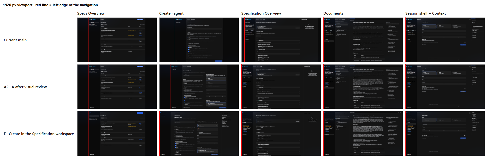

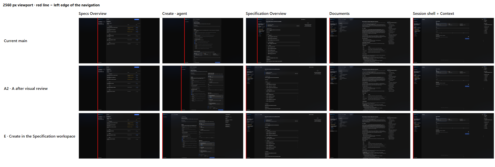

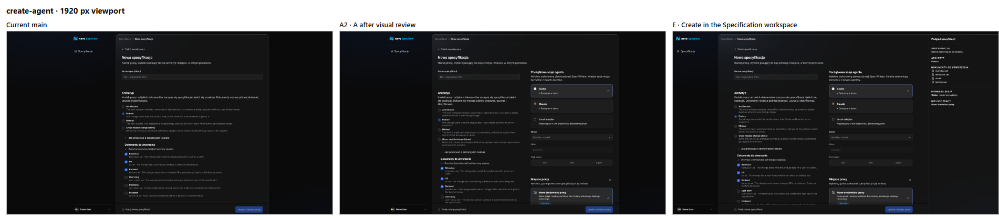

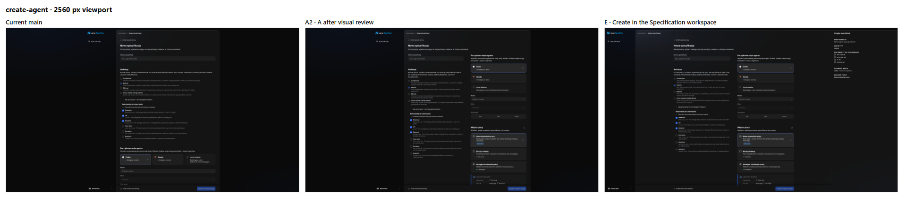

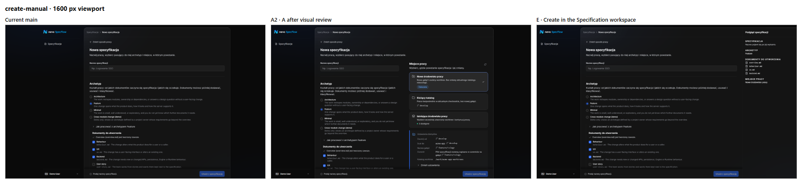

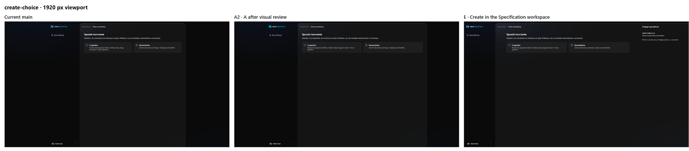

### Failure modes seen at full size

| Variant | Problem                                                                                                                                 | Screenshot                                                                        |
| ------- | --------------------------------------------------------------------------------------------------------------------------------------- | --------------------------------------------------------------------------------- |
| B       | The list stretches: titles start near x≈293 and the status column near x≈2140.                                                          | [B, Specs Overview, 2560](images/shell-geometry/B-overview-2560.png)              |
| B       | A widened container with stretched controls: the name field and model select are about 1070 px wide.                                    | [B, Create, 2560](images/shell-geometry/B-create-agent-2560.png)                  |
| A, B    | Specification Overview keeps a 1100 px column on the left and leaves a dead band of about 630 px.                                       | [A, Specification Overview, 2560](images/shell-geometry/A-spec-overview-2560.png) |
| C       | Tiles squeezed three across a 720 px column; descriptions wrap to five lines.                                                           | [C, Create, 2560](images/shell-geometry/C-create-agent-2560.png)                  |
| D       | The jump moves to the right edge, and a void of about 1190 px makes the screen lopsided.                                                | [D, Specs Overview, 2560](images/shell-geometry/D-overview-2560.png)              |
| E       | The preview repeats values visible beside it; at 1600 the form collapses to one wide column; at 2560 a 570 px panel is about 70% empty. | [E vs A2, Create, 1600](images/shell-geometry/compare-AE-create-manual-1600.png)  |

### First-round recommendation (A2) at full size

| Screen                                    | Screenshot                                                                          |
| ----------------------------------------- | ----------------------------------------------------------------------------------- |
| Create with an agent, 1920                | [A2, Create, 1920](images/shell-geometry/A2-create-agent-1920.png)                  |
| Specification Overview, 2560              | [A2, Specification Overview, 2560](images/shell-geometry/A2-spec-overview-2560.png) |
| Specs Overview snapped left, 1600         | [A2, Specs Overview, 1600](images/shell-geometry/A2-overview-1600.png)              |
| Create, 1280: one column, no jump         | [A2, Create, 1280](images/shell-geometry/A2-create-agent-1280.png)                  |
| Create, 390: unchanged                    | [A2, Create, 390](images/shell-geometry/A2-create-agent-390.png)                    |
| Full Session, 2560: same in every variant | [Session, 2560](images/shell-geometry/shared-session-2560.png)                      |

## 4. Visual review

Every prototype was rendered, captured and inspected, then revised and re-rendered. Two defects
were fixed during that loop:

- In the narrow columns, tiles stayed three across and text broke almost letter by letter.
- The two-column form stayed centred inside the inner content container, leaving side bands.

Independent reviewers who did not build the layouts then judged the screenshots against the
layout and containment rules and the criteria of this review. One reviewer ran two rounds, first
over A, B, C and D, then over A2. A second, fresh reviewer compared A2 and E with `main` without
seeing the earlier conclusions.

| Variant | Reviewer verdict                 | Main reason                                                                                                                                                                           |
| ------- | -------------------------------- | ------------------------------------------------------------------------------------------------------------------------------------------------------------------------------------- |
| main    | Reject                           | Three navigation jumps at 1920 and 2560; a 902 px form centred in a dark viewport.                                                                                                    |
| A       | Accept with fixes                | One jump at the context boundary, but a dead band on Specification Overview, a wider list gap and a 25 px twitch at 1600.                                                             |
| A2      | **Accept with fixes**            | Fixes the dead band, the list gap and the choice cards; keeps 1280 and 390 unchanged.                                                                                                 |
| B       | Reject                           | Perfect continuity paid for with broken content: stretched list columns and controls.                                                                                                 |
| C       | Accept with fixes, weaker than A | Squeezed tiles, and its one jump falls between Overview and Documents, two sibling views users switch between all the time.                                                           |
| D       | Reject                           | Navigation is stable, but the right edge jumps instead and the screen reads as stuck to one side.                                                                                     |
| E       | Reject as specified              | The preview only mirrors the form, the panel on the choice step is filler, and the jump moves to Specs Overview → Create, where the navigator moves while its content stays the same. |

The first draft of this review favoured C. The reviewer's argument about where the jump falls
changed that recommendation. The second reviewer reached A2 independently.

**Why the Create Session principle does not carry over.** The Context panel of Create Session holds
real context that the start form does not show. A Create Specification panel can only mirror the
form, because everything it could show is chosen in that same form. If the owner still prefers the
continuity of E, the reviewer's minimum changes are: no panel on the choice step, no fields already
visible, content edges matching Specification Overview, and two columns kept at 1600. After those
cuts the panel would be almost empty.

**Regression check.** At 390 px every screen is byte-identical to `main` in every variant except
Specification Overview, which differs only in hash with no visible change. At 1280 px every variant
removes the current 55 px jump on Create. A2 keeps a single-column form; E narrows it to about
606 px to fit its panel.

**Interaction check.** The same scripted interactions gave identical results in `main`, A2 and E:

| Interaction                                                        | Result in main, A2 and E                            |
| ------------------------------------------------------------------ | --------------------------------------------------- |
| Open a Task from Specification Overview at 2560                    | Task preview replaces Activity history in Secondary |
| Close the Task preview                                             | Activity history returns                            |
| Drag the Session splitter at 1920                                  | The split moves by the dragged distance             |
| Splitter on Specification Overview                                 | None, as in `main`                                  |
| Mobile: open a Task from Specification Overview, then browser Back | Back leaves the Specification for the Specs list    |

The last row is existing `main` behaviour, not a regression. It differs from the narrow-layout Back
intent of the route model and is recorded in the mobile findings of the audit.

## 5. First-round recommendation: A2 (proposal)

> **Superseded in part.** A follow-up review found A2 incomplete. Section 6 completes it as A3,
> and section 7 lists the current decisions.

A2 makes the existing distinction explicit and consistent instead of incidental:

- **Focused mode** covers Specs Overview and every Create state. It uses one bounded width, the
  existing `content-standard` token, so Specs Overview → Create never moves.
- **Workspace mode** covers Specification Overview and everything inside a Specification:
  Documents, Editor, Session and Full Task. It always fills the width, so moving between sibling
  views of one Specification never moves either.
- **One jump remains, at the context boundary**, when the user enters or leaves a Specification.
  That is also where the navigator gains or loses the Specification section, so the change has a
  visible reason.
- **Extra width in Create** goes to a two-column arrangement of its existing sections: what is
  created beside who works on it and where. The workflow, the sections and their order in the
  single column do not change.
- **Extra width in Specification Overview** is balanced by centring its readable column in the
  pane, the same way Documents centres its reading column.
- **Small leftovers do not centre.** When centring would leave less than 240 px, the shell stays at
  the left edge, which removes small twitches like the one at 1600.

A2 still needs one fix before implementation: at 1280 the Create footer button sits about 10 px to
the right of the form edge.

### What A2 would need in production

- **Nevo UI.** An explicit shell mode or a snap rule in `AppShell`, instead of the per-screen
  measurement the prototype uses. This is a shared capability, not screen CSS.
- **Design System docs.** An amendment to the Bounded workspace rule: Focused screens share one
  token, and Specification Overview moves from `bounded` to a full-width pane with a centred
  column.
- **SpecFlow UI.** Create adopts `content-standard`. Its sections use a container-query
  two-column arrangement. That arrangement applies to the real project form as well as the demo
  form; A2 itself was only prototyped on the demo form, which section 6 corrects.
- **No change** to Documents, Session, the 50/50 split, root tabs, Back behaviour or mobile.
- **Verification.** Before-and-after captures of the whole journey at 1280, 1600, 1920, 2560 and
  390 px, and transition tests, not single-screen stories.

## 6. Completing A2: the real Create and Specification Overview

A follow-up review found that A2 was judged on incomplete evidence. This iteration closes those gaps.
It treats shell geometry, the Create composition and the Specification Overview composition as
three separate decisions.

### What the follow-up review asked for, and what the code shows

| Request                                            | Finding in code and docs                                                                                                                                                                                                        |
| -------------------------------------------------- | ------------------------------------------------------------------------------------------------------------------------------------------------------------------------------------------------------------------------------- |
| Render the real project Create, not only the demo  | The project Create (`CreateProjectForm`) has Name, an optional **Goal**, Archetype with its documents, and the full Git workspace section. It has **no method choice and no agent section**; that exists only in the demo flow. |
| Respect the accepted one-column rule               | The demo contract says the form is "single column on every width" and forbids a summary on the right. A two-column Create changes that rule and must change the contract text, not only CSS.                                    |
| Keep the progress page narrow                      | The project contract gives the progress page "the same content width and alignment as the form (about 880 px, `content-form`, centred)".                                                                                        |
| Do not centre Specification Overview like Markdown | A2 centred an operational page of tasks, sessions and documents, and left a large empty Activity history panel beside it.                                                                                                       |

A2 rendered with the real project form confirms the gap: the single column grows to 1100 px and the
name and goal fields stretch to about 1030 px, the "widened container, same arrangement" pattern.

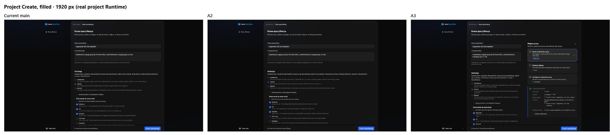

### Variant A3: A2 completed

- **Create, two columns from a 992 px form column.** Left: name, goal, archetype and its documents.
  Right: where the Specification is created. In the demo agent flow the right column holds the
  agent first, then the workspace, the same order as the single column. Below 992 px the form
  stays one column: at 1280 px, at 200% zoom and on mobile.
- **Keyboard order follows reading order.** Tab moves through the whole left column, then the right
  column, then the Create button.
- **Footer aligned with the form.** The Create button ends on the form edge at every width.
- **Progress page.** The outer frame keeps the Create width, so nothing moves on submit; the progress
  content stays at `content-form`, left-aligned with the form.
- **Specification Overview, operational layout.** On panes of at least 1408 px the existing sections
  sit in two columns: summary, attention and tasks on the left; continue session and documents on
  the right. Content starts at the pane edge, aligned with the breadcrumb. Narrower panes keep the
  current single column and its order.

**A3h** is A3 plus one change: on viewports of at least 2200 px Activity history becomes the last
section of the right column instead of a separate Secondary panel. A Task preview still opens in
the Secondary.

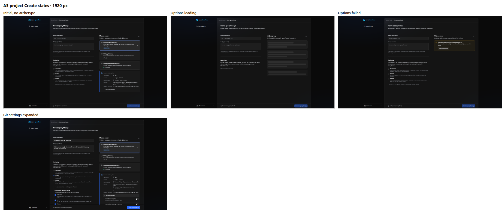

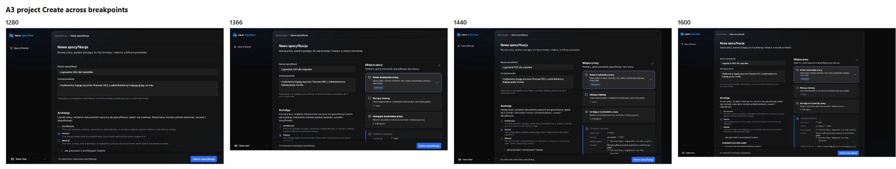

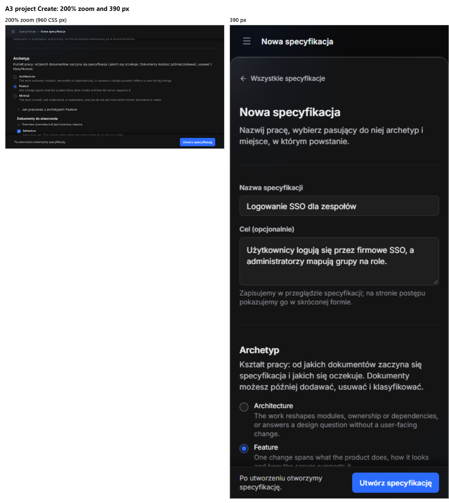

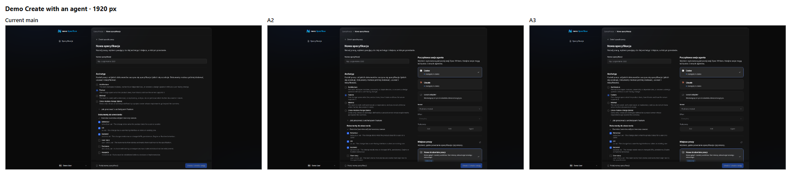

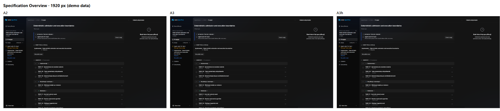

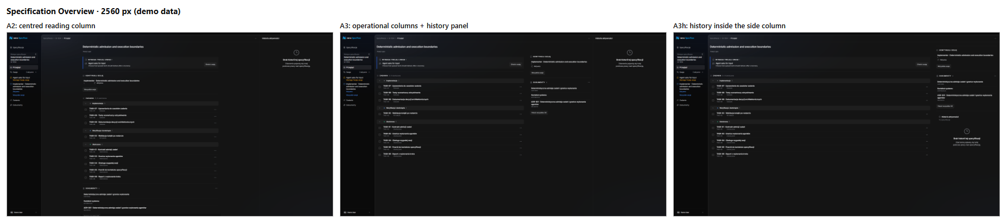

Full size: [A2 project Create, 1920](images/shell-geometry/A2-project-create-1920.png),
[A3 project Create, 1920](images/shell-geometry/A3-project-create-1920.png),
[A3 project Create, whole form, 1920](images/shell-geometry/A3-project-create-full-1920.png),
[A3 Specification Overview, 2560](images/shell-geometry/A3-spec-overview-2560.png),
[A3h Specification Overview, 2560](images/shell-geometry/A3h-spec-overview-2560.png).

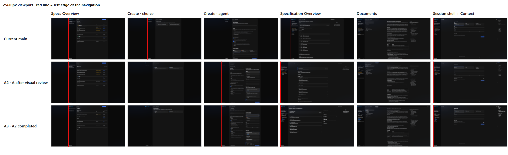

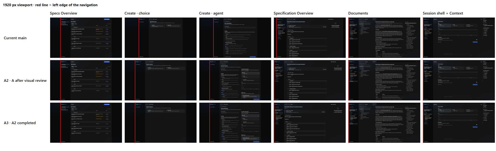

### Verification in this iteration

| Check                  | Result                                                                                                                                                                                                                                         |
| ---------------------- | ---------------------------------------------------------------------------------------------------------------------------------------------------------------------------------------------------------------------------------------------- |
| Real project Runtime   | `nevo-specflow start` on a scratch Git project with installed definitions; three Specifications created through the form, each with a new worktree                                                                                             |
| Viewports              | 1280, 1366, 1440, 1600, 1920, 2560, 390 and 200% zoom                                                                                                                                                                                          |
| Create states          | Initial without archetype, filled, whole form, Git settings expanded, options loading, options failed; progress in progress, succeeded and refused (protected branch, invalid path)                                                            |
| Git states in the form | With `main` protected, the current-folder tile is disabled and says why; a custom branch on a protected pattern is a field error, Create is disabled and the footer names the reason; the archetype guide expanded beside a long document list |
| Field error and focus  | Enter in the name field does not submit and focus stays on the name, in `main` and A3 alike. In A3 the faulty branch is visible on the same screen in the right column; in `main` it is below the fold and only the footer explains it         |
| Frame continuity       | Specs Overview and Create share the same frame at every width; the navigation does not move between them                                                                                                                                       |
| Mobile                 | Every demo screen at 390 px is byte-identical to `main` except Specification Overview in A3h, which differs only in hash                                                                                                                       |
| Interactions           | Task preview, closing it, Session splitter and mobile Back behave as in `main` in A3 and A3h                                                                                                                                                   |
| Type check and lint    | Clean for the prototype                                                                                                                                                                                                                        |

**Limits.**

- The project Runtime does not serve the Specification Overview projection yet, so a newly created
  Specification shows "unavailable" after Create. Specification Overview was judged on demo data.
- A server-side name error could not be produced: the server accepts any title and generates a
  branch name. A client-side field error was checked instead, with a protected branch name.
- Refused and succeeded progress states come from Storybook, which has no snap rule, so at 1600 px
  its navigation is centred while the app snaps it to the left edge.

### Progress page and the whole form

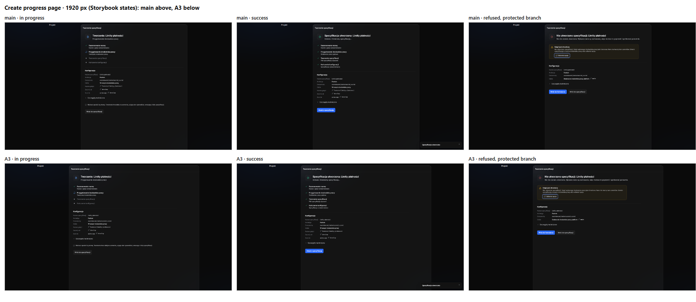

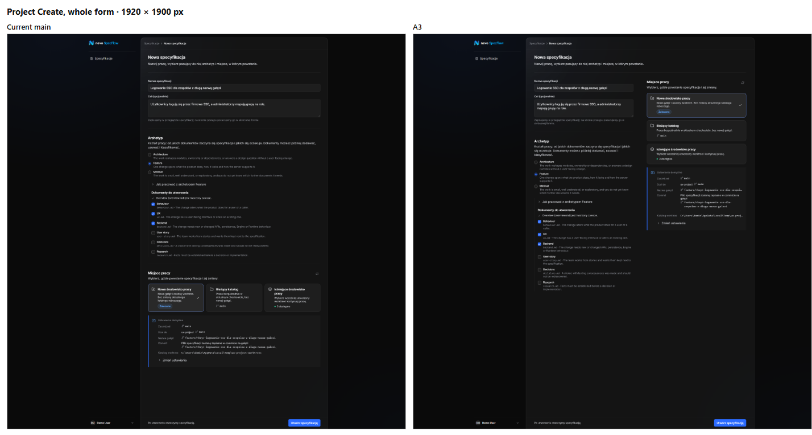

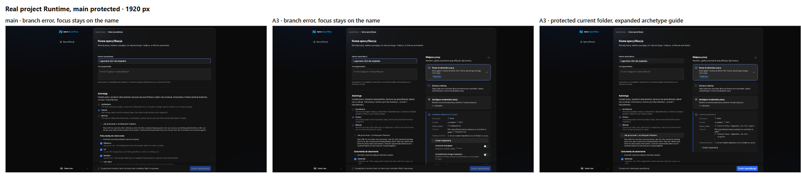

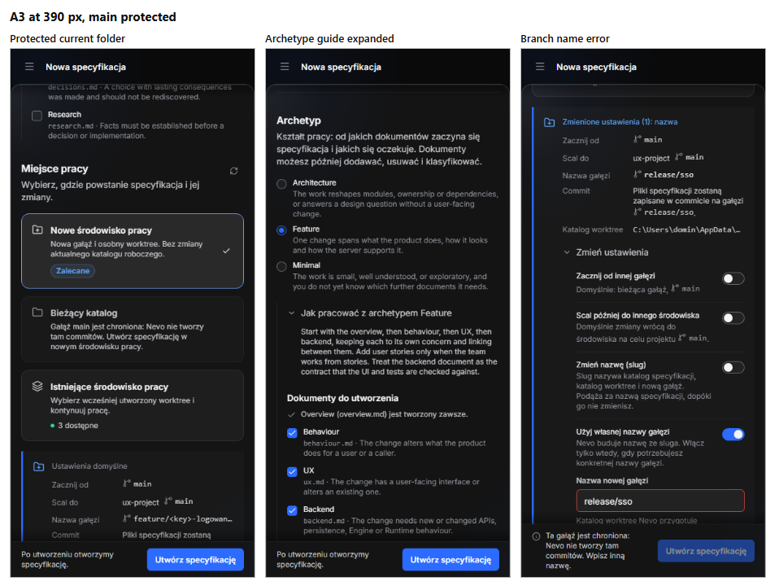

### Independent review of this iteration

A fresh reviewer, who had not built the layouts, judged A3 and A3h against the accepted contracts
and the layout rules. The reviewer's findings were fixed in A3 and re-rendered:

| Reviewer finding                                                                                                      | Fix in A3                                                                                                              |
| --------------------------------------------------------------------------------------------------------------------- | ---------------------------------------------------------------------------------------------------------------------- |
| The method-choice step and the progress page used a frame 10 px narrower, so at 1600 px the choice step jumped 120 px | Every Create state uses the same 1102 px frame; the navigation stays put from Specs Overview through the progress page |
| Branch and path values wrapped mid-word in the narrower right column                                                  | Value-only rows (branch name, worktree folder) stay on one line and truncate, with the full path in a tooltip          |
| The progress divider ran past the 880 px column                                                                       | The whole progress content, dividers included, stays at `content-form`                                                 |
| The Specification Overview side column started with a stray rule above the attention block                            | The summary spans both columns; the side column starts level with the attention block                                  |

| Variant | Verdict                                    | Reason                                                                                                                                                                                              |
| ------- | ------------------------------------------ | --------------------------------------------------------------------------------------------------------------------------------------------------------------------------------------------------- |
| A3      | **Accept with fixes**, fixes applied above | Two-column Create fits the whole real form on one screen at 2560 px, states and Tab order are sound, no regression at 1280 or 390                                                                   |
| A3h     | **Reject as shown**                        | Task rows stretch to about 1730 px, the action menu sits about 1350 px from its title, and the history location depends on the viewport. It trades a dead Secondary for dead space inside the rows. |

**Still open after the fixes:**

- **The Git commit row repeats the branch name inside a sentence.** It still wraps long branch names
  mid-word, and `main` does the same with long names. This is a copy decision rather than a layout
  one: the row could refer to the branch shown above it.
- **The recent Session moves out of the main reading column on wide Specification Overview panes.**
  The workspace spec warns against deriving hierarchy from unused space, so the owner decides
  whether that move is acceptable.
- **The empty Activity history Secondary remains.** It is audit finding 1.2 and a separate decision.
- **A blocked Create does not move focus to the faulty field.** The footer names the reason, but the
  user has to find the field. This is existing behaviour in `main`; moving focus to the first
  invalid field would help in every layout.
- **The Git defaults block reads as chaotic.** It looks like an alert, has four left edges, mixes
  four value styles, repeats the branch name and `main`, restates every default again under
  **Change settings**, and the contract's three-row rule has grown to five rows. Directions: back to
  the three decision rows, a plain list aligned with the section, editing per row instead of a
  panel of switches, one disclosure style, and label above value on mobile.

### Contract changes A3 would require

These are proposals. Nothing below has been applied to the accepted documents.

| Document                                                                             | Current text                                                                                                                                       | Proposed change                                                                                                                                                                                             |
| ------------------------------------------------------------------------------------ | -------------------------------------------------------------------------------------------------------------------------------------------------- | ----------------------------------------------------------------------------------------------------------------------------------------------------------------------------------------------------------- |
| `docs/ideas/specflow-ui/screens/specification-creation-ui-spec.md` (demo Create)     | "The form is Name, Workflow, first Session (AI only), Branch and worktree, single column on every width."                                          | One column below a 992 px form column; above it two columns, what is created on the left and who starts it and where on the right, in the same order. The ban on a Secondary or summary on the right stays. |
| `docs/product/specflow/specification-creation.md` (project Create and progress page) | The progress page "has the same content width and alignment as the form (one focused column of about 880 px, the `content-form` width, centred …)" | The progress page shares the Create frame, so nothing moves on submit, and keeps its content at `content-form`, left-aligned with the form.                                                                 |
| `docs/design-system/principles/layout-and-containment.md` (Bounded workspace rule)   | Each bounded page uses its own width token on `AppContent`.                                                                                        | Focused screens share one frame token; Specification Overview leaves the bounded mode.                                                                                                                      |

Activity history placement is not fixed by an accepted product document; only the implementation
puts it in the Secondary. Adopting A3h is therefore a product decision rather than a contract
change.

## 7. Owner decisions (2026-11-07)

The owner accepted A3 conditionally as the basis for production work. The table records each
decision; "conditional" items need the evidence named in the condition before they become a
contract.

| #   | Topic                                  | Decision                                                                                                                             | Condition or instruction                                                                                                                                                                                 |
| --- | -------------------------------------- | ------------------------------------------------------------------------------------------------------------------------------------ | -------------------------------------------------------------------------------------------------------------------------------------------------------------------------------------------------------- |
| 1   | Direction                              | **Accepted.** A3, as three independent decisions and implementation scopes: App Shell, Create, Specification Overview. A3h rejected. | —                                                                                                                                                                                                        |
| 2   | One jump at the Specification boundary | **Conditional.** A justified context boundary, but 595 px at 2560 px is still significant.                                           | No extra 2200 px breakpoint to shrink the jump. Evaluate the real transition between screens, not only static screenshots.                                                                               |
| 3   | Snap threshold of 240 px               | **Not yet.** The idea of a stable Focused geometry is accepted, the threshold is not.                                                | Check transitions and width behaviour from 1500 to 1800 px. Consider using the available frame width while keeping control widths limited; do not stretch the form.                                      |
| 4   | Two-column Create                      | **Accepted.** From a 992 px form column, one column below.                                                                           | The layout follows the container width, not the viewport. Keep the keyboard order and no preview panel.                                                                                                  |
| 5   | Progress page                          | **Accepted.** Same Create frame, content limited to `content-form`, no layout jump on submit.                                        | —                                                                                                                                                                                                        |
| 6   | Specification Overview                 | **Accepted** for two columns, **conditional** for hierarchy. 1408 px is the starting threshold.                                      | The recent Session may sit on the right but must stay an easy-to-see entry for continuing work; its priority must not come from leftover space. Check its position against Requires attention and Tasks. |
| 7   | Activity history                       | **Stays in the Secondary.** A3h rejected.                                                                                            | The empty panel needs its own solution; it must not permanently reserve a large area for an empty message.                                                                                               |
| 8   | Git commit row                         | **Accepted.** Do not repeat the full branch name; refer to the branch shown above, with clear context.                               | —                                                                                                                                                                                                        |
| 9   | Design System rule                     | **Accepted.** Amend the Bounded workspace rule together with the production implementation.                                          | No divergence between docs and code.                                                                                                                                                                     |
| 10  | Create stays Focused                   | **Accepted.** No Create Session approach for Create Specification; variant E stays rejected.                                         | —                                                                                                                                                                                                        |

**Additional corrections requested.**

- **Git settings.** Recompose the block around the three real user decisions, without adding
  containers, separators or switches, and without changing Git semantics.
- **Form validation.** The user must be able to reach the faulty field easily when Create is
  blocked; propose an accessible, deterministic behaviour that leads to the first error without
  starting a forbidden operation.
- **Process.** Do not implement unapproved snap variants or further Overview changes as final
  contracts. Close the geometry comparisons and the Overview hierarchy first, then prepare the
  production scope of A3 with its documentation changes. Keep visual evidence, accepted decisions
  and production implementation separate; the prototype branch is not mergeable.

### What A3 would need in production

- **Nevo UI.** A Focused frame capability and a snap rule in `AppShell`, instead of the prototype's
  pixel classes and per-screen measurement.
- **SpecFlow UI.** Both Create forms use a container-query two-column arrangement; value-only Git
  rows truncate with a tooltip; the progress page keeps `content-form` inside the frame;
  Specification Overview composes its existing sections in two columns on wide panes.
- **Docs.** The contract amendments listed above, applied together with the code.
- **No change** to Documents, Session, the 50/50 split, root tabs, Back behaviour or mobile.
- **Verification.** The same journey captures at 1280, 1366, 1440, 1600, 1920, 2560, 390 px and 200%
  zoom, plus transition and keyboard checks, on both the demo and a real project Runtime.

## 8. Reproduce

1. Check out `proto/app-shell-geometry`.
2. Run the demo Runtime as described in the audit's
   [verification guide](README.md#reproduce-the-environment), and the UI with Vite on port 5173.
3. Set `localStorage['proto.layout']` to `A`, `A2`, `A3`, `A3h`, `B`, `C`, `D` or `E`, then reload. Without the key
   the app behaves exactly like `main`.

**Limits of the evidence.**

- Prototype widths are pixel classes.
- A2 rearranged only the demo Create form; A3 was rendered and used on the real project Create
  form as well (section 6).
- Full Session screenshots come from Storybook, where the navigation is a stub. Session is the same
  in every variant.
