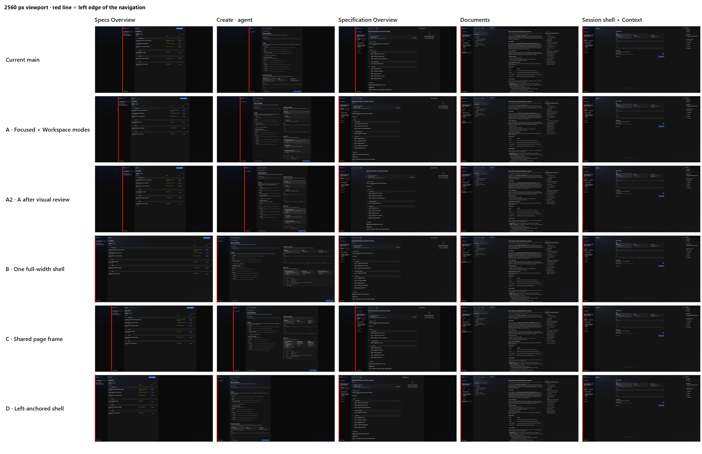
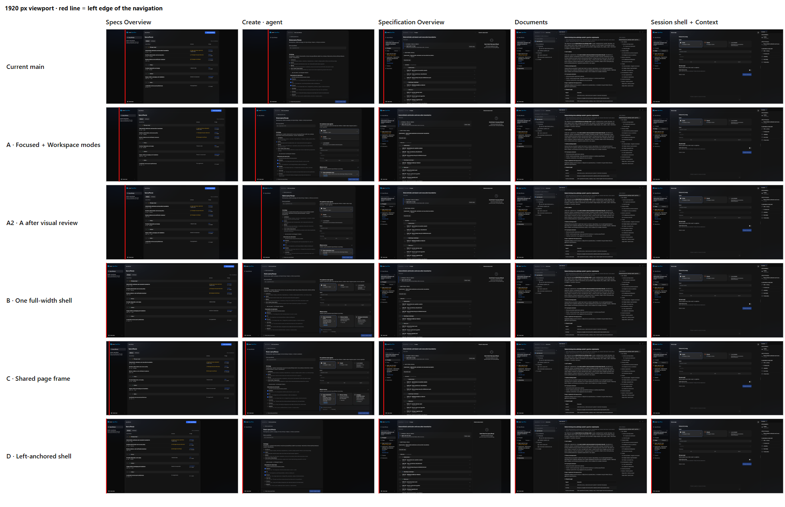
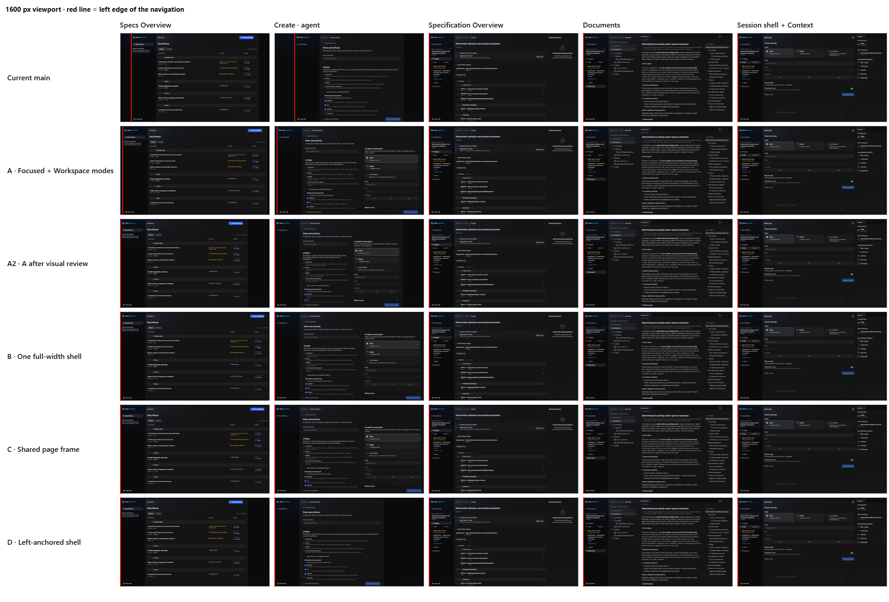
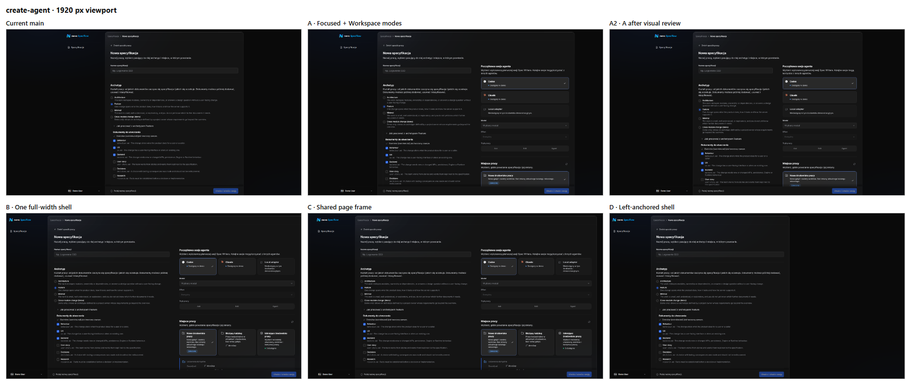
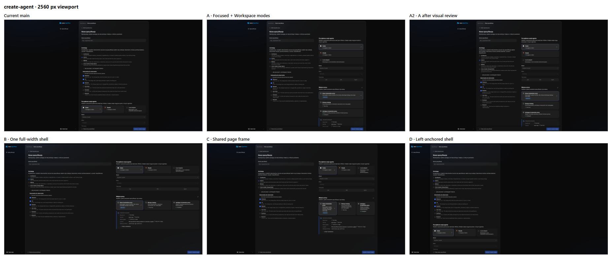
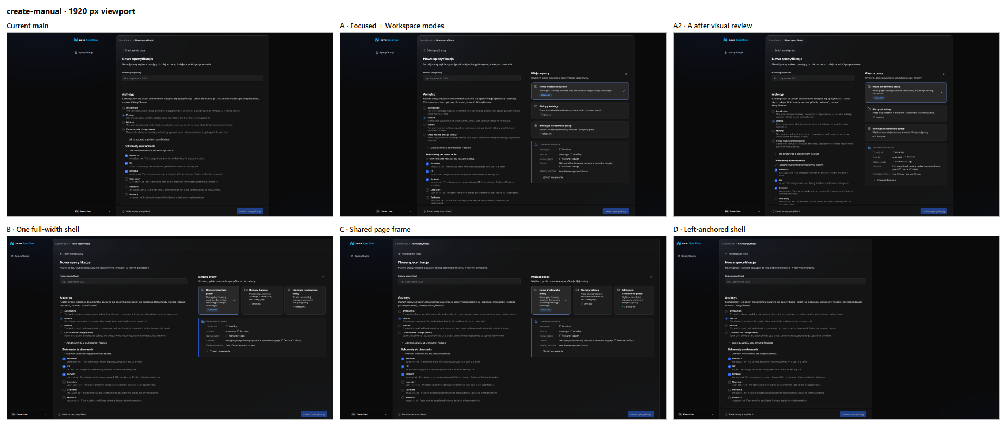
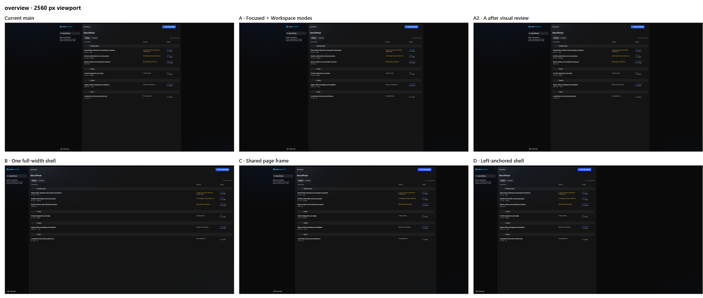
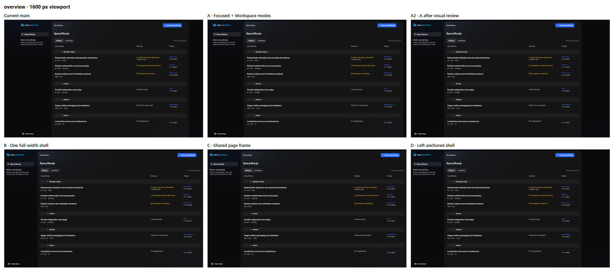
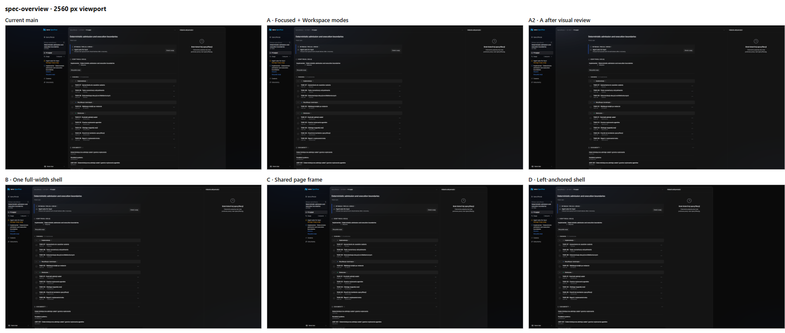

# App Shell geometry and space use, rendered layout proposals

> **Status: proposals, not approved designs.** Every layout below is a prototype. Nothing here
> changes production behaviour until the owner chooses a direction.

This is a follow-up to finding 1.1 of the [UX audit](README.md#11-the-shell-changes-geometry-between-screens).
The original finding and its screenshots stay in the audit.

## 1. The problem, measured

The current shell centres the navigation together with the workspace. Each screen chooses its own
bounded width, so the navigation moves along one user journey. Positions are the left edge of the
navigation in px along **Specs Overview → Create → Specification Overview → Documents → Session**.

| Viewport | Current main            | Jumps |
| -------- | ----------------------- | ----- |
| 1280     | 0 · 55 · 0 · 0 · 0      | 2     |
| 1600     | 115 · 215 · 0 · 0 · 0   | 2     |
| 1920     | 275 · 375 · 69 · 0 · 0  | 3     |
| 2560     | 595 · 695 · 359 · 0 · 0 | 3     |

Mobile is not affected: it always uses the full width with a navigation drawer.

### What the investigation found in code

- The centring is deliberate. The accepted
  [Bounded workspace rule](../../../design-system/principles/layout-and-containment.md#bounded-workspace-rule)
  centres a Primary-only page whose readable unit has a fixed width. Specs Overview, Create and
  Specification Overview use `AppWorkspace fit="bounded"`.
- The widths differ by accident of each screen: Specs Overview uses `content-standard`, Create uses
  `content-form`, and Specification Overview is `content-standard` plus its Activity history
  Secondary.
- `AppWorkspace` documents `fit="available"` as the mode for editors and **creation flows**, but
  Create Specification uses `bounded`.
- Documents and Full Session already fill the width; nothing in this review changes them.

## 2. Variants that were prototyped

All variants were built on `main` in an isolated worktree, using only existing Nevo UI components
and tokens, and switched at runtime. Branch: `proto/app-shell-geometry` (not for merge).

| Variant                          | What changes                                                                                                                                                                                                    | How extra width is used                                                                                    |
| -------------------------------- | --------------------------------------------------------------------------------------------------------------------------------------------------------------------------------------------------------------- | ---------------------------------------------------------------------------------------------------------- |
| **A** Focused + Workspace modes  | Specs Overview and Create share one bounded width of 1280 px. Specification Overview, Documents and Session fill the width.                                                                                     | Create's existing sections go into two columns: name, archetype and documents beside agent and workspace.  |
| **A2** A after the visual review | Shared Focused width is the existing `content-standard`. Specification Overview fills the width with its column centred in the pane. A centred shell snaps to the left edge when less than 240 px would remain. | Same two-column Create. Specification Overview keeps a readable column, balanced against Activity history. |
| **B** One full-width shell       | Every screen fills the width; the navigation never moves.                                                                                                                                                       | The list stretches; Create uses two columns across the full width.                                         |
| **C** Shared page frame          | Specs Overview, Create and Specification Overview share the Specification Overview's bounded width of about 1575 px. Documents and Session fill the width.                                                      | Two-column Create inside the larger frame.                                                                 |
| **D** Left-anchored shell        | Current widths, but the shell is anchored to the left edge instead of centred.                                                                                                                                  | None; the leftover width becomes background on the right.                                                  |

No variant adds panels, content or features. Only existing elements were rearranged.

## 3. Rendered evidence

Each journey strip shows one viewport. Rows are variants, columns are the consecutive screens, and
the red line marks the left edge of the navigation.

### Navigation left edge along the journey (px)

| Variant | 1600                  | 1920                   | 2560                    |
| ------- | --------------------- | ---------------------- | ----------------------- |
| main    | 115 · 215 · 0 · 0 · 0 | 275 · 375 · 69 · 0 · 0 | 595 · 695 · 359 · 0 · 0 |
| A       | 25 · 25 · 0 · 0 · 0   | 185 · 185 · 0 · 0 · 0  | 505 · 505 · 0 · 0 · 0   |
| A2      | 0 · 0 · 0 · 0 · 0     | 275 · 275 · 0 · 0 · 0  | 595 · 595 · 0 · 0 · 0   |
| B       | always 0              | always 0               | always 0                |
| C       | 0 · 0 · 0 · 0 · 0     | 39 · 39 · 69 · 0 · 0   | 359 · 359 · 359 · 0 · 0 |
| D       | always 0              | always 0               | always 0                |

### Create Specification with an agent

### Specs Overview and Specification Overview

### Failure modes seen at full size

| Variant | Problem                                                                                              | Screenshot                                                                        |
| ------- | ---------------------------------------------------------------------------------------------------- | --------------------------------------------------------------------------------- |
| B       | The list stretches: titles start near x≈293 and the status column near x≈2140.                       | [B, Specs Overview, 2560](images/shell-geometry/B-overview-2560.png)              |
| B       | A widened container with stretched controls: the name field and model select are about 1070 px wide. | [B, Create, 2560](images/shell-geometry/B-create-agent-2560.png)                  |
| A, B    | Specification Overview keeps a 1100 px column on the left and leaves a dead band of about 630 px.    | [A, Specification Overview, 2560](images/shell-geometry/A-spec-overview-2560.png) |
| C       | Tiles squeezed three across a 720 px column; descriptions wrap to five lines.                        | [C, Create, 2560](images/shell-geometry/C-create-agent-2560.png)                  |
| D       | The jump moves to the right edge, and a void of about 1190 px makes the screen lopsided.             | [D, Specs Overview, 2560](images/shell-geometry/D-overview-2560.png)              |

### Recommended variant at full size

| Screen                                    | Screenshot                                                                          |
| ----------------------------------------- | ----------------------------------------------------------------------------------- |
| Create with an agent, 1920                | [A2, Create, 1920](images/shell-geometry/A2-create-agent-1920.png)                  |
| Specification Overview, 2560              | [A2, Specification Overview, 2560](images/shell-geometry/A2-spec-overview-2560.png) |
| Specs Overview snapped left, 1600         | [A2, Specs Overview, 1600](images/shell-geometry/A2-overview-1600.png)              |
| Create, 1280: one column, no jump         | [A2, Create, 1280](images/shell-geometry/A2-create-agent-1280.png)                  |
| Create, 390: unchanged                    | [A2, Create, 390](images/shell-geometry/A2-create-agent-390.png)                    |
| Full Session, 2560: same in every variant | [Session, 2560](images/shell-geometry/shared-session-2560.png)                      |

## 4. Visual review

Every prototype was rendered, captured and inspected, then revised and re-rendered. Two defects
were fixed during that loop:

- In the narrow columns, tiles stayed three across and text broke almost letter by letter.
- The two-column form stayed centred inside the inner content container, leaving side bands.

An independent reviewer who did not build the layouts then judged the screenshots against the
layout and containment rules and the criteria of this review. The reviewer ran two rounds.

| Variant | Reviewer verdict                 | Main reason                                                                                                                 |
| ------- | -------------------------------- | --------------------------------------------------------------------------------------------------------------------------- |
| main    | Reject                           | Three navigation jumps at 1920 and 2560; a 902 px form centred in a dark viewport.                                          |
| A       | Accept with fixes                | One jump at the context boundary, but a dead band on Specification Overview, a wider list gap and a 25 px twitch at 1600.   |
| A2      | **Accept with fixes**            | Fixes the dead band, the list gap and the choice cards; keeps 1280 and 390 unchanged.                                       |
| B       | Reject                           | Perfect continuity paid for with broken content: stretched list columns and controls.                                       |
| C       | Accept with fixes, weaker than A | Squeezed tiles, and its one jump falls between Overview and Documents, two sibling views users switch between all the time. |
| D       | Reject                           | Navigation is stable, but the right edge jumps instead and the screen reads as stuck to one side.                           |

The first draft of this review favoured C. The reviewer's argument about where the jump falls
changed that recommendation.

**Regression check.** At 390 px every screen is byte-identical to `main` in every variant except
Specification Overview, which differs only in hash with no visible change. At 1280 px every variant
removes the current 55 px jump on Create and keeps a single-column form.

## 5. Recommendation: A2 (proposal)

A2 makes the existing distinction explicit and consistent instead of incidental:

- **Focused mode** covers Specs Overview and every Create state. It uses one bounded width, the
  existing `content-standard` token, so Specs Overview → Create never moves.
- **Workspace mode** covers Specification Overview and everything inside a Specification:
  Documents, Editor, Session and Full Task. It always fills the width, so moving between sibling
  views of one Specification never moves either.
- **One jump remains, at the context boundary**, when the user enters or leaves a Specification.
  That is also where the navigator gains or loses the Specification section, so the change has a
  visible reason.
- **Extra width in Create** goes to a two-column arrangement of its existing sections: what is
  created beside who works on it and where. The workflow, the sections and their order in the
  single column do not change.
- **Extra width in Specification Overview** is balanced by centring its readable column in the
  pane, the same way Documents centres its reading column.
- **Small leftovers do not centre.** When centring would leave less than 240 px, the shell stays at
  the left edge, which removes small twitches like the one at 1600.

### What A2 would need in production

- **Nevo UI.** An explicit shell mode or a snap rule in `AppShell`, instead of the per-screen
  measurement the prototype uses. This is a shared capability, not screen CSS.
- **Design System docs.** An amendment to the Bounded workspace rule: Focused screens share one
  token, and Specification Overview moves from `bounded` to a full-width pane with a centred
  column.
- **SpecFlow UI.** Create adopts `content-standard`. Its sections use a container-query
  two-column arrangement. That arrangement applies to the real project form as well as the demo
  form; only the demo form was prototyped.
- **No change** to Documents, Session, the 50/50 split, root tabs, Back behaviour or mobile.
- **Verification.** Before-and-after captures of the whole journey at 1280, 1600, 1920, 2560 and
  390 px, and transition tests, not single-screen stories.

## 6. Decisions for the owner

1. **Direction.** Choose A2, or another variant.
2. **The remaining jump.** Accept one navigation jump at the Specification boundary. It is 275 px at
   1920 and 595 px at 2560, larger than in A because the Focused width shrank from 1280 to 1100.
   The alternative is a 1280 px Focused width used only on screens of 2200 px and wider.
3. **Snap threshold.** Accept the 240 px threshold and the empty strip of about 230 px it leaves on
   the right of Focused screens at 1600.
4. **Breadcrumb alignment.** On centred Workspace pages the breadcrumb stays at the pane edge while
   the title starts about 310 px further right at 2560. Documents already behaves this way. Align
   both or accept it.
5. **Create arrangement.** Approve the two-column grouping of the existing Create sections; the
   creation workflow itself does not change.
6. **Design System rule.** Approve amending the Bounded workspace rule as described above.

## 7. Reproduce

1. Check out `proto/app-shell-geometry`.
2. Run the demo Runtime as described in the audit's
   [verification guide](README.md#reproduce-the-environment), and the UI with Vite on port 5173.
3. Set `localStorage['proto.layout']` to `A`, `A2`, `B`, `C` or `D`, then reload. Without the key
   the app behaves exactly like `main`.

**Limits of the evidence.**

- Prototype widths are pixel classes.
- Only the demo Create form was rearranged.
- Full Session screenshots come from Storybook, where the navigation is a stub. Session is the same
  in every variant.
