# App Shell geometry and space use, rendered layout proposals

> **Status.** The owner accepted A3 conditionally on 2026-11-07 (section 7). The width rule for
> the Focused frame, the Spec Overview hierarchy, the Git rows and the blocked-Create guide are
> still proposals (section 8). Every layout here is a prototype on `proto/app-shell-geometry`,
> which is not meant to be merged. Section 9 proposes the production scope.

This is a follow-up to finding 1.1 of the [UX audit](README.md#11-the-shell-changes-geometry-between-screens).
The original finding and its screenshots stay in the audit.

## 1. The problem, measured

The current shell centres the navigation together with the workspace. Each screen chooses its own
bounded width, so the navigation moves along one user journey. Positions are the left edge of the
navigation in px along **Specs Overview → Create → Specification Overview → Documents → Session**.

| Viewport | Current main            | Jumps |
| -------- | ----------------------- | ----- |
| 1280     | 0 · 55 · 0 · 0 · 0      | 2     |
| 1600     | 115 · 215 · 0 · 0 · 0   | 2     |
| 1920     | 275 · 375 · 69 · 0 · 0  | 3     |
| 2560     | 595 · 695 · 359 · 0 · 0 | 3     |

Mobile is not affected: it always uses the full width with a navigation drawer.

### What the investigation found in code

- The centring is deliberate. The accepted
  [Bounded workspace rule](../../../design-system/principles/layout-and-containment.md#bounded-workspace-rule)
  centres a Primary-only page whose readable unit has a fixed width. Specs Overview, Create and
  Specification Overview use `AppWorkspace fit="bounded"`.
- The widths differ by accident of each screen: Specs Overview uses `content-standard`, Create uses
  `content-form`, and Specification Overview is `content-standard` plus its Activity history
  Secondary.
- `AppWorkspace` documents `fit="available"` as the mode for editors and **creation flows**, but
  Create Specification uses `bounded`.
- Documents and Full Session already fill the width; nothing in this review changes them.

## 2. Variants that were prototyped

All variants were built on `main` in an isolated worktree, using only existing Nevo UI components
and tokens, and switched at runtime. Branch: `proto/app-shell-geometry` (not for merge).

| Variant                                     | What changes                                                                                                                                                                                                                                  | How extra width is used                                                                                                               |
| ------------------------------------------- | --------------------------------------------------------------------------------------------------------------------------------------------------------------------------------------------------------------------------------------------- | ------------------------------------------------------------------------------------------------------------------------------------- |
| **A** Focused + Workspace modes             | Specs Overview and Create share one bounded width of 1280 px. Specification Overview, Documents and Session fill the width.                                                                                                                   | Create's existing sections go into two columns: name, archetype and documents beside agent and workspace.                             |
| **A2** A after the visual review            | Shared Focused width is the existing `content-standard`. Specification Overview fills the width with its column centred in the pane. A centred shell snaps to the left edge when less than 240 px would remain.                               | Same two-column Create. Specification Overview keeps a readable column, balanced against Activity history.                            |
| **B** One full-width shell                  | Every screen fills the width; the navigation never moves.                                                                                                                                                                                     | The list stretches; Create uses two columns across the full width.                                                                    |
| **C** Shared page frame                     | Specs Overview, Create and Specification Overview share the Specification Overview's bounded width of about 1575 px. Documents and Session fill the width.                                                                                    | Two-column Create inside the larger frame.                                                                                            |
| **D** Left-anchored shell                   | Current widths, but the shell is anchored to the left edge instead of centred.                                                                                                                                                                | None; the leftover width becomes background on the right.                                                                             |
| **E** Create in the Specification workspace | A2, except Create uses the Specification workspace geometry, following the Create Session principle: the form sits in the same centred column the Specification Overview uses after creation, and a side panel previews what will be created. | The side panel shows name, archetype, document filenames, first-session agent and workspace place, all values the form already holds. |

No variant adds panels, content or features. Only existing elements were rearranged.

## 3. Rendered evidence

Each journey strip shows one viewport. Rows are variants, columns are the consecutive screens, and
the red line marks the left edge of the navigation.

### Navigation left edge along the journey (px)

| Variant | 1600                  | 1920                   | 2560                    |
| ------- | --------------------- | ---------------------- | ----------------------- |
| main    | 115 · 215 · 0 · 0 · 0 | 275 · 375 · 69 · 0 · 0 | 595 · 695 · 359 · 0 · 0 |
| A       | 25 · 25 · 0 · 0 · 0   | 185 · 185 · 0 · 0 · 0  | 505 · 505 · 0 · 0 · 0   |
| A2      | 0 · 0 · 0 · 0 · 0     | 275 · 275 · 0 · 0 · 0  | 595 · 595 · 0 · 0 · 0   |
| B       | always 0              | always 0               | always 0                |
| C       | 0 · 0 · 0 · 0 · 0     | 39 · 39 · 69 · 0 · 0   | 359 · 359 · 359 · 0 · 0 |
| D       | always 0              | always 0               | always 0                |
| E       | 0 · 0 · 0 · 0 · 0     | 275 · 0 · 0 · 0 · 0    | 595 · 0 · 0 · 0 · 0     |

### Create Specification with an agent

### Specs Overview and Specification Overview

### Create in the Specification workspace (variant E)

Variant E tests the Create Session principle without moving Create into the Session shell. The
journey strips compare it with `main` and A2.

### Failure modes seen at full size

| Variant | Problem                                                                                                                                 | Screenshot                                                                        |
| ------- | --------------------------------------------------------------------------------------------------------------------------------------- | --------------------------------------------------------------------------------- |
| B       | The list stretches: titles start near x≈293 and the status column near x≈2140.                                                          | [B, Specs Overview, 2560](images/shell-geometry/B-overview-2560.png)              |
| B       | A widened container with stretched controls: the name field and model select are about 1070 px wide.                                    | [B, Create, 2560](images/shell-geometry/B-create-agent-2560.png)                  |
| A, B    | Specification Overview keeps a 1100 px column on the left and leaves a dead band of about 630 px.                                       | [A, Specification Overview, 2560](images/shell-geometry/A-spec-overview-2560.png) |
| C       | Tiles squeezed three across a 720 px column; descriptions wrap to five lines.                                                           | [C, Create, 2560](images/shell-geometry/C-create-agent-2560.png)                  |
| D       | The jump moves to the right edge, and a void of about 1190 px makes the screen lopsided.                                                | [D, Specs Overview, 2560](images/shell-geometry/D-overview-2560.png)              |
| E       | The preview repeats values visible beside it; at 1600 the form collapses to one wide column; at 2560 a 570 px panel is about 70% empty. | [E vs A2, Create, 1600](images/shell-geometry/compare-AE-create-manual-1600.png)  |

### First-round recommendation (A2) at full size

| Screen                                    | Screenshot                                                                          |
| ----------------------------------------- | ----------------------------------------------------------------------------------- |
| Create with an agent, 1920                | [A2, Create, 1920](images/shell-geometry/A2-create-agent-1920.png)                  |
| Specification Overview, 2560              | [A2, Specification Overview, 2560](images/shell-geometry/A2-spec-overview-2560.png) |
| Specs Overview snapped left, 1600         | [A2, Specs Overview, 1600](images/shell-geometry/A2-overview-1600.png)              |
| Create, 1280: one column, no jump         | [A2, Create, 1280](images/shell-geometry/A2-create-agent-1280.png)                  |
| Create, 390: unchanged                    | [A2, Create, 390](images/shell-geometry/A2-create-agent-390.png)                    |
| Full Session, 2560: same in every variant | [Session, 2560](images/shell-geometry/shared-session-2560.png)                      |

## 4. Visual review

Every prototype was rendered, captured and inspected, then revised and re-rendered. Two defects
were fixed during that loop:

- In the narrow columns, tiles stayed three across and text broke almost letter by letter.
- The two-column form stayed centred inside the inner content container, leaving side bands.

Independent reviewers who did not build the layouts then judged the screenshots against the
layout and containment rules and the criteria of this review. One reviewer ran two rounds, first
over A, B, C and D, then over A2. A second, fresh reviewer compared A2 and E with `main` without
seeing the earlier conclusions.

| Variant | Reviewer verdict                 | Main reason                                                                                                                                                                           |
| ------- | -------------------------------- | ------------------------------------------------------------------------------------------------------------------------------------------------------------------------------------- |
| main    | Reject                           | Three navigation jumps at 1920 and 2560; a 902 px form centred in a dark viewport.                                                                                                    |
| A       | Accept with fixes                | One jump at the context boundary, but a dead band on Specification Overview, a wider list gap and a 25 px twitch at 1600.                                                             |
| A2      | **Accept with fixes**            | Fixes the dead band, the list gap and the choice cards; keeps 1280 and 390 unchanged.                                                                                                 |
| B       | Reject                           | Perfect continuity paid for with broken content: stretched list columns and controls.                                                                                                 |
| C       | Accept with fixes, weaker than A | Squeezed tiles, and its one jump falls between Overview and Documents, two sibling views users switch between all the time.                                                           |
| D       | Reject                           | Navigation is stable, but the right edge jumps instead and the screen reads as stuck to one side.                                                                                     |
| E       | Reject as specified              | The preview only mirrors the form, the panel on the choice step is filler, and the jump moves to Specs Overview → Create, where the navigator moves while its content stays the same. |

The first draft of this review favoured C. The reviewer's argument about where the jump falls
changed that recommendation. The second reviewer reached A2 independently.

**Why the Create Session principle does not carry over.** The Context panel of Create Session holds
real context that the start form does not show. A Create Specification panel can only mirror the
form, because everything it could show is chosen in that same form. If the owner still prefers the
continuity of E, the reviewer's minimum changes are: no panel on the choice step, no fields already
visible, content edges matching Specification Overview, and two columns kept at 1600. After those
cuts the panel would be almost empty.

**Regression check.** At 390 px every screen is byte-identical to `main` in every variant except
Specification Overview, which differs only in hash with no visible change. At 1280 px every variant
removes the current 55 px jump on Create. A2 keeps a single-column form; E narrows it to about
606 px to fit its panel.

**Interaction check.** The same scripted interactions gave identical results in `main`, A2 and E:

| Interaction                                                        | Result in main, A2 and E                            |
| ------------------------------------------------------------------ | --------------------------------------------------- |
| Open a Task from Specification Overview at 2560                    | Task preview replaces Activity history in Secondary |
| Close the Task preview                                             | Activity history returns                            |
| Drag the Session splitter at 1920                                  | The split moves by the dragged distance             |
| Splitter on Specification Overview                                 | None, as in `main`                                  |
| Mobile: open a Task from Specification Overview, then browser Back | Back leaves the Specification for the Specs list    |

The last row is existing `main` behaviour, not a regression. It differs from the narrow-layout Back
intent of the route model and is recorded in the mobile findings of the audit.

## 5. First-round recommendation: A2 (proposal)

> **Superseded in part.** A follow-up review found A2 incomplete. Section 6 completes it as A3,
> and section 7 lists the current decisions.

A2 makes the existing distinction explicit and consistent instead of incidental:

- **Focused mode** covers Specs Overview and every Create state. It uses one bounded width, the
  existing `content-standard` token, so Specs Overview → Create never moves.
- **Workspace mode** covers Specification Overview and everything inside a Specification:
  Documents, Editor, Session and Full Task. It always fills the width, so moving between sibling
  views of one Specification never moves either.
- **One jump remains, at the context boundary**, when the user enters or leaves a Specification.
  That is also where the navigator gains or loses the Specification section, so the change has a
  visible reason.
- **Extra width in Create** goes to a two-column arrangement of its existing sections: what is
  created beside who works on it and where. The workflow, the sections and their order in the
  single column do not change.
- **Extra width in Specification Overview** is balanced by centring its readable column in the
  pane, the same way Documents centres its reading column.
- **Small leftovers do not centre.** When centring would leave less than 240 px, the shell stays at
  the left edge, which removes small twitches like the one at 1600.

A2 still needs one fix before implementation: at 1280 the Create footer button sits about 10 px to
the right of the form edge.

### What A2 would need in production

- **Nevo UI.** An explicit shell mode or a snap rule in `AppShell`, instead of the per-screen
  measurement the prototype uses. This is a shared capability, not screen CSS.
- **Design System docs.** An amendment to the Bounded workspace rule: Focused screens share one
  token, and Specification Overview moves from `bounded` to a full-width pane with a centred
  column.
- **SpecFlow UI.** Create adopts `content-standard`. Its sections use a container-query
  two-column arrangement. That arrangement applies to the real project form as well as the demo
  form; A2 itself was only prototyped on the demo form, which section 6 corrects.
- **No change** to Documents, Session, the 50/50 split, root tabs, Back behaviour or mobile.
- **Verification.** Before-and-after captures of the whole journey at 1280, 1600, 1920, 2560 and
  390 px, and transition tests, not single-screen stories.

## 6. Completing A2: the real Create and Specification Overview

A follow-up review found that A2 was judged on incomplete evidence. This iteration closes those gaps.
It treats shell geometry, the Create composition and the Specification Overview composition as
three separate decisions.

### What the follow-up review asked for, and what the code shows

| Request                                            | Finding in code and docs                                                                                                                                                                                                        |
| -------------------------------------------------- | ------------------------------------------------------------------------------------------------------------------------------------------------------------------------------------------------------------------------------- |
| Render the real project Create, not only the demo  | The project Create (`CreateProjectForm`) has Name, an optional **Goal**, Archetype with its documents, and the full Git workspace section. It has **no method choice and no agent section**; that exists only in the demo flow. |
| Respect the accepted one-column rule               | The demo contract says the form is "single column on every width" and forbids a summary on the right. A two-column Create changes that rule and must change the contract text, not only CSS.                                    |
| Keep the progress page narrow                      | The project contract gives the progress page "the same content width and alignment as the form (about 880 px, `content-form`, centred)".                                                                                        |
| Do not centre Specification Overview like Markdown | A2 centred an operational page of tasks, sessions and documents, and left a large empty Activity history panel beside it.                                                                                                       |

A2 rendered with the real project form confirms the gap: the single column grows to 1100 px and the
name and goal fields stretch to about 1030 px, the "widened container, same arrangement" pattern.

### Variant A3: A2 completed

- **Create, two columns from a 992 px form column.** Left: name, goal, archetype and its documents.
  Right: where the Specification is created. In the demo agent flow the right column holds the
  agent first, then the workspace, the same order as the single column. Below 992 px the form
  stays one column: at 1280 px, at 200% zoom and on mobile.
- **Keyboard order follows reading order.** Tab moves through the whole left column, then the right
  column, then the Create button.
- **Footer aligned with the form.** The Create button ends on the form edge at every width.
- **Progress page.** The outer frame keeps the Create width, so nothing moves on submit; the progress
  content stays at `content-form`, left-aligned with the form.
- **Specification Overview, operational layout.** On panes of at least 1408 px the existing sections
  sit in two columns: summary, attention and tasks on the left; continue session and documents on
  the right. Content starts at the pane edge, aligned with the breadcrumb. Narrower panes keep the
  current single column and its order.

**A3h** is A3 plus one change: on viewports of at least 2200 px Activity history becomes the last
section of the right column instead of a separate Secondary panel. A Task preview still opens in
the Secondary.

Full size: [A2 project Create, 1920](images/shell-geometry/A2-project-create-1920.png),
[A3 project Create, 1920](images/shell-geometry/A3-project-create-1920.png),
[A3 project Create, whole form, 1920](images/shell-geometry/A3-project-create-full-1920.png),
[A3 Specification Overview, 2560](images/shell-geometry/A3-spec-overview-2560.png),
[A3h Specification Overview, 2560](images/shell-geometry/A3h-spec-overview-2560.png).

### Verification in this iteration

| Check                  | Result                                                                                                                                                                                                                                         |
| ---------------------- | ---------------------------------------------------------------------------------------------------------------------------------------------------------------------------------------------------------------------------------------------- |
| Real project Runtime   | `nevo-specflow start` on a scratch Git project with installed definitions; three Specifications created through the form, each with a new worktree                                                                                             |
| Viewports              | 1280, 1366, 1440, 1600, 1920, 2560, 390 and 200% zoom                                                                                                                                                                                          |
| Create states          | Initial without archetype, filled, whole form, Git settings expanded, options loading, options failed; progress in progress, succeeded and refused (protected branch, invalid path)                                                            |
| Git states in the form | With `main` protected, the current-folder tile is disabled and says why; a custom branch on a protected pattern is a field error, Create is disabled and the footer names the reason; the archetype guide expanded beside a long document list |
| Field error and focus  | Enter in the name field does not submit and focus stays on the name, in `main` and A3 alike. In A3 the faulty branch is visible on the same screen in the right column; in `main` it is below the fold and only the footer explains it         |
| Frame continuity       | Specs Overview and Create share the same frame at every width; the navigation does not move between them                                                                                                                                       |
| Mobile                 | Every demo screen at 390 px is byte-identical to `main` except Specification Overview in A3h, which differs only in hash                                                                                                                       |
| Interactions           | Task preview, closing it, Session splitter and mobile Back behave as in `main` in A3 and A3h                                                                                                                                                   |
| Type check and lint    | Clean for the prototype                                                                                                                                                                                                                        |

**Limits.**

- The project Runtime does not serve the Specification Overview projection yet, so a newly created
  Specification shows "unavailable" after Create. Specification Overview was judged on demo data.
- A server-side name error could not be produced: the server accepts any title and generates a
  branch name. A client-side field error was checked instead, with a protected branch name.
- Refused and succeeded progress states come from Storybook, which has no snap rule, so at 1600 px
  its navigation is centred while the app snaps it to the left edge.

### Progress page and the whole form

### Independent review of this iteration

A fresh reviewer, who had not built the layouts, judged A3 and A3h against the accepted contracts
and the layout rules. The reviewer's findings were fixed in A3 and re-rendered:

| Reviewer finding                                                                                                      | Fix in A3                                                                                                              |
| --------------------------------------------------------------------------------------------------------------------- | ---------------------------------------------------------------------------------------------------------------------- |
| The method-choice step and the progress page used a frame 10 px narrower, so at 1600 px the choice step jumped 120 px | Every Create state uses the same 1102 px frame; the navigation stays put from Specs Overview through the progress page |
| Branch and path values wrapped mid-word in the narrower right column                                                  | Value-only rows (branch name, worktree folder) stay on one line and truncate, with the full path in a tooltip          |
| The progress divider ran past the 880 px column                                                                       | The whole progress content, dividers included, stays at `content-form`                                                 |
| The Specification Overview side column started with a stray rule above the attention block                            | The summary spans both columns; the side column starts level with the attention block                                  |

| Variant | Verdict                                    | Reason                                                                                                                                                                                              |
| ------- | ------------------------------------------ | --------------------------------------------------------------------------------------------------------------------------------------------------------------------------------------------------- |
| A3      | **Accept with fixes**, fixes applied above | Two-column Create fits the whole real form on one screen at 2560 px, states and Tab order are sound, no regression at 1280 or 390                                                                   |
| A3h     | **Reject as shown**                        | Task rows stretch to about 1730 px, the action menu sits about 1350 px from its title, and the history location depends on the viewport. It trades a dead Secondary for dead space inside the rows. |

**Still open after the fixes:**

- **The Git commit row repeats the branch name inside a sentence.** It still wraps long branch names
  mid-word, and `main` does the same with long names. This is a copy decision rather than a layout
  one: the row could refer to the branch shown above it.
- **The recent Session moves out of the main reading column on wide Specification Overview panes.**
  The workspace spec warns against deriving hierarchy from unused space, so the owner decides
  whether that move is acceptable.
- **The empty Activity history Secondary remains.** It is audit finding 1.2 and a separate decision.
- **A blocked Create does not move focus to the faulty field.** The footer names the reason, but the
  user has to find the field. This is existing behaviour in `main`; moving focus to the first
  invalid field would help in every layout.
- **The Git defaults block reads as chaotic.** It looks like an alert, has four left edges, mixes
  four value styles, repeats the branch name and `main`, restates every default again under
  **Change settings**, and the contract's three-row rule has grown to five rows. Directions: back to
  the three decision rows, a plain list aligned with the section, editing per row instead of a
  panel of switches, one disclosure style, and label above value on mobile.

### Contract changes A3 would require

These are proposals. Nothing below has been applied to the accepted documents.

| Document                                                                             | Current text                                                                                                                                       | Proposed change                                                                                                                                                                                             |
| ------------------------------------------------------------------------------------ | -------------------------------------------------------------------------------------------------------------------------------------------------- | ----------------------------------------------------------------------------------------------------------------------------------------------------------------------------------------------------------- |
| `docs/ideas/specflow-ui/screens/specification-creation-ui-spec.md` (demo Create)     | "The form is Name, Workflow, first Session (AI only), Branch and worktree, single column on every width."                                          | One column below a 992 px form column; above it two columns, what is created on the left and who starts it and where on the right, in the same order. The ban on a Secondary or summary on the right stays. |
| `docs/product/specflow/specification-creation.md` (project Create and progress page) | The progress page "has the same content width and alignment as the form (one focused column of about 880 px, the `content-form` width, centred …)" | The progress page shares the Create frame, so nothing moves on submit, and keeps its content at `content-form`, left-aligned with the form.                                                                 |
| `docs/design-system/principles/layout-and-containment.md` (Bounded workspace rule)   | Each bounded page uses its own width token on `AppContent`.                                                                                        | Focused screens share one frame token; Specification Overview leaves the bounded mode.                                                                                                                      |

Activity history placement is not fixed by an accepted product document; only the implementation
puts it in the Secondary. Adopting A3h is therefore a product decision rather than a contract
change.

## 7. Owner decisions (2026-11-07)

The owner accepted A3 conditionally as the basis for production work. The table records each
decision; "conditional" items need the evidence named in the condition before they become a
contract.

| #   | Topic                                  | Decision                                                                                                                             | Condition or instruction                                                                                                                                                                                 |
| --- | -------------------------------------- | ------------------------------------------------------------------------------------------------------------------------------------ | -------------------------------------------------------------------------------------------------------------------------------------------------------------------------------------------------------- |
| 1   | Direction                              | **Accepted.** A3, as three independent decisions and implementation scopes: App Shell, Create, Specification Overview. A3h rejected. | —                                                                                                                                                                                                        |
| 2   | One jump at the Specification boundary | **Conditional.** A justified context boundary, but 595 px at 2560 px is still significant.                                           | No extra 2200 px breakpoint to shrink the jump. Evaluate the real transition between screens, not only static screenshots.                                                                               |
| 3   | Snap threshold of 240 px               | **Not yet.** The idea of a stable Focused geometry is accepted, the threshold is not.                                                | Check transitions and width behaviour from 1500 to 1800 px. Consider using the available frame width while keeping control widths limited; do not stretch the form.                                      |
| 4   | Two-column Create                      | **Accepted.** From a 992 px form column, one column below.                                                                           | The layout follows the container width, not the viewport. Keep the keyboard order and no preview panel.                                                                                                  |
| 5   | Progress page                          | **Accepted.** Same Create frame, content limited to `content-form`, no layout jump on submit.                                        | —                                                                                                                                                                                                        |
| 6   | Specification Overview                 | **Accepted** for two columns, **conditional** for hierarchy. 1408 px is the starting threshold.                                      | The recent Session may sit on the right but must stay an easy-to-see entry for continuing work; its priority must not come from leftover space. Check its position against Requires attention and Tasks. |
| 7   | Activity history                       | **Stays in the Secondary.** A3h rejected.                                                                                            | The empty panel needs its own solution; it must not permanently reserve a large area for an empty message.                                                                                               |
| 8   | Git commit row                         | **Accepted.** Do not repeat the full branch name; refer to the branch shown above, with clear context.                               | —                                                                                                                                                                                                        |
| 9   | Design System rule                     | **Accepted.** Amend the Bounded workspace rule together with the production implementation.                                          | No divergence between docs and code.                                                                                                                                                                     |
| 10  | Create stays Focused                   | **Accepted.** No Create Session approach for Create Specification; variant E stays rejected.                                         | —                                                                                                                                                                                                        |

**Additional corrections requested.**

- **Git settings.** Recompose the block around the three real user decisions, without adding
  containers, separators or switches, and without changing Git semantics.
- **Form validation.** The user must be able to reach the faulty field easily when Create is
  blocked; propose an accessible, deterministic behaviour that leads to the first error without
  starting a forbidden operation.
- **Process.** Do not implement unapproved snap variants or further Overview changes as final
  contracts. Close the geometry comparisons and the Overview hierarchy first, then prepare the
  production scope of A3 with its documentation changes. Keep visual evidence, accepted decisions
  and production implementation separate; the prototype branch is not mergeable.

### What A3 would need in production

- **Nevo UI.** A Focused frame capability and a width rule in `AppShell`, instead of the
  prototype's pixel classes and per-screen measurement. The rule itself is still open; section 8
  compares the options, and section 9 is the proposed scope.
- **SpecFlow UI.** Both Create forms use a container-query two-column arrangement; value-only Git
  rows truncate with a tooltip; the progress page keeps `content-form` inside the frame;
  Specification Overview composes its existing sections in two columns on wide panes.
- **Docs.** The contract amendments listed above, applied together with the code.
- **No change** to Documents, Session, the 50/50 split, root tabs, Back behaviour or mobile.
- **Verification.** The same journey captures at 1280, 1366, 1440, 1600, 1920, 2560, 390 px and 200%
  zoom, plus transition and keyboard checks, on both the demo and a real project Runtime.

## 8. Closing the comparisons (iteration 4)

This section answers the conditions in section 7. Every variant below is still a prototype flag on
`proto/app-shell-geometry`; none of them is a contract until the owner chooses one. Evidence comes
from the demo Runtime (geometry, Spec Overview) and a real project Runtime (Git settings, the
blocked-Create guide), in Polish, with Chromium.

### Focused frame width from 1366 to 2560 px (decision 3)

Four rules for the Focused frame (Specifications and Create) were compared on A3. Specification
Overview is full width in every mode, so it is the reference line.

| Mode                       | Rule                                                                                         | 1500–1700 px                                                        | Above                                                                            | Discontinuity while resizing                                     |
| -------------------------- | -------------------------------------------------------------------------------------------- | ------------------------------------------------------------------- | -------------------------------------------------------------------------------- | ---------------------------------------------------------------- |
| `snap240` (A3 as rendered) | Frame 1102 px; the shell anchors left while the leftover is under 240 px, otherwise centres. | Navigation at 0, an empty strip of 130–230 px on the right.         | Centred, navigation from 140 px.                                                 | At 1610 px the navigation jumps from 0 to 120 px.                |
| `center`                   | Frame 1102 px, always centred.                                                               | Navigation at 65–115 px.                                            | Centred.                                                                         | None; the frame never moves relative to the window centre.       |
| `fill`                     | The frame fills the width below a 1610 px viewport, then a centred 1102 px frame.            | Fills up to about 1340 px, then switches to 1102 px.                | Centred.                                                                         | At 1610 px the frame shrinks by 240 px and the navigation jumps. |
| `grow` (1440 px maximum)   | The frame follows the available width up to 1440 px, then centres.                           | Fills: 1232 px at 1500, 1432 px at 1700, the same as Spec Overview. | Centred 1440 px frame; navigation at 46 px (1800), 106 px (1920), 426 px (2560). | None. The frame stops growing at 1708 px and starts centring.    |

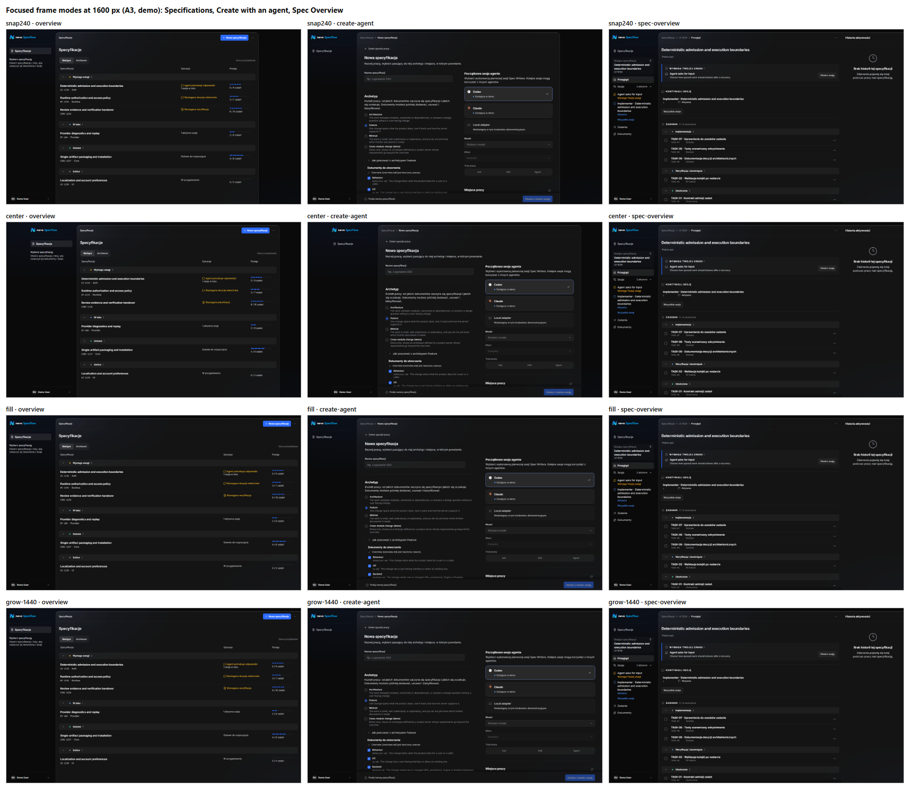

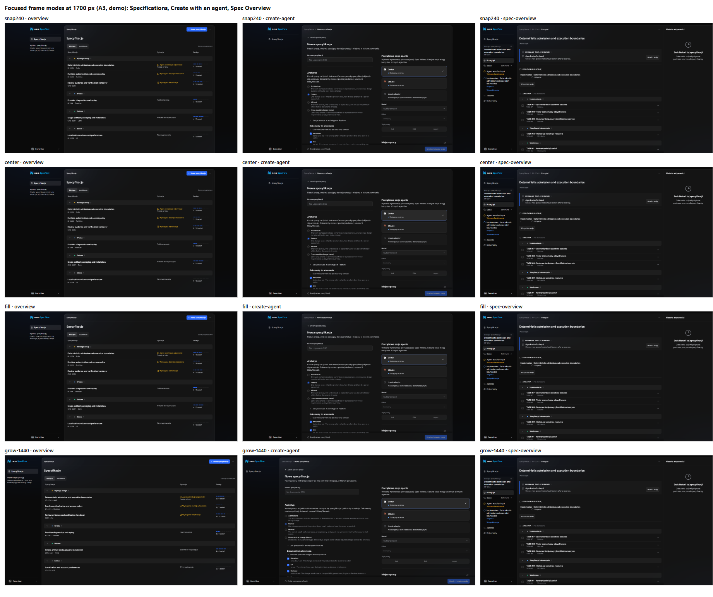

- **The text inputs are not stretched in any mode.** They stay capped at 34rem (544 px), and text
  blocks keep their reading width.
- **`grow` does stretch other controls.** In the right Create column, the provider cards, the Model
  and Effort pickers and the Ask/Edit/Agent control grow to about 650 px. In the Specifications list,
  the Situation column ends up about 1000 px from the names at 1700 px.
- **Production `grow` would need two things:** a cap on those controls, and a list that keeps its
  columns together.
- **`grow` 1280 px** behaves like `grow` 1440 px with an earlier cap: it starts centring at 1548 px,
  so from 1600 px Specifications and Create are 52 px narrower than Spec Overview.

### Real transitions along the journey (decisions 2 and 3)

The script clicked through the real application:

overview → Create → Create with an agent → overview → Spec Overview → Documents → Spec Overview → Session → Back to Spec Overview → overview.

It sampled the navigation and workspace rectangles on every animation frame. The diagrams draw the
settled geometry per screen, and draw an intermediate paint in red wherever one appeared.

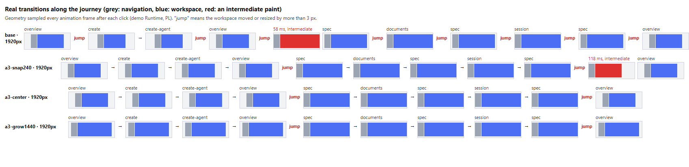

The same journey at 1600 px and 2560 px

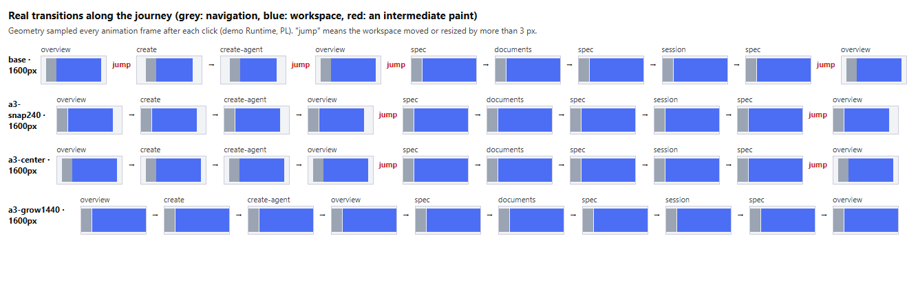

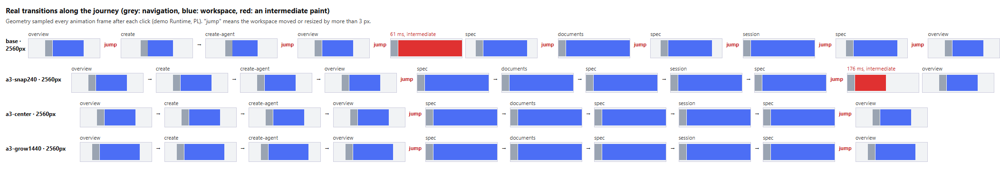

| Configuration  | Geometry changes per journey (1920 px)                                                                                                    | Intermediate paints                                                                                                                                                                                |
| -------------- | ----------------------------------------------------------------------------------------------------------------------------------------- | -------------------------------------------------------------------------------------------------------------------------------------------------------------------------------------------------- |
| Current `main` | 8 of 9 steps. Create is 200 px narrower than the list, and Spec Overview (1515 px, centred) differs from Documents and Session (1652 px). | Entering a Specification first paints the full width for about 120 ms, then settles at 1515 px.                                                                                                    |
| A3 `snap240`   | 2: entering and leaving the Specification (the same boundary in both directions).                                                         | Leaving the Specification paints the 1102 px frame anchored left for one or two frames (40 ms at 1920, 14 ms at 2560), then centres. Cause: the prototype measures the leftover on a 100 ms timer. |
| A3 `center`    | 2: entering and leaving the Specification.                                                                                                | None, apart from 1 px sub-pixel settling.                                                                                                                                                          |
| A3 `grow`      | 2 at 1920 and 2560 px. 0 at 1600 px: the whole journey keeps one 1332 px frame.                                                           | None, apart from 1 px sub-pixel settling.                                                                                                                                                          |

- **Inside the Specification, A3 is stable.** Spec Overview, Documents and Session share one
  geometry in every A3 configuration. In `main`, by contrast, each move between Spec Overview and
  the other two changes width.
- **Every A3 configuration changes geometry only at the Specification boundary.** That means twice
  per journey, on entering and on leaving. Each crossing is a single step. `center` and `grow` show
  no intermediate paint. Its size is 230 px at 1600 px with `snap240` or `center`, and 0 with
  `grow`. At 1920 px the jump grows to 212 px with `grow`, against 550 px with the other modes.
- **A snap rule that measures in JavaScript produces a wrong first paint.** Any production snap rule
  must be computed in CSS or before paint (layout effect), not on a timer.

### Specification Overview hierarchy (decision 6)

Three compositions were rendered at 1920 and 2560 px for the demo specifications. They cover every
combination: with Requires attention and a Session (`admission`), attention only (`security`,
`review`), a Session only (`providers`), and neither (`packaging`, `localization`).

- **`side`.** Left column: Requires attention, then Tasks. Right column: Continue session first,
  then Documents and related items.
- **`left`.** Continue session sits in the left column between Requires attention and Tasks; the
  right column keeps Documents.
- **`row`.** A "now" row puts Requires attention and Continue session side by side above a second
  row with Tasks and the rest.

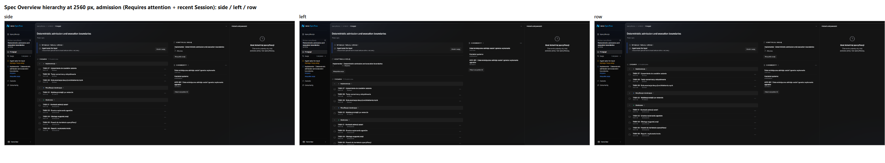

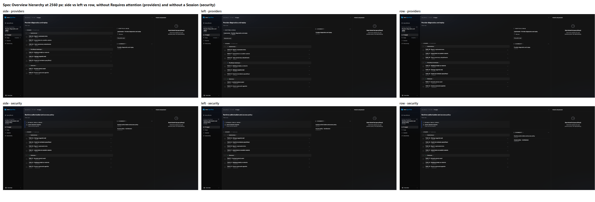

- **With the Secondary open, two columns start between a 2180 and a 2200 px viewport (measured).**
  The Secondary (Activity History) takes a quarter of the workspace, about 400 px at 1920 px, so the
  content stays below 1408 px. At 1920 px all three variants render as the same single column.
- **The 1408 px threshold plus a quarter-width Secondary amounts to the 2200 px breakpoint the owner
  rejected.** It needs a decision together with the empty Activity History panel (decision 7). For
  example, a Secondary that does not reserve its quarter while it is empty would leave about 1620 px
  of content at 1920 px, and two columns would start from about 1700 px.
- **`side`.** Continue session starts on the same line as Requires attention, in every case. Tasks
  are never pushed down, and Tasks start at the top whenever there is nothing needing attention.
  The order in the right column is fixed (Continue session, Documents, related), so the Session's
  priority is a rule, not leftover space.
- **`left`.** The Session sits in the reading order, but it pushes Tasks down by about 180 px. On a
  950 px high window this moves most of the Tasks list below the fold. The right column then holds
  only Documents.
- **`row`.** This pairs attention and Session explicitly, but leaves empty bands. With a Session
  and no attention (`providers`), the left half of the first row is empty and Tasks start about
  55 px lower. With attention and no Session, the right half is empty.

### Git settings as three decision rows (correction 1)

Status: a first composition. The independent review found defects that must be fixed before the
owner judges it (listed below the screenshots).

The block was recomposed as three rows, one per user decision, inside the existing form section.
The rows are Start from (Zacznij od), Merge into (Scal do) and Branch name (Nazwa gałęzi). There is
no accent container, no new separator and no new switch.

- **Each row** shows a label, the value and one text action.
- **The base and target actions** are Change / Use default ("Zmień" / "Użyj domyślnej"). They call
  the same on/off transition as the existing switch, so the request semantics do not change: off
  means the default and is omitted from the request.
- **The branch row** opens the existing slug and branch fields.
- **The commit row** becomes a quiet note that refers to the branch above (decision 8): "Pliki
  specyfikacji trafią w commicie na tę gałąź."
- **The worktree folder** is a quiet single line, truncated, with the full path as a tooltip.

| Current block                                                    | Decision rows (collapsed)                                         |
| ---------------------------------------------------------------- | ----------------------------------------------------------------- |
| 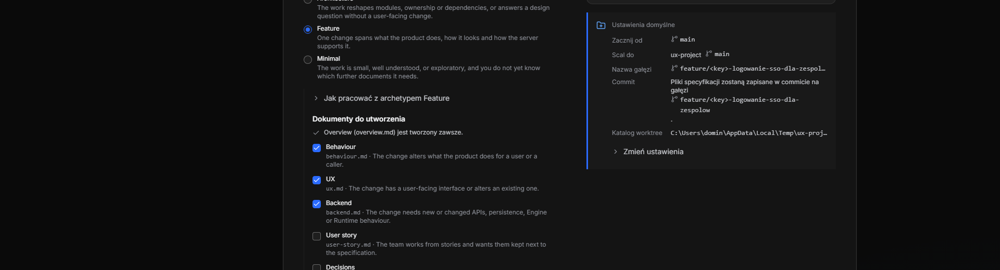 | 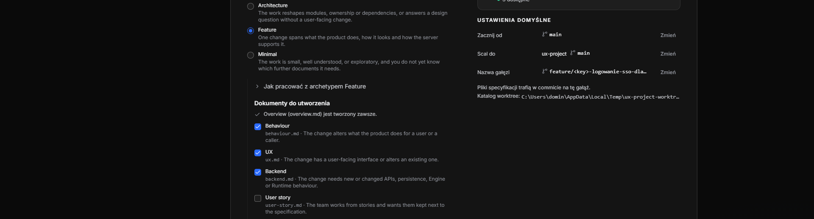 |

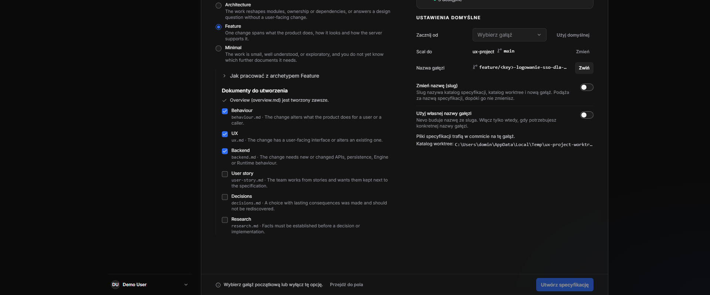

On a 390 px viewport, the label and the action share the first line and the value takes the second.
Use default restores the default on desktop and mobile.

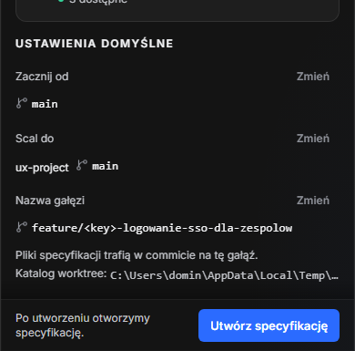

Defects found by the independent review, all still open:

1. The blocking message still says "…lub wyłącz tę opcję", but the switch is gone; it should name
   the row action instead.
2. The three row actions differ: Change and Use default are text actions, while Close ("Zwiń") is a
   filled pressed button.
3. Branch name still opens the two existing switches (slug, own branch name) and a divider, so this
   decision is still two toggles behind a disclosure.
4. The preview shows the raw `<key>` token, and truncation hides the end of the branch name even on
   desktop.
5. On 390 px the sticky footer covers the lower expanded field.

### Reaching the first faulty field when Create is blocked (correction 2)

The proposal:

- **The Create button keeps `type="submit"`** but uses `aria-disabled="true"` instead of `disabled`,
  so it stays focusable and is announced as unavailable.
- **Activating it** (click, Enter or Space), or pressing Enter in a form field, never submits. It
  announces the blocking reason in the existing live region and moves focus to the first faulty
  field.
- **The order is fixed by the form's own order:** name, archetype, then the workspace and Git fields
  (the field that owns the error, else the branch, the slug, the first available workspace).
- **The footer hint gets a quiet "Go to field" action** ("Przejdź do pola") that does the same.

Verified on the real project Runtime at 1920 and 390 px:

- **Empty name.** Focus moves to the name input.
- **Protected custom branch** (`feature/new-api`). Enter in the name field moves focus to the branch
  input, scrolled into view.
- **Every case.** The URL stays `/specs/new` and nothing is created.

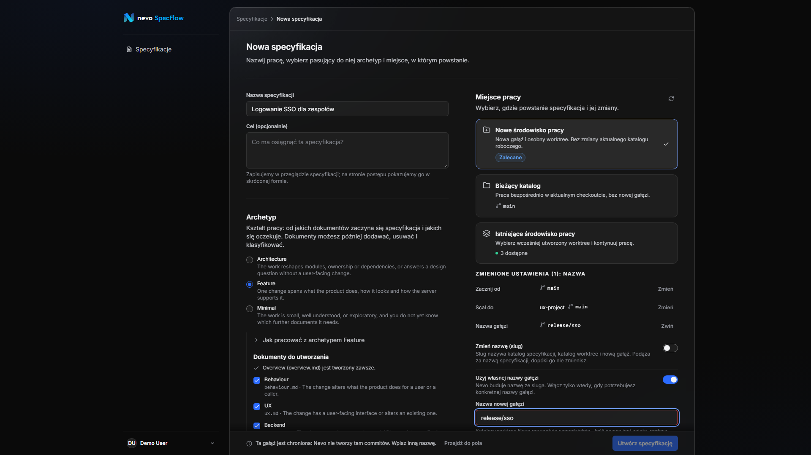

Open risks:

- **The empty name has no inline error.** The reason appears only in the footer and in the live
  region; the field needs `aria-invalid` and a described error of its own.
- **The sticky footer can cover the help text under the focused field.** It needs a scroll padding
  equal to the footer height.
- **The behaviour with several errors at once was not tested.** Nor was the absence of network
  requests: "never submits" was shown only through the URL and the missing Specification.
- **Contrast.** The dimmed Create button and the quiet action need a contrast check.

### An existing defect found on the way

On the real project Runtime, turning on Start from (base override) shows an empty picker and the
blocking error "Wybierz gałąź początkową lub wyłącz tę opcję", even on `main`. The cause is a
mismatch:

- `defaultBaseValue` in `packages/specflow-ui/src/features/specs/creation/workspace/model/workspaceTiles.ts`
  looks for the primary workspace branch (`main`) among the listed base refs.
- The Runtime lists those base refs as full refs (`refs/heads/main`).
- The unit tests use short names, so they do not catch it.

This is outside the layout work. It needs a separate fix that decides which side owns the ref
format.

### Independent review of iteration 4

A reviewer with fresh context assessed the evidence of this section without the author's conclusions.
Its findings are merged above: the `grow` costs, the Secondary threshold, the Git defects and the
guide risks. These are the points where it adds to or corrects the author:

- **Ranking of the Focused modes:** `grow` 1440, `center`, `snap240`, `fill`. `fill` is effectively
  a breakpoint at 1610 px.
- **`snap240`.** The left-anchored first paint on leaving a Specification comes from measuring the
  outgoing layout. A width rule must derive from the viewport or the container, never from the
  element it resizes.
- **Spec Overview ranking:** `side`, `left`, `row`. `row` is rejected because of its empty bands.
  The Session in `side` is noticed early, but its visual weight is low. Its title is the only link,
  and All sessions ("Wszystkie sesje") looks more like the action than the continue target does.
- **Problems outside the brief:**
  - The same Session appears three times: in the Specification navigation, in Requires attention
    and in Continue session. That dilutes the priority decision 6 protects.
  - Unlabelled numbers sit under the Session titles.
  - English demo strings are mixed into the Polish UI.

### What this iteration recommends (proposals)

- **Focused frame (decision 3).** Choose between `center` and `grow` with a 1440 px maximum.
  - **`grow`** gives the calmest journey: no change at all up to 1708 px, and a smaller jump above
    that. It needs control caps in Create and a list layout that does not drift apart.
  - **`center`** keeps the frame bounded and simple, but every crossing of the Specification
    boundary moves the navigation.
  - **Not recommended:** `snap240` (a resize jump and a wrong first paint) and `fill` (a breakpoint).
- **Specification boundary (decision 2).** Keep the single boundary. The transition evidence shows
  no other change anywhere in the journey for A3.
- **Spec Overview (decision 6).** Use `side` as the hierarchy, giving the Continue session entry
  more weight: the whole row is clickable and has a clear primary action. First decide the
  threshold together with the Activity History panel (decision 7); otherwise two columns only
  appear from about 2200 px.
- **Git rows and the guide.** Fix the listed defects and render them again before the owner judges
  the composition.

## 9. Proposed production scope of A3

Proposal for the owner. The table separates what is already accepted (section 7) from what still
waits for a decision based on section 8. The three scopes follow decision 1. Each lands as one PR
with its documentation changes and tests, so code and contracts never diverge. They do not build on
the prototype branch: they reimplement the accepted parts cleanly, and every prototype flag stays
out of production.

| Scope                         | Accepted, ready to specify                                                                                                                                                                                                                                                                                                                                                                                                           | Waits for an owner decision                                                                                                                                                                                                                                                                                                                                      | Documentation changed in the same PR                                                                                                                                                                                                  |
| ----------------------------- | ------------------------------------------------------------------------------------------------------------------------------------------------------------------------------------------------------------------------------------------------------------------------------------------------------------------------------------------------------------------------------------------------------------------------------------ | ---------------------------------------------------------------------------------------------------------------------------------------------------------------------------------------------------------------------------------------------------------------------------------------------------------------------------------------------------------------- | ------------------------------------------------------------------------------------------------------------------------------------------------------------------------------------------------------------------------------------- |
| **1. App Shell geometry**     | <ul><li>Nevo UI: an explicit Focused frame in `AppShell` / `AppWorkspace`, with one frame token shared by every Focused screen.</li><li>The Focused width rule is written in CSS, not measured in JavaScript.</li><li>SpecFlow: Specifications and Create use the Focused frame. Specification Overview, Documents and Session use the full width, so the Specification keeps one geometry.</li><li>No 2200 px breakpoint.</li></ul> | <ul><li>The width rule between 1366 and 1800 px: `center` or `grow` (and its maximum), or another rule. `snap240` and `fill` are not recommended (section 8).</li></ul>                                                                                                                                                                                          | <ul><li>`docs/design-system/principles/layout-and-containment.md`, Bounded workspace rule (decision 9).</li><li>The Nevo UI implementation notes for `AppWorkspace`.</li></ul>                                                        |
| **2. Create Specification**   | <ul><li>Two columns from a 992 px form column, container-based, with keyboard order kept and no preview panel, in the project and demo forms (decision 4).</li><li>The progress page in the same frame at `content-form` (decision 5).</li><li>A shorter commit row that refers to the branch above (decision 8).</li><li>Value-only rows truncate with a tooltip.</li></ul>                                                         | <ul><li>Git settings as three decision rows, after the listed defects are fixed (section 8).</li><li>Guiding to the first faulty field (section 8).</li></ul> Both are proposals rendered once, so the owner should accept the composition and behaviour before they become contracts.                                                                           | <ul><li>`docs/product/specflow/specification-creation.md` (Create layout, Git settings, progress page, blocked-Create behaviour).</li><li>`docs/ideas/specflow-ui/screens/specification-creation-ui-spec.md` (demo Create).</li></ul> |
| **3. Specification Overview** | <ul><li>Two columns from a 1408 px content width, composed from the existing sections; one column below (decision 6).</li></ul>                                                                                                                                                                                                                                                                                                      | <ul><li>The hierarchy: `side`, `left` or `row` (section 8).</li><li>The two-column threshold together with the Secondary: with Activity History open, two columns start at about 2200 px today (section 8).</li><li>A separate design for the empty Activity History panel, so that it stops reserving a wide strip for an empty message (decision 7).</li></ul> | The Specification Overview screen contract, where the two-column composition and the Session's position are written down.                                                                                                             |

**Delivery.**

- **Order.** Scope 1 goes first because the other two are judged inside its frame. Scopes 2 and 3
  are independent after that.
- **Verification for each scope:**
  - the journey captures at 1280, 1366, 1440, 1600, 1920, 2560 and 390 px, and at 200% zoom;
  - the per-frame transition check from section 8;
  - keyboard order;
  - the demo Runtime, a real project Runtime and Storybook.

  The prototype scripts stay in the audit's reproduction notes as references, not as tests.

- **Outside these scopes.**
  - The `defaultBaseValue` defect is a separate fix with its own test.
  - Mobile Back from a pushed Task preview, which leaves the Specification, stays recorded in the
    audit.

## 10. Reproduce

1. Check out `proto/app-shell-geometry`.
2. Run the demo Runtime as described in the audit's
   [verification guide](README.md#reproduce-the-environment), and the UI with Vite on port 5173.
3. Set `localStorage['proto.layout']` to `A`, `A2`, `A3`, `A3h`, `B`, `C`, `D` or `E`, then reload. Without the key
   the app behaves exactly like `main`.
4. Iteration 4 flags (with `A3`):
   - `proto.snap`: `snap240` (default), `center`, `fill` or `grow`;
   - `proto.growMax`: `1440` (default) or `1280`;
   - `proto.overview`: `side` (default), `left` or `row`;
   - `proto.git`: `rows`;
   - `proto.guide`: `on`.

**Limits of the evidence.**

- Prototype widths are pixel classes.
- A2 rearranged only the demo Create form; A3 was rendered and used on the real project Create
  form as well (section 6).
- Full Session screenshots come from Storybook, where the navigation is a stub. Session is the same
  in every variant.
