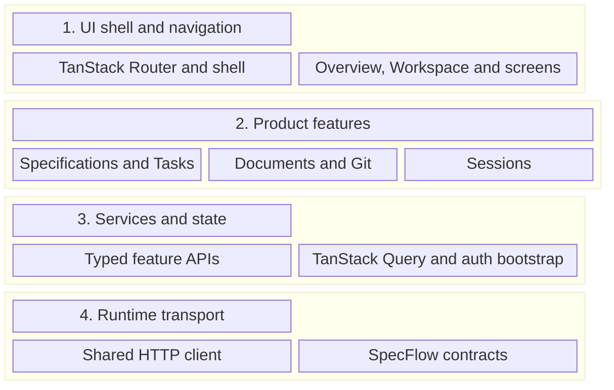

# SpecFlow UI application architecture

`packages/specflow-ui/` is the product UI capability and React application composition root. It
owns SpecFlow copy, localization, brand assembly, routing, screens, frontend build output,
authentication UI, and product-specific interaction decisions. It consumes reusable mechanics from
`@nevo/ui` and remains part of the single local product composed by `@nevo/specflow`; it is not
an independently deployed `apps/*` host.

## UI responsibility layers

This view shows UI ownership and shared dependencies. UI features are vertical slices,
not layers of independent microservices; data access is composed once at the application root.
The reusable `@nevo/ui` design system supplies components across these features but is **not** a SpecFlow product feature.

The browser talks to Runtime over HTTP/SSE, never imports Runtime internals, and
does not contain a parallel Engine. Components receive bounded view models rather than raw
transport clients. The [architecture overview](../../../architecture/overview.md) owns the
cross-process view; this document owns the UI's detailed application decisions.

## Where to read next

| Concern                                                       | Owner                                                                          |
| ------------------------------------------------------------- | ------------------------------------------------------------------------------ |
| Router, feature adapters, query state and Runtime integration | [Application composition](../../../architecture/ui-application-composition.md) |
| User routes, shell, authentication and localization           | [Navigation and authentication](application-navigation-and-auth.md)            |
| Server freshness, batching and failure ownership              | [Data loading](data-loading-and-integration.md)                                |
| Reusable components and design constraints                    | [Nevo UI design system](../../../design-system/)                               |
